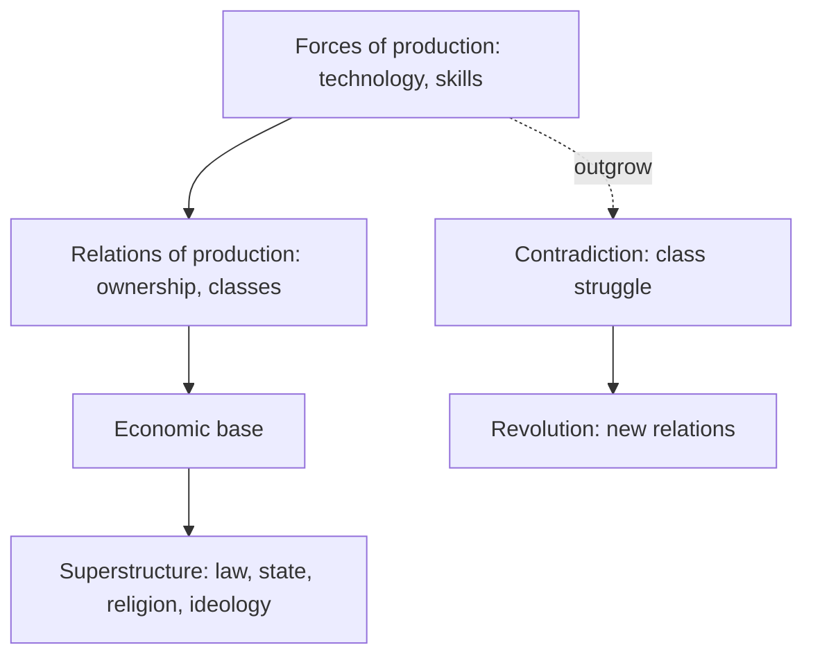

# Marx and historical materialism

**Prerequisites:** [[german-idealism|German idealism]]; helpful: [[eco:04-karl-marx.md|Marx in the history of economic thought]]

@@IMG@@

## Turning Hegel right side up

[[georg-wilhelm-friedrich-hegel|Hegel]] taught that history is the self-development of Spirit, and that contradictions drive it forward. After his death in 1831 his students split. "Right Hegelians" saw the Prussian state and Protestant Christianity as reason realized. "Left" or "Young Hegelians" turned the dialectic into a weapon of criticism. Ludwig Feuerbach's *The Essence of Christianity* (1841) argued that God is humanity's own essence projected outward and worshipped as an alien being; theology is really anthropology.

[[karl-marx|Karl Marx]] (1818–1883) took the next step. Feuerbach had explained religion by human nature but treated human nature as fixed. Marx asked what explains the projection itself. His answer: the material conditions in which people produce their lives. In the afterword to the second edition of *Capital* he wrote that with Hegel the dialectic "is standing on its head. It must be turned right side up again."

## Historical materialism from first principles

1. Before people can do politics, religion, art or philosophy, they must eat, drink, find shelter and clothe themselves. So the first historical act is production.
2. Production always happens in social relations: who owns the land, tools and factories (the **means of production**), who works, and who gets the product. These **relations of production** correspond to a given level of the **forces of production** (technology, skills, organization).
3. Together they form the economic **base**. On it rises a **superstructure** of law, state, religion and ideas. "It is not the consciousness of men that determines their being, but, on the contrary, their social being that determines their consciousness" (Preface to *A Contribution to the Critique of Political Economy*, 1859).
4. When the forces of production outgrow the existing relations, the relations become fetters, and an era of social revolution begins.
5. "The history of all hitherto existing society is the history of class struggles" ([[communist-manifesto|*The Communist Manifesto*]], 1848): freeman and slave, lord and serf, bourgeois and proletarian.

## Alienation and capitalism

In the *Economic and Philosophic Manuscripts of 1844*, unpublished until 1932, Marx described **[[g:alienation|alienation]]** under capitalism. Workers are alienated from the product of their labour (it belongs to another and confronts them as an alien power), from the activity of labour (work becomes a mere means to survive), from their "species-being" (free, creative production) and from one another.

In *Capital* (vol. 1, 1867) he analysed capitalism as a system. Commodities exchange according to the labour time socially necessary to produce them (a version of the classical labour theory of value from [[eco:01-adam-smith.md|Smith]] and [[eco:02-david-ricardo.md|Ricardo]]). Labour-power is a special commodity: workers are paid the value of their labour-power (what it costs to reproduce it) but produce more value than that. The difference, **surplus value**, is the source of profit. "Commodity fetishism" names the way social relations between people appear as relations between things, prices and markets. Competition drives accumulation, concentration, crises and, Marx predicted, the eventual overthrow of capitalism by the proletariat.

## Ideology

Why do people accept arrangements that harm them? Because "the ideas of the ruling class are in every epoch the ruling ideas" (*The German Ideology*). [[g:ideology|Ideology]] presents particular interests as universal and historical arrangements as natural. Religion is "the sigh of the oppressed creature… the opium of the people" (from the introduction to the *Contribution to the Critique of Hegel's Philosophy of Right*, 1844), both a protest against real suffering and a consolation that keeps it in place.

## The point is to change it

The eleventh of Marx's *Theses on Feuerbach* (1845) reads: "The philosophers have only interpreted the world, in various ways; the point is to change it." Philosophy, for Marx, must become practice.

## Criticisms and legacy

Economists rejected the labour theory of value after the marginal revolution of the 1870s (see [[eco:05-william-stanley-jevons.md|Jevons]] and [[eco:06-carl-menger.md|Menger]]). [[karl-popper|Popper]] argued that Marxism became unfalsifiable as its adherents reinterpreted failed predictions. Regimes claiming his name in the twentieth century produced mass terror and famine; scholars debate how far this was implicit in his theory and how far it was a betrayal. Meanwhile his analyses of class, alienation, ideology and capitalist crisis remain central to sociology, history and critical theory, and were taken up in different ways by the Frankfurt School, Antonio Gramsci and many others.

## Key ideas

- Marx turned Hegel's dialectic into historical materialism: material production and class relations drive history.
- Base and superstructure: economic relations shape law, politics and ideas.
- Under capitalism workers are alienated and exploited through surplus value.
- Ideology naturalizes class interests; philosophy should change the world, not only interpret it.

## Where this leads

- Next: [[transcendentalism|American transcendentalism]]
- Thinker: [[karl-marx|Karl Marx]]; text: [[communist-manifesto|*The Communist Manifesto*]]
- Economics: [[eco:04-karl-marx.md|Marx in economics]], [[micro:glossary/marxian-economics.md|Marxian economics]]
- Forward: [[philosophy-of-science|Popper's critique]]; [[structuralism-and-after|Foucault and power]]
