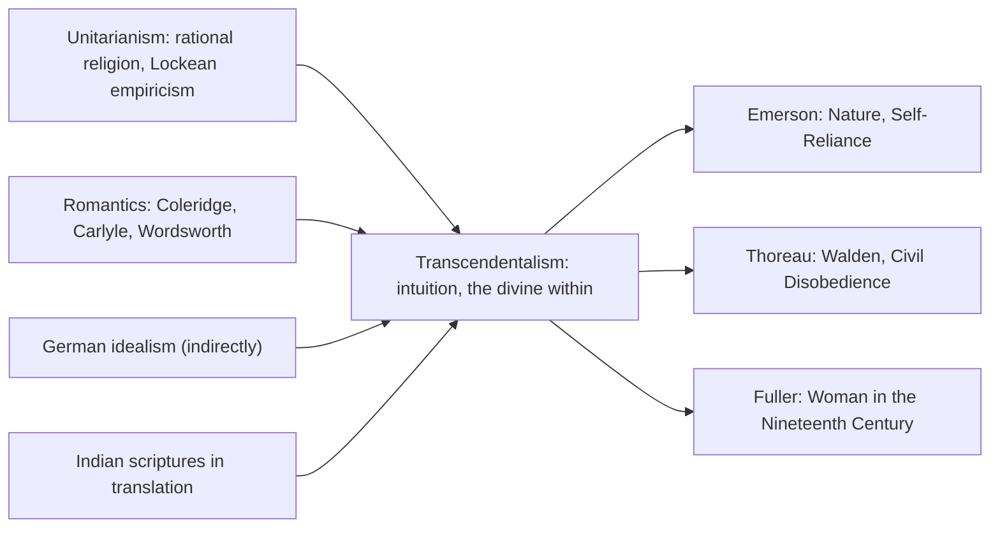

# American transcendentalism: self-reliance and nature

**Prerequisites:** [Kant's Copernican revolution](../early-modern/07-kants-copernican-revolution.md) (for the word "transcendental"); helpful: [German idealism](01-german-idealism.md)

@@IMG@@

## Where the name comes from

"Transcendentalism" was a movement of writers, ministers and reformers in New England, centred on Concord and Boston, from roughly 1836 to the 1850s. The name borrows [Kant](../early-modern/thinkers/immanuel-kant.md)'s word "transcendental", but loosely. Kant used it for the conditions of possible experience. The Americans, who read Kant mostly through Coleridge, Carlyle and French interpreters, used it for the conviction that the mind has an intuitive access to truth that goes beyond (transcends) the senses and logical argument. As Ralph Waldo Emerson put it in a lecture of 1842, what is popularly called transcendentalism is idealism as it appears in 1842.

## From first principles: what they rejected

The movement grew out of Unitarianism, a liberal form of New England Protestantism that had already rejected the doctrine of the Trinity and Calvinist predestination in favour of a rational, moral religion. To the transcendentalists, Unitarianism seemed cold, "corpse-cold" in Emerson's phrase, relying on historical evidence for miracles and on Lockean empiricism. They wanted religion as direct experience. Their sources were wide: Plato and Neoplatonism, German idealism, English Romantic poets, Swedenborg, and the newly translated Hindu scriptures such as the *Bhagavad Gita*.

## Core ideas

- **The divine in each person.** Each soul participates in a universal spirit Emerson called the "Over-Soul". Therefore each person can find truth by looking inward. In the "Divinity School Address" (1838) Emerson told Harvard's graduating ministers to go alone, to refuse the good models, and to dare to love God without mediator or veil. He was not invited back for nearly thirty years.
- **Self-reliance.** If truth is within, conformity is a betrayal. "Trust thyself: every heart vibrates to that iron string" (["Self-Reliance"](texts/self-reliance.md), 1841). "A foolish consistency is the hobgoblin of little minds."
- **Nature as symbol.** In *Nature* (1836) Emerson described standing on bare ground, his head bathed by the blithe air, becoming "a transparent eye-ball" through which the currents of universal being circulate. Natural facts are symbols of spiritual facts.
- **Simplicity and dissent.** [Thoreau](thinkers/henry-david-thoreau.md) tested these ideas in practice, living in a cabin at Walden Pond (1845–47) and refusing to pay a poll tax that supported slavery and the Mexican War, for which he spent a night in jail (1846).
- **Reform.** Margaret Fuller's *Woman in the Nineteenth Century* (1845) was an early American feminist classic; members founded utopian communities (Brook Farm, Fruitlands); many became abolitionists.

## Assessment

Critics then and since have charged the movement with vagueness and with an individualism that underrates community, institutions and evil. Hawthorne satirized Brook Farm in *The Blithedale Romance*; Melville parodied Emersonian optimism. Yet the transcendentalists shaped American literature (Whitman called Emerson his master), environmentalism (John Muir), and civil disobedience, through Thoreau's influence on [Tolstoy](thinkers/leo-tolstoy.md), Gandhi and Martin Luther King Jr. Nietzsche read Emerson closely and admiringly.

## Key ideas

- Transcendentalism held that truth and the divine are accessible by intuition within each person.
- It reacted against the rational religion of Unitarianism and drew on Romanticism, idealism and Asian scriptures.
- Emerson preached self-reliance and nature as spiritual symbol; Thoreau lived deliberately and practised civil disobedience.
- It shaped American literature, environmentalism and nonviolent resistance.

## Where this leads

- Next: [Existential beginnings: Kierkegaard and Dostoevsky](06-existential-beginnings.md)
- Thinkers: [Ralph Waldo Emerson](thinkers/ralph-waldo-emerson.md), [Henry David Thoreau](thinkers/henry-david-thoreau.md)
- Texts: ["Self-Reliance"](texts/self-reliance.md), [*Walden*](texts/walden.md)
- Forward: [Tolstoy on non-resistance](texts/the-kingdom-of-god-is-within-you.md)
