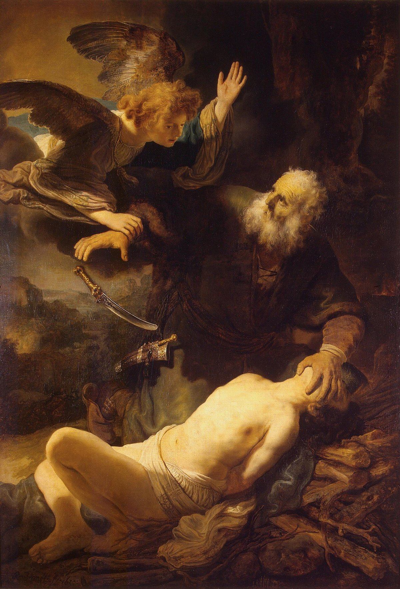
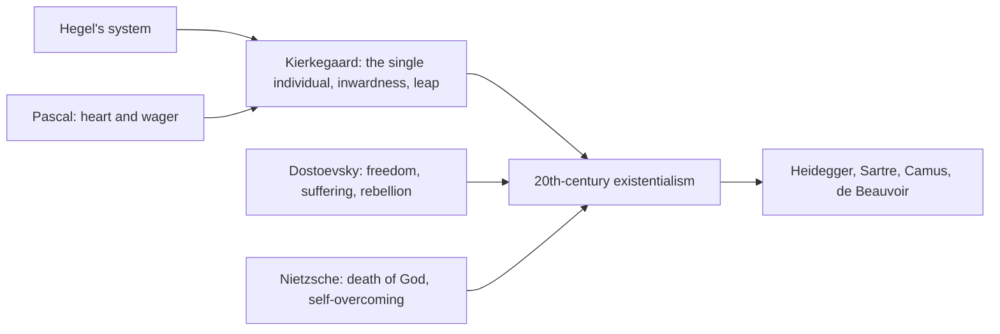

# Existential beginnings: the single individual

**Prerequisites:** [German idealism](01-german-idealism.md); helpful: [Pascal's *Pensées*](../early-modern/texts/pensees.md), [the binding of Isaac](../../../../religion/abrahamic/christianity/bible/old-testament/stories/01-the-binding-of-isaac.md)

*Rembrandt, *The Sacrifice of Isaac* (1635), Hermitage Museum, the scene at the heart of Kierkegaard's *Fear and Trembling*. Credit: Rembrandt. License: Public domain. Source: [File:Rembrandt Abraham's Sacrifice (Hermitage).jpg](https://commons.wikimedia.org/wiki/File:Rembrandt_Abraham's_Sacrifice_(Hermitage).jpg).*

## The problem a system cannot solve

Suppose a philosopher builds a complete system: logic, nature, history, art, religion, all reconciled in a final account of reality. Now suppose you, a particular person, must decide whether to marry, how to face your death, whether to believe in God. Does the system help? It tells you how Spirit realizes itself in world history. It does not tell you what to do with your one life, or how to become the person you are supposed to be.

That gap is where **existential philosophy** begins. Its central claim is that the most important questions are not answered by objective knowledge but must be lived by an individual who chooses, commits, despairs and believes, and who cannot hand that task to anyone else, not to a system, a crowd or a church. The two great nineteenth-century sources, writing independently, were the Danish philosopher [Søren Kierkegaard](thinkers/soren-kierkegaard.md) (1813–1855) and the Russian novelist [Fyodor Dostoevsky](thinkers/fyodor-dostoevsky.md) (1821–1881). Neither used the word "existentialism", which was coined in the 1940s.

## Kierkegaard: truth as subjectivity

Kierkegaard wrote much of his work under pseudonyms, each representing a point of view, so that readers would have to decide for themselves rather than adopt an author's doctrine. Some of his central ideas:

- **Three spheres (or stages) of existence.** The **aesthetic** life seeks pleasure, interest and novelty and avoids commitment; its end is boredom and despair. The **ethical** life commits to universal duties, marriage, vocation; but it cannot deal with guilt and the exception. The **religious** life is a personal relation to God that may go beyond the universal ethical. See [*Fear and Trembling*](texts/fear-and-trembling.md) and *Either/Or*.
- **Truth is subjectivity.** For questions of existence, what matters is not only *what* is believed but *how*: with passionate inwardness. An "objective" Christian who knows the doctrines but does not live them is further from truth than a pagan who prays passionately to an idol.
- **The leap.** Faith is not the conclusion of an argument; it is a commitment made in the face of objective uncertainty and even absurdity (that the eternal God became a human being in time). Kierkegaard's word is "leap" (*Spring*); the phrase "leap of faith" is a later summary.
- **Anxiety and despair.** *The Concept of Anxiety* (1844) describes anxiety as "the dizziness of freedom": the feeling of standing before possibilities. *The Sickness unto Death* (1849) analyses despair as a misrelation of the self to itself, the refusal to be the self one is or the defiant attempt to be a self of one's own making.
- **The crowd.** "The crowd is untruth." Public opinion, the press and the established Church let individuals hide from responsibility.

## Dostoevsky: freedom and its abyss

Dostoevsky was not a philosopher by profession, but his novels dramatize existential problems with unmatched force (see [the next lesson](07-the-philosophical-novel.md)). In [*Notes from Underground*](texts/notes-from-underground.md) (1864), the narrator insists that humans will act against their own rational advantage simply to prove they are free and not "piano keys" played by the laws of nature. In [*The Brothers Karamazov*](texts/the-brothers-karamazov.md) (1880), Ivan returns his "ticket" to a world harmony bought with the suffering of children, and tells the parable of the Grand Inquisitor, who claims that people cannot bear freedom and want bread, miracle and authority instead.

## Shared themes

Both writers place the individual's freedom and responsibility at the centre; both treat anxiety and despair as revealing rather than merely pathological; both distrust rational systems that promise to make life transparent; both are, in their own ways, Christian thinkers whose work was later taken up by atheists. That last point matters: twentieth-century existentialism split into religious (Gabriel Marcel, Karl Jaspers, in some readings) and atheist (Sartre, de Beauvoir, Camus, though Camus rejected the label) forms.

## Key ideas

- Existential philosophy starts from the individual who must choose and live, not from an objective system.
- Kierkegaard: three spheres of existence, truth as subjectivity, faith as a leap, anxiety and despair.
- Dostoevsky: freedom as both dignity and burden; rebellion against theodicy; the Grand Inquisitor.
- Both were Christian thinkers whose ideas were later developed by religious and atheist existentialists.

## Where this leads

- Next: [The philosophical novel: Dostoevsky and Tolstoy](07-the-philosophical-novel.md)
- Thinkers: [Søren Kierkegaard](thinkers/soren-kierkegaard.md), [Fyodor Dostoevsky](thinkers/fyodor-dostoevsky.md)
- Texts: [*Fear and Trembling*](texts/fear-and-trembling.md), [*Notes from Underground*](texts/notes-from-underground.md)
- Forward: [Twentieth-century existentialism](../twentieth-century/03-existentialism.md)
- Related: [Genesis](../../../../religion/abrahamic/christianity/bible/old-testament/books/law-torah/genesis.md) (Abraham)
