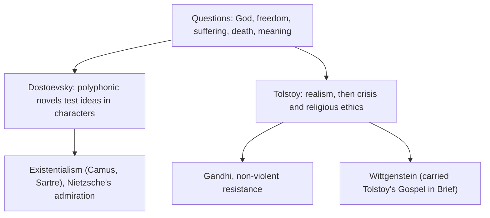

# The philosophical novel: Dostoevsky and Tolstoy

**Prerequisites:** [[existential-beginnings|Existential beginnings]]; helpful: [[bib:new-testament/stories/03-sermon-on-the-mount.md|the Sermon on the Mount]]

@@IMG@@

## Why novelists belong in a philosophy course

Philosophy usually argues: premises, conclusions, objections. But some questions are hard to settle by argument alone because they concern how ideas *live* in a person. What happens to someone who truly believes that "everything is permitted" if there is no God? What does it feel like to realize, at the end of a successful life, that it was lived wrongly? Novels can test ideas by embodying them in characters and following the consequences through a life. [[fyodor-dostoevsky|Fyodor Dostoevsky]] and [[leo-tolstoy|Leo Tolstoy]] are the supreme examples. Neither was a professional philosopher; both are read by philosophers because their fiction does philosophical work. Tolstoy also wrote non-fiction philosophy and religious essays that influenced Gandhi.

## The Russian situation

Nineteenth-century Russia had an autocratic tsar, a serf system abolished only in 1861, a powerful Orthodox Church and a small, intensely argumentative educated class, the *intelligentsia*. Western ideas arrived in waves: Hegel, French socialism, utilitarianism, materialism, Darwin. Debates between "Westernizers", who wanted Russia to follow Europe, and "Slavophiles", who prized Russian Orthodoxy and peasant community, framed much of the literature. Questions Europeans argued about in books, Russians often argued about as matters of life and death; Dostoevsky was sentenced to death for membership in a radical circle and reprieved at the last moment.

## Dostoevsky: ideas as characters

Dostoevsky's novels have been called "polyphonic" (the critic Mikhail Bakhtin's term): characters voice opposed worldviews with full force, and the author does not simply refute the ones he rejects.

- **Rational egoism and the underground.** [[notes-from-underground|*Notes from Underground*]] attacks the utilitarian, scientific utopia of Chernyshevsky's novel *What Is to Be Done?*
- **The extraordinary man.** In *Crime and Punishment* (1866), Raskolnikov murders a pawnbroker partly to test whether he is a "Napoleon" who may step over moral law. His suffering and eventual confession argue against him.
- **Nihilism and revolution.** *Demons* (1871–72) portrays a revolutionary cell modelled on a real murder.
- **God, suffering, freedom.** [[the-brothers-karamazov|*The Brothers Karamazov*]] (1880) sets Ivan's rebellion and the Grand Inquisitor against the elder Zosima's ethic of active love and the claim that "each of us is responsible for all".

## Tolstoy: the meaning of life

Tolstoy's great novels, *War and Peace* (1865–69) and *Anna Karenina* (1875–77), contain philosophy: *War and Peace* includes essays arguing that history is not made by great men but by the countless actions of ordinary people, and *Anna Karenina* follows Levin's search for meaning alongside Anna's tragedy. Around 1879, at the height of his fame, Tolstoy fell into a crisis described in [[a-confession|*A Confession*]]: he could find no meaning that death would not destroy, and he contemplated suicide. He found an answer in the faith of ordinary working people and then in his own radical reading of the Gospels, focused on the [[bib:new-testament/stories/03-sermon-on-the-mount.md|Sermon on the Mount]], especially "resist not evil". In [[the-kingdom-of-god-is-within-you|*The Kingdom of God Is Within You*]] (1894) he argued that true Christianity requires non-violence and the rejection of state coercion. The Orthodox Church excommunicated him in 1901. His late story [[the-death-of-ivan-ilyich|*The Death of Ivan Ilyich*]] (1886) is a classic of reflection on death.

## Their influence on philosophy

Nietzsche called Dostoevsky the only psychologist from whom he had anything to learn. [[albert-camus|Camus]] adapted *Demons* for the stage and discussed Kirilov at length in [[the-myth-of-sisyphus|*The Myth of Sisyphus*]]. [[rene-girard|René Girard]] built his theory of mimetic desire largely from reading Dostoevsky, Cervantes, Stendhal, Flaubert and Proust. Tolstoy corresponded with the young Gandhi, who named his South African community "Tolstoy Farm". [[ludwig-wittgenstein|Wittgenstein]] carried Tolstoy's *Gospel in Brief* through the First World War.

## Key ideas

- Novels can test ideas by embodying them in characters and following their consequences through a life.
- Dostoevsky's polyphonic novels give opposed worldviews their full force: rational egoism, nihilism, rebellion, faith.
- Tolstoy moved from great realist novels to a crisis of meaning and a radical Christian ethic of non-violence.
- Both influenced existentialism, Girard, Gandhi and Wittgenstein.

## Where this leads

- Next: [[nietzsche-and-the-death-of-god|Nietzsche and the death of God]]
- Thinkers: [[fyodor-dostoevsky|Dostoevsky]], [[leo-tolstoy|Tolstoy]]
- Texts: [[the-brothers-karamazov|*The Brothers Karamazov*]], [[a-confession|*A Confession*]], [[the-death-of-ivan-ilyich|*The Death of Ivan Ilyich*]]
- Forward: [[mimetic-theory|Girard's mimetic theory]]
