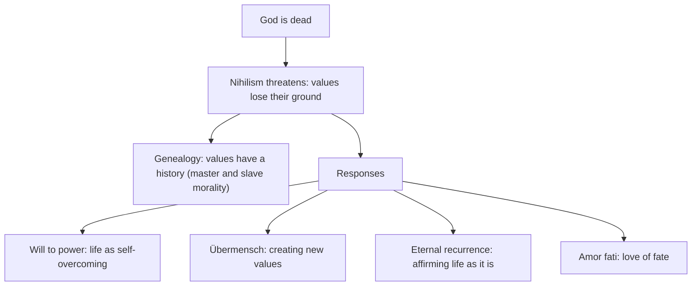

# Nietzsche and the death of God

**Prerequisites:** [Schopenhauer: pessimism and the will](02-pessimism-and-the-will.md); helpful: [Existential beginnings](06-existential-beginnings.md)

@@IMG@@

## The madman's announcement

In section 125 of *The Gay Science* (1882), [Friedrich Nietzsche](thinkers/friedrich-nietzsche.md) tells of a madman who runs into the marketplace with a lantern in bright morning, crying "I seek God!" The bystanders, who do not believe in God, laugh. He tells them: "God is dead. God remains dead. And we have killed him." They do not understand. He concludes that he has come too early; the deed is still more distant from them than the most distant stars, though they have done it themselves.

The point is not a proof that God does not exist. It is a cultural diagnosis. Belief in the Christian God had sustained European values: the meaning of suffering, the authority of morality, the worth of truth. Science, historical criticism and the habits of honesty that Christianity itself cultivated had made that belief no longer credible for educated Europeans. But people went on living as if the values it supported still stood. Nietzsche saw that they would not. The consequence would be **[nihilism](../../../glossary/modern/nihilism.md)**: the highest values devaluing themselves, the sense that nothing has meaning or worth.

## Genealogy: where values come from

If values do not come from God, where do they come from? Nietzsche's method was **genealogy**: tracing values to the needs, drives and power relations that produced them. In [*On the Genealogy of Morality*](texts/on-the-genealogy-of-morality.md) (1887) he distinguished:

- **Master morality**, in which the strong and noble call themselves and their qualities "good" (strong, proud, healthy) and the weak "bad", meaning lowly.
- **Slave morality**, born of **[ressentiment](../../../glossary/modern/ressentiment.md)**, in which the weak call the strong "evil" and make their own condition (humility, meekness, patience) into "good".

He argued that Judeo-Christian morality was a triumph of slave morality, and that guilt, conscience and the "ascetic ideal" turned human aggression inward. Whether this genealogy is historically accurate, and what to make of its treatment of Judaism and Christianity, is fiercely debated.

## Affirmation instead of denial

Nietzsche's early teacher was [Schopenhauer](thinkers/arthur-schopenhauer.md), who concluded that life is suffering and should be denied. Nietzsche accepted that life contains terrible suffering but rejected denial. His key positive ideas:

- **[Will to power](../../../glossary/modern/will-to-power.md).** Living things seek not mere survival but the expansion and expression of their strength. Even asceticism, he argued, is a twisted form of will to power.
- **The [Übermensch](../../../glossary/modern/ubermensch.md)** ("overman"). In [*Thus Spoke Zarathustra*](texts/thus-spoke-zarathustra.md), a figure who creates values rather than receiving them, the meaning of the earth after God. Contrasted with the "last man", who wants only comfort.
- **[Eternal recurrence](../../../glossary/modern/eternal-recurrence.md).** Imagine a demon telling you that you must live this life again, innumerable times, with nothing new. Would you curse him or bless him? The thought is a test of whether one can affirm one's life completely.
- **[Amor fati](../../../glossary/modern/amor-fati.md).** "Love of fate": wanting nothing to be different, not forward, not backward, not in all eternity.
- **[Perspectivism](../../../glossary/modern/perspectivism.md).** There is no view from nowhere; all knowing is from a perspective, shaped by drives. This does not mean every view is equally good; more perspectives give a fuller picture.

## Misuse and reception

After Nietzsche's collapse in 1889, his sister Elisabeth Förster-Nietzsche controlled his archive, compiled the posthumous *The Will to Power* from his notebooks, and promoted him to German nationalists and later the Nazis. Nietzsche himself had broken with his sister partly over her husband's antisemitism and had written against antisemites and German nationalism. Walter Kaufmann's postwar translations and commentary did much to rescue him from that association. He influenced existentialism, [Heidegger](../twentieth-century/thinkers/martin-heidegger.md), [Foucault](../twentieth-century/thinkers/michel-foucault.md)'s genealogies, [psychoanalysis](../twentieth-century/thinkers/sigmund-freud.md) and modern literature. [Girard](../twentieth-century/thinkers/rene-girard.md) read him as the thinker who saw most clearly what Christianity is (a defence of victims) and chose the other side.

## Key ideas

- "God is dead" is a diagnosis of European culture: belief has collapsed and nihilism threatens.
- Genealogy traces values to their origins in drives and power; Nietzsche contrasts master and slave morality.
- Will to power, the Übermensch, eternal recurrence and amor fati are his answers: affirm life rather than deny it.
- His work was distorted by his sister and the Nazis and later recovered by scholars.

## Where this leads

- Next era: [The twentieth century](../twentieth-century/README.md)
- Thinker: [Friedrich Nietzsche](thinkers/friedrich-nietzsche.md)
- Texts: [*Zarathustra*](texts/thus-spoke-zarathustra.md), [*Beyond Good and Evil*](texts/beyond-good-and-evil.md), [*Genealogy*](texts/on-the-genealogy-of-morality.md)
- Forward: [Existentialism](../twentieth-century/03-existentialism.md), [Foucault's genealogies](../twentieth-century/08-structuralism-and-after.md), [Girard](../twentieth-century/09-mimetic-theory.md)
