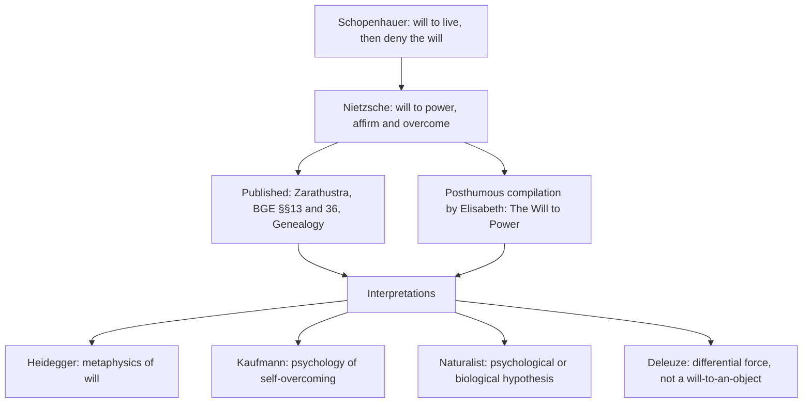

# The will to power

**Prerequisites:** [Nietzsche and the death of God](08-nietzsche-and-the-death-of-god.md); [Schopenhauer: pessimism and the will](02-pessimism-and-the-will.md)

*The Nietzsche-Archiv in Weimar, where Nietzsche's notebooks were kept after his collapse and where the posthumous compilation *The Will to Power* was prepared. Credit: DWRZ David Wen Riccardi-Zhu. License: [CC BY-SA 3.0](https://creativecommons.org/licenses/by-sa/3.0). Source: [File:Nietzsche Archives in Weimar.JPG](https://commons.wikimedia.org/wiki/File:Nietzsche_Archives_in_Weimar.JPG).*

## From will to live to will to power

[Nietzsche](thinkers/friedrich-nietzsche.md)'s first philosophical love was [Schopenhauer](thinkers/arthur-schopenhauer.md). In [*The World as Will and Representation*](texts/world-as-will-and-representation.md), Schopenhauer argued that the thing in itself, behind the world of representation, is a blind, ceaseless **[will to live](../../../glossary/modern/will-to-live.md)**: striving without purpose, never satisfied, the source of suffering. The wise response, he thought, was aesthetic contemplation, compassion, and finally denial of the will.

Nietzsche accepted that life is driven by a deep striving, and that suffering is real. He rejected the conclusion. Living things, he came to think, do not aim merely to stay alive or to avoid pain. They aim to expand, to discharge their strength, to overcome resistance — including resistance in themselves. That drive he called the **[will to power](../../../glossary/modern/will-to-power.md)** (*Wille zur Macht*). Self-preservation is real, but it is a by-product, not the core. Even the ascetic who seems to say no to life is, on this reading, still expressing a will to power, turned inward.

The contrast can be put simply. Schopenhauer's will wants to live, and because life is suffering it should be denied. Nietzsche's will wants to grow and overcome, and the task is to affirm it.

## Where the idea appears in the published books

The phrase and the thought show up in the works Nietzsche himself finished, not only in the notebooks.

In [*Thus Spoke Zarathustra*](texts/thus-spoke-zarathustra.md), the speech "On Self-Overcoming" makes life itself the speaker. Life, Zarathustra reports, revealed that it is that which must always overcome itself. Even the will to truth, and the moral will, are forms of this [self-overcoming](../../../glossary/modern/self-overcoming.md). Will to power here is not first of all domination of other people; it is life's tendency to go beyond its present form.

In [*Beyond Good and Evil*](texts/beyond-good-and-evil.md) the claim is sharper and more theoretical. Section 13 warns physiologists not to take the drive for self-preservation as the basic instinct of an organism: a living thing seeks above all to discharge its strength; life itself is will to power; self-preservation is one of the indirect results. Section 36 offers a more daring hypothesis. The only "reality" we know from inside is our own drives and will. If we tried to explain the world on that basis, the world in its intelligible character would be will to power and nothing else. Whether Nietzsche is stating a metaphysics here, or trying out a hypothesis, is one of the main disputes about the idea. The book also ties will to power to the psychology of philosophers and to "what is noble."

[*On the Genealogy of Morality*](texts/on-the-genealogy-of-morality.md) uses the idea historically and critically. Against a Darwinism that stresses mere adaptation and survival, Nietzsche treats the essence of life as will to power: a striving to grow, to appropriate, to impose form (especially II.12). The "slave revolt" in morals, [*ressentiment*](../../../glossary/modern/ressentiment.md), and the ascetic ideal are read as strategies of power, including the power of the weak to survive and to interpret the world.

Later 1888 books (*Twilight of the Idols*, *The Antichrist*) continue the theme. He never published a systematic treatise under the title *The Will to Power*.

## The posthumous book

He did, however, plan one. In 1886–88 he sketched a major work sometimes titled *The Will to Power: Attempt at a Revaluation of All Values*, and filled notebooks with material. In the autumn of 1888 he abandoned that plan and used some of the material in the short books of that year. Then came the collapse of January 1889.

His sister Elisabeth Förster-Nietzsche took control of the archive, eventually housed in the Nietzsche-Archiv in Weimar. With the help of Heinrich Köselitz ("Peter Gast") and, at first, the Horneffer brothers, she published *Der Wille zur Macht* in 1901 (about 483 sections), then a greatly expanded edition in 1906 with 1,067 numbered sections in four parts: European nihilism; a critique of previous values; the principle of a new valuation; and "discipline and breeding." The arrangement, titles and selection were editorial. They were not a book Nietzsche left ready for the press.

That compilation was widely read as his unfinished masterpiece, including by German nationalists and later the Nazis (encouraged by Elisabeth's presentation of her brother) and by [Heidegger](../twentieth-century/thinkers/martin-heidegger.md). The critical edition of the notebooks by Giorgio Colli and Mazzino Montinari, begun in the 1960s, showed how much the printed *Will to Power* owed to editorial construction. Walter Kaufmann and R. J. Hollingdale's English translation (1967) still follows the 1906 numbering, but warns the reader that it is a collection of notes, not a finished system. The notes remain valuable. The book called *The Will to Power* should not be treated as Nietzsche's last testament.

## How the idea has been read

Interpretations differ because the published remarks are bold, brief and not all of one kind, and because the notebooks invite system-building.

- **Metaphysical (Heidegger).** In his Nietzsche lectures of the 1930s, later published as *Nietzsche* (1961), Martin Heidegger treated will to power as Nietzsche's name for the being of beings, and [eternal recurrence](../../../glossary/modern/eternal-recurrence.md) as the way the whole of beings is. Nietzsche becomes the last metaphysician of the West, completing a history in which being is understood as will. Heidegger relied heavily on the compiled *Will to Power*. Later scholars have questioned that textual basis, but the reading remains influential.

- **Psychological (Kaufmann).** In *Nietzsche: Philosopher, Psychologist, Antichrist* (1950), Walter Kaufmann argued that will to power is primarily a psychology of self-overcoming and sublimation, not a license to dominate others and not a finished cosmology. This reading helped detach Nietzsche from the Nazi use of him and from the idea that the 1906 book is a system.

- **Naturalist.** Writers such as Brian Leiter, and in related ways Maudemarie Clark, treat Nietzsche as a philosophical naturalist. Will to power is then a psychological or biological hypothesis about drives, continuous with the life sciences, not a claim about the inner nature of all reality. Some in this camp read *Beyond Good and Evil* §36 as exploratory rather than as Nietzsche's settled metaphysics.

- **Deleuze.** In *Nietzsche and Philosophy* (1962), Gilles Deleuze argued that will to power is not a will that has power as its object. It is the differential, genetic element of force: forces are active or reactive, and the will to power is what makes them what they are. Affirmation, not mere struggle for domination, is the key. The reading is part of Deleuze's wider attack on Hegelian dialectic.

These readings can overlap, and none has a monopoly. A cautious path is to start from the published texts — self-overcoming, the critique of self-preservation, the genealogy of morals — and to treat the cosmological statements and the notebooks as more contested.

## Key ideas

- Nietzsche reworked Schopenhauer's will to live into a will to power: life as expansion and self-overcoming, not mere survival, and to be affirmed rather than denied.
- The idea is already in *Zarathustra*, *Beyond Good and Evil* (especially §§13 and 36) and the *Genealogy*; he never finished a treatise under that title.
- *The Will to Power* published after his death is a compilation by Elisabeth Förster-Nietzsche and her collaborators, not a book he completed.
- Heidegger, Kaufmann, naturalist readers and Deleuze offer conflicting accounts of how far the idea is a metaphysics, a psychology, or a theory of force.

## Where this leads

- Back: [Nietzsche and the death of God](08-nietzsche-and-the-death-of-god.md), [Schopenhauer](thinkers/arthur-schopenhauer.md)
- Thinker and texts: [Nietzsche](thinkers/friedrich-nietzsche.md), [*Zarathustra*](texts/thus-spoke-zarathustra.md), [*Beyond Good and Evil*](texts/beyond-good-and-evil.md), [*Genealogy*](texts/on-the-genealogy-of-morality.md)
- Forward: [Heidegger](../twentieth-century/thinkers/martin-heidegger.md), [Foucault](../twentieth-century/thinkers/michel-foucault.md)
- Glossary: [will to power](../../../glossary/modern/will-to-power.md), [will to live](../../../glossary/modern/will-to-live.md), [self-overcoming](../../../glossary/modern/self-overcoming.md)
