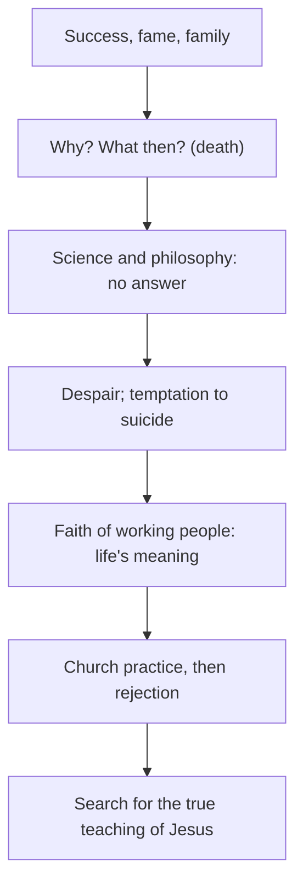

# Tolstoy, *A Confession*

**Prerequisites:** [[leo-tolstoy|Leo Tolstoy]]; [[the-philosophical-novel|The philosophical novel]]

@@IMG@@

## Dating and publication

Written in 1879–1880 and revised until 1882, when it was meant to appear in the journal *Russian Thought*; the religious censorship banned it, and it was first published in Geneva in 1884. In Russian it is *Ispoved*. It is short, about 80 pages, and is the hinge between [[leo-tolstoy|Tolstoy]]'s great novels and his later religious writings.

## Outline

- **Loss of faith.** Raised Orthodox, he lost his faith at 18 without crisis, as many educated people did; belief simply fell away. He lived for ambition, pleasure and, as a writer, for fame and money, preaching to others what he did not understand himself.
- **The arrest of life.** Around fifty, prosperous, famous, healthy and with a loving family, he began to be stopped by questions: "Why?" "What then?" "What will come of my life?" He found he could not answer, and hid a rope so as not to hang himself and stopped going out with a gun.
- **The Eastern fable.** A traveller fleeing a beast falls into a well, at whose bottom waits a dragon; he clings to a branch that two mice, one black and one white (night and day), are gnawing through, while he licks drops of honey from the leaves. The honey of family and art no longer sweetens.
- **Searching the sciences and the wise.** The experimental sciences answer other questions; speculative philosophy answers in circles. [[arthur-schopenhauer|Schopenhauer]], Solomon (Ecclesiastes), the Buddha and Socrates all say life is evil or vanity.
- **Four ways out.** People of his class live by ignorance, epicureanism, strength (suicide) or weakness (going on living without answer). He was in the fourth.
- **The faith of the people.** Millions of working people live meaningfully by faith. Faith is "the force of life". He returned to the Orthodox Church, practised for a time, then found its rituals, its blessing of war and executions and its hostility to other faiths impossible.
- **Conclusion.** He resolves to examine the teaching and separate truth from falsehood: the project of his later works. A dream of hanging over an abyss and finding himself supported ends the book.

## Key ideas

- A life's meaning must survive the fact of death; worldly success cannot supply it.
- Rational knowledge cannot answer the question of meaning; faith, as a force of life, does.
- Tolstoy's faith turned from the Church's dogmas toward Jesus's ethical teaching.

## Reception

*A Confession* is a classic of the "meaning of life" question in philosophy and a source for existentialism; William James discussed it in *The Varieties of Religious Experience* (1902) as a case of the "sick soul". Wittgenstein's remarks on the meaning of life in the *Tractatus* echo its themes. Translations: Aylmer Maude (classic); Jane Kentish (Penguin, with other religious writings).

## Where this leads

- Next text: [[the-kingdom-of-god-is-within-you|*The Kingdom of God Is Within You*]]
- Related: [[bib:old-testament/books/wisdom-poetry/ecclesiastes.md|Ecclesiastes]]
- Back: [[augustine-confessions|Augustine's *Confessions*]]
- Forward: [[the-myth-of-sisyphus|*The Myth of Sisyphus*]], which opens with the question of suicide
