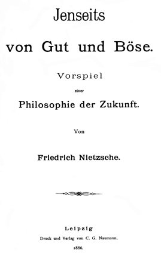
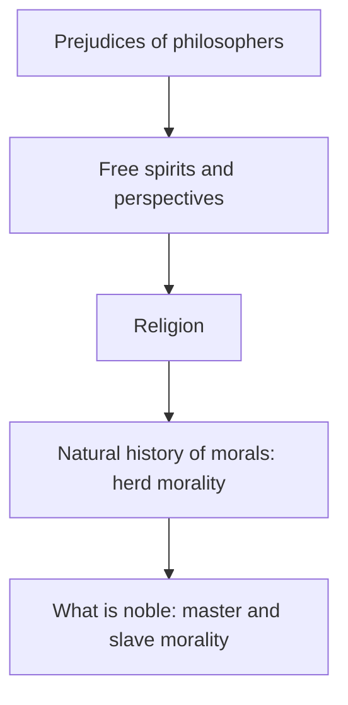

# Nietzsche, *Beyond Good and Evil*

**Prerequisites:** [Friedrich Nietzsche](../thinkers/friedrich-nietzsche.md); helpful: [*Thus Spoke Zarathustra*](thus-spoke-zarathustra.md)

*Title page of the first edition of *Jenseits von Gut und Böse* (1886). Credit: C. G. Naumann, publisher. License: Public domain. Source: [File:Jenseits von Gut und Böse - 1886.jpg](https://commons.wikimedia.org/wiki/File:Jenseits_von_Gut_und_Böse_-_1886.jpg).*

## Dating and form

*Jenseits von Gut und Böse: Vorspiel einer Philosophie der Zukunft* ("Prelude to a Philosophy of the Future") was published at [Nietzsche](../thinkers/friedrich-nietzsche.md)'s own expense in Leipzig in 1886. He described it as saying the same things as *Zarathustra*, but differently: in prose aphorisms and short essays, with polemical sharpness. It has a preface, nine parts (296 numbered sections) and a closing poem, "From High Mountains".

## Outline

- **Preface.** "Supposing truth is a woman — what then?" Dogmatic philosophers have been clumsy suitors. Plato's invention of pure spirit and the good in itself was the worst of errors; Christianity is "Platonism for the people".
- **1. On the Prejudices of Philosophers.** Every great philosophy is the personal confession of its author, a kind of involuntary memoir. Why truth rather than untruth? Critiques of Descartes' "I think", of free will and unfree will, of Stoic "life according to nature". Physics too is an interpretation. Will to power as a hypothesis about the world.
- **2. The Free Spirit.** Masks, perspectives, the philosopher of the dangerous "perhaps".
- **3. The Religious Character.** Religion as cruelty and self-denial, and as a tool for the strong.
- **4. Epigrams and Interludes.** Short aphorisms, including "Whoever fights monsters should see to it that in the process he does not become a monster. And if you gaze long into an abyss, the abyss also gazes into you" (§146).
- **5. On the Natural History of Morals.** Morality as "herd-animal morality"; the slave revolt in morals begins with the Jews (a claim developed in the *Genealogy* and much criticized).
- **6. We Scholars; 7. Our Virtues.** On specialists, objectivity, the historical sense, and honesty as the free spirits' remaining virtue.
- **8. Peoples and Fatherlands.** Critical of German nationalism and antisemitism; advocates "good Europeans".
- **9. What Is Noble?** Master morality and slave morality first named (§260); the pathos of distance; rank order.

## Key ideas

- Philosophies express the drives and values of their authors; even "truth" must be questioned.
- Morality has a natural history; "herd morality" levels and tames.
- The philosophers of the future will create values; nobility involves self-reverence and a pathos of distance.

## Reception

The book is one of the best entry points to Nietzsche's mature thought. Its aristocratic radicalism, remarks on women and sweeping claims about peoples remain controversial. Translations: Walter Kaufmann (Vintage, also in *Basic Writings of Nietzsche*); R. J. Hollingdale (Penguin); Judith Norman (Cambridge); Marion Faber (Oxford).

## Where this leads

- Next text: [*On the Genealogy of Morality*](on-the-genealogy-of-morality.md)
- Back: [Descartes's *Meditations*](../../early-modern/texts/meditations-on-first-philosophy.md), criticized in §16
- Glossary: [perspectivism](../../../../glossary/modern/perspectivism.md), [master and slave morality](../../../../glossary/modern/master-and-slave-morality.md)
