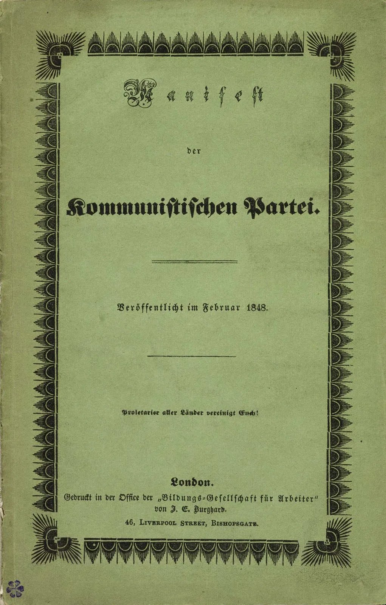

# Marx and Engels, *The Communist Manifesto*

**Prerequisites:** [Karl Marx](../thinkers/karl-marx.md); [Marx and historical materialism](../04-marx-and-historical-materialism.md)

*Cover of the first edition of the *Manifest der Kommunistischen Partei* (London, 1848). Credit: Friedrich Engels, Karl Marx. License: Public domain. Source: [File:Communist-manifesto.png](https://commons.wikimedia.org/wiki/File:Communist-manifesto.png).*

## Dating and occasion

*Manifest der Kommunistischen Partei* was commissioned by the Communist League, a small secret society of German artisans, and written by [Marx](../thinkers/karl-marx.md) with Friedrich Engels in Brussels in late 1847 and January 1848. It was printed in London in February 1848, just as revolution broke out in Paris, though it had little influence on the revolutions of that year. It was published anonymously; later editions carried both names and new prefaces. It is short, about 40 pages.

## Outline

- **Preamble.** "A spectre is haunting Europe — the spectre of communism."
- **I. Bourgeois and Proletarians.** "The history of all hitherto existing society is the history of class struggles." The bourgeoisie has played a most revolutionary part: it has torn apart feudal ties, created a world market, built productive forces greater than all previous generations together, and "all that is solid melts into air" (in a common translation). But it has created its own gravediggers, the proletariat, who will grow, organize and overthrow it.
- **II. Proletarians and Communists.** Communists have no interests separate from the proletariat as a whole. Their aim is the abolition of bourgeois private property in the means of production. Replies to objections about family, nation, freedom and culture. A ten-point programme for advanced countries, including a progressive income tax, abolition of inheritance, free public education and the end of child factory labour. The aim: "an association in which the free development of each is the condition for the free development of all."
- **III. Socialist and Communist Literature.** Polemics against "reactionary", "conservative" and "utopian" socialisms (Saint-Simon, Fourier, Owen).
- **IV. Position of the Communists in relation to the various existing opposition parties.** Ends: "The proletarians have nothing to lose but their chains. They have a world to win. Working men of all countries, unite!"

## Key ideas

- History is the history of class struggles.
- Capitalism is a dynamic, revolutionary force that also creates the class that will overthrow it.
- Communism aims to abolish private property in the means of production for the free development of all.

## Reception

The *Manifesto* became one of the most widely read political documents in history, translated into many languages. Its account of globalization and capitalist dynamism is often praised even by critics; its predictions of proletarian revolution in advanced countries were not fulfilled in the way it expected. Editions: Penguin Classics with an introduction by Gareth Stedman Jones; Verso's edition introduced by Eric Hobsbawm.

## Where this leads

- Next text: [*On Liberty*](on-liberty.md)
- Back: [*Phenomenology of Spirit*](phenomenology-of-spirit.md)
- Economics: [Marx (economics)](../../../../../economics/microeconomics/10-history-of-thought/thinkers/04-karl-marx.md)
- Forward: [Karl Popper](../../twentieth-century/thinkers/karl-popper.md)'s critique in *The Open Society and Its Enemies*
