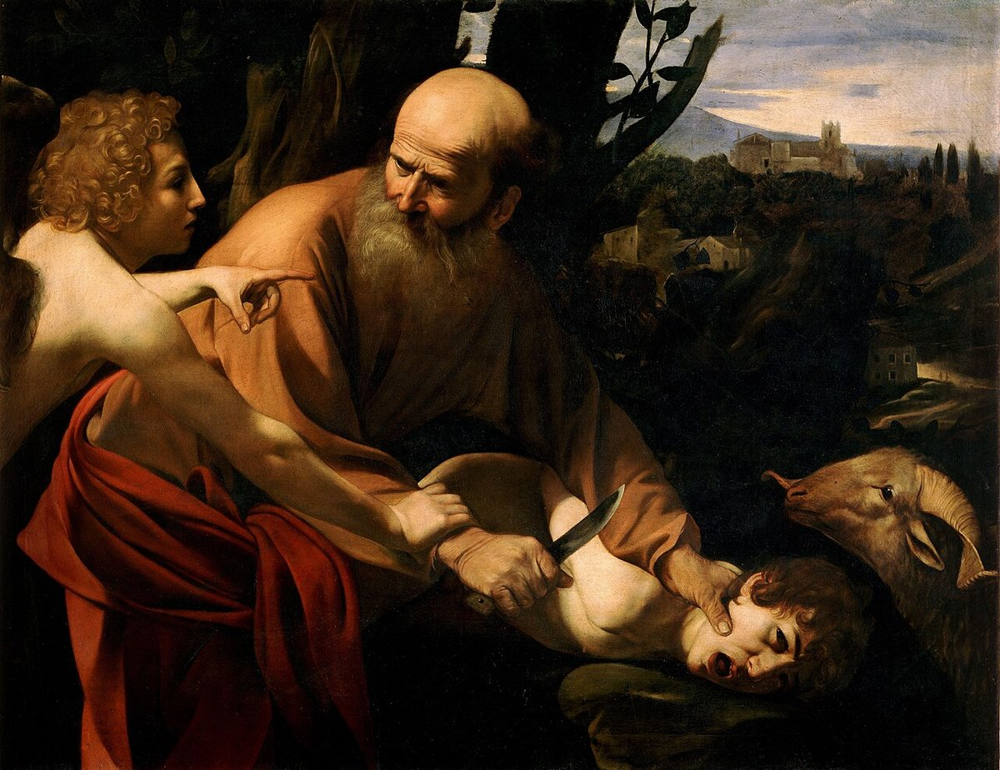
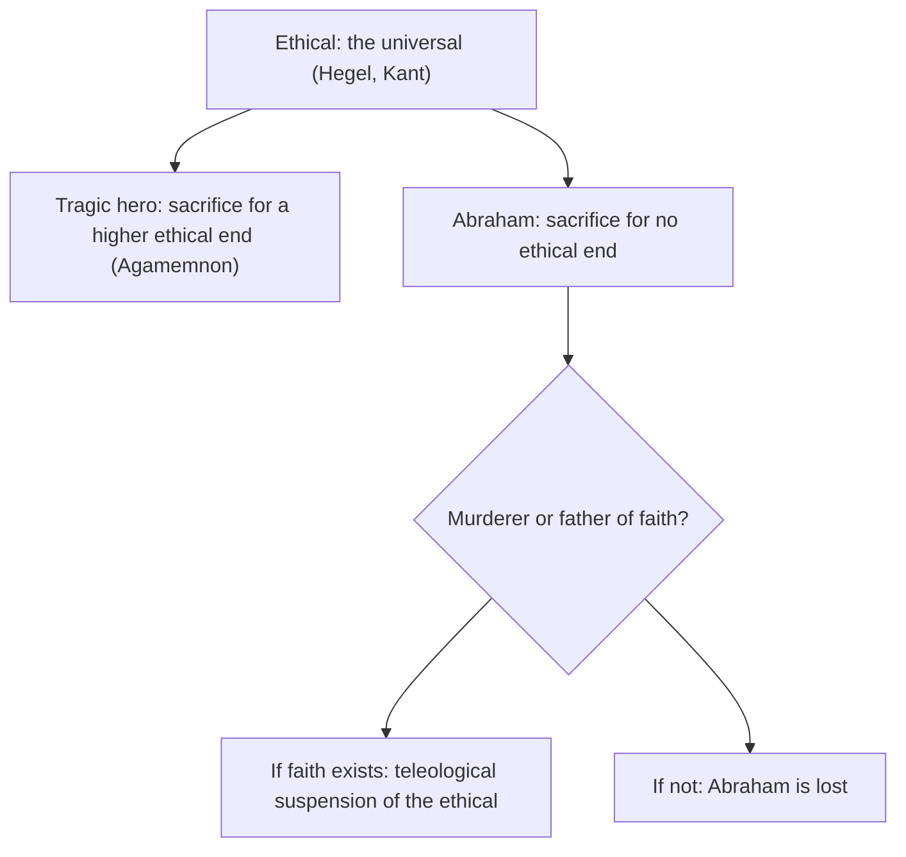

# Kierkegaard, *Fear and Trembling*

**Prerequisites:** [Søren Kierkegaard](../thinkers/soren-kierkegaard.md); [The binding of Isaac](../../../../../religion/abrahamic/christianity/bible/old-testament/stories/01-the-binding-of-isaac.md) (Genesis 22)

*Caravaggio, *The Sacrifice of Isaac* (c. 1603), Uffizi Gallery, Florence. Credit: Caravaggio. License: Public domain. Source: [File:Sacrifice of Isaac-Caravaggio (Uffizi).jpg](https://commons.wikimedia.org/wiki/File:Sacrifice_of_Isaac-Caravaggio_(Uffizi).jpg).*

## Dating and pseudonym

Published in Copenhagen on 16 October 1843, the same day as *Repetition*, under the pseudonym **Johannes de Silentio** ("John of Silence"). The title comes from Philippians 2:12, "work out your own salvation with fear and trembling". Johannes describes himself not as a philosopher or a man of faith but as someone who admires faith and cannot understand it. Many readers connect the book to [Kierkegaard](../thinkers/soren-kierkegaard.md)'s broken engagement with Regine Olsen, a sacrifice he could not explain to her.

## Structure

- **Preface.** Against an age that wants to "go further" than faith, as if faith were easy.
- **Tuning Up (*Stemning*).** Four retellings of Abraham's journey to Mount Moriah, each imagining a way Abraham might have failed to be the father of faith.
- **Eulogy on Abraham.** Praise of Abraham's greatness.
- **Preliminary Expectoration.** The "knight of infinite resignation", who gives up the finite and finds peace in the eternal, versus the "knight of faith", who gives up everything and yet by virtue of the absurd receives the finite back. The knight of faith might look like a tax collector.
- **Problema I.** Is there a teleological suspension of the ethical? If the ethical is the universal and highest, Abraham is a murderer. If faith is real, the single individual can stand higher than the universal.
- **Problema II.** Is there an absolute duty to God?
- **Problema III.** Was Abraham ethically defensible in keeping silent about his purpose to Sarah, Eliezer and Isaac? Comparisons with tragic heroes (Agamemnon, Jephthah, Brutus), who sacrifice a child for a higher ethical good the community can understand, unlike Abraham.
- **Epilogue.**

## Key ideas

- Faith is not an easy first step but the highest and most terrible passion.
- Infinite resignation is within human power; faith, which receives the finite back "by virtue of the absurd", is not.
- If faith exists, the individual can stand in absolute relation to God above the universal ethical.
- Abraham cannot speak, because his reasons cannot be made intelligible in universal terms.

## Interpretation

Readers disagree on whether the book endorses religious violence, critiques Hegelian ethics, explores the limits of language, or ironically exposes the impossibility of faith as described. Jewish readers have criticized its use of the Akedah, which in Jewish tradition is often read as God's rejection of child sacrifice. The book remains central to debates about divine command, religious exception and moral autonomy. Translations: Alastair Hannay (Penguin); Howard and Edna Hong (Princeton, *Kierkegaard's Writings*); Sylvia Walsh (Cambridge).

## Where this leads

- Next text: [*The Communist Manifesto*](communist-manifesto.md)
- Related: [Genesis](../../../../../religion/abrahamic/christianity/bible/old-testament/books/law-torah/genesis.md); [Paul](../../../../../religion/abrahamic/christianity/bible/glossary/people/paul.md) (Philippians)
- Forward: [Camus's critique of the leap](../../twentieth-century/texts/the-myth-of-sisyphus.md)
- Glossary: [teleological suspension of the ethical](../../../../glossary/modern/teleological-suspension-of-the-ethical.md)
