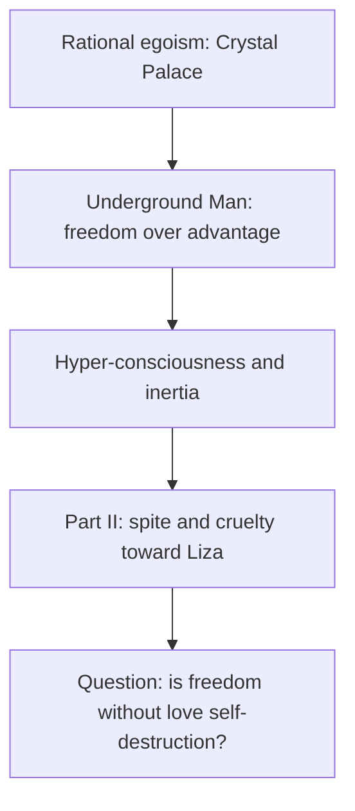

# Dostoevsky, *Notes from Underground*

**Prerequisites:** [[fyodor-dostoevsky|Fyodor Dostoevsky]]; [[existential-beginnings|Existential beginnings]]

*A novella, not a treatise. It is included because its narrator's arguments against rational egoism are a landmark of existential thought.*

@@IMG@@

## Dating and context

Published in 1864 in *Epoch*, the journal [[fyodor-dostoevsky|Dostoevsky]] ran with his brother, during the months his first wife was dying and shortly before his brother's death. It responds to Nikolai Chernyshevsky's novel *What Is to Be Done?* (1863), which presented "rational egoism": if people understood their true interests, they would act rationally and a harmonious society, symbolized by a "Crystal Palace" (after the glass exhibition hall built in London in 1851), would follow. Censors cut a passage in Part I in which, Dostoevsky complained, he had derived the need for faith in Christ.

## Structure

- **Part I, "Underground."** A forty-year-old retired civil servant in St Petersburg, "a sick man… a spiteful man", addresses imagined readers. He is hyper-conscious, which makes him unable to act; he takes pleasure in his toothache and his humiliations. Against the rational egoists, he argues that humans do not always want what is to their advantage; what they want most is "independent wanting", to have their own way even against reason, if only to prove they are human beings and not piano keys or organ stops. "Two times two makes four" is a fine thing, but "two times two makes five" is sometimes a very charming thing too. He would rather smash the Crystal Palace than live in it as a predicted creature.
- **Part II, "Apropos of the Wet Snow."** Episodes from his twenties: a ridiculous campaign to bump into an officer on Nevsky Prospect; a disastrous dinner with former schoolmates; and his encounter with Liza, a young woman in a brothel, whom he first moves with talk of a better life and then humiliates when she comes to him for help.

## Key ideas

- Human beings value free will above rational self-interest and will act against reason to assert it.
- Excessive consciousness can paralyse action and breed spite.
- The narrator is both a critic of rationalism and a warning about isolated, loveless freedom.

## Reception

Often called the first existentialist novel; Walter Kaufmann placed it at the start of his anthology *Existentialism from Dostoevsky to Sartre* (1956). It influenced Nietzsche, Camus, Sartre and modern fiction's unreliable, self-lacerating narrators. Translations: Richard Pevear and Larissa Volokhonsky (Vintage); Michael R. Katz (Norton Critical Edition); Constance Garnett (classic).

## Where this leads

- Next text: [[the-brothers-karamazov|*The Brothers Karamazov*]]
- Back: [[utilitarianism-and-liberalism|utilitarianism]], one of its targets
- Forward: [[being-and-nothingness|*Being and Nothingness*]]
