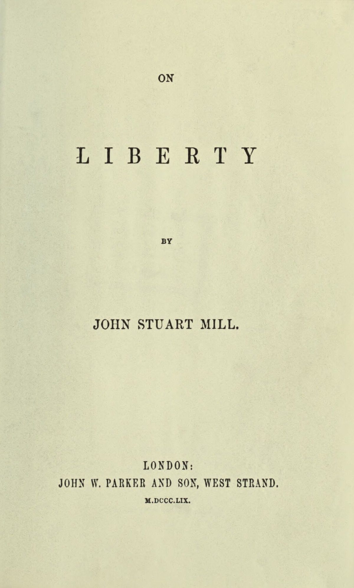
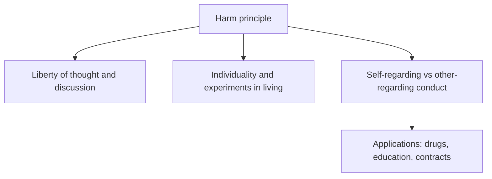

# Mill, *On Liberty*

**Prerequisites:** [John Stuart Mill](../thinkers/john-stuart-mill.md); [Utilitarianism and liberalism](../03-utilitarianism-and-liberalism.md)

*Title page of the first edition of Mill's *On Liberty* (1859). Credit: John Stuart Mill (author), John W. Parker and Son (publisher). License: Public domain. Source: [File:On Liberty (first edition title page via facsimile).jpg](https://commons.wikimedia.org/wiki/File:On_Liberty_(first_edition_title_page_via_facsimile).jpg).*

## Dating and authorship

Published in London in 1859, a year after the death of Harriet Taylor Mill, to whose memory [Mill](../thinkers/john-stuart-mill.md) dedicated it as "the inspirer, and in part the author, of all that is best in my writings". It was planned and drafted with her in the 1850s. The essay is short, five chapters.

## Outline

1. **Introductory.** The old struggle of liberty against rulers has been won in democracies; the new danger is the "tyranny of the majority", including social tyranny through opinion and custom. The **harm principle**: "the only purpose for which power can be rightfully exercised over any member of a civilized community, against his will, is to prevent harm to others. His own good, either physical or moral, is not a sufficient warrant." The principle applies to adults in societies capable of improvement through free discussion. Mill grounds liberty in utility "in the largest sense", the permanent interests of man as a progressive being.
2. **Of the Liberty of Thought and Discussion.** Silencing an opinion is wrong because (a) it may be true, and we are fallible; (b) it may contain part of the truth; (c) even if false, its challenge keeps the truth alive and understood; (d) otherwise the truth becomes a "dead dogma", not a "living truth". The examples of Socrates and Jesus.
3. **Of Individuality, as One of the Elements of Well-Being.** Human nature is not a machine but a tree that needs to grow on all sides; "experiments of living"; the danger of conformity and "the despotism of custom".
4. **Of the Limits to the Authority of Society over the Individual.** Distinguishes self-regarding conduct from conduct that harms others' interests; society may express disapproval but not punish self-regarding conduct.
5. **Applications.** Trade, poisons, drunkenness, gambling, education (the state may require education without providing it), marriage, and selling oneself into slavery (not permitted, because it abdicates freedom).

## Key ideas

- The only justification for coercion of adults is preventing harm to others.
- Free discussion is essential because we are fallible and because truths need challenge to stay alive.
- Individuality is part of human well-being; conformity and custom are threats.

## Reception

*On Liberty* is a cornerstone of liberal thought, cited in debates on free speech, drug laws, paternalism and privacy. Critics include James Fitzjames Stephen and Patrick Devlin (who argued society may enforce shared morality, in the famous debate with H. L. A. Hart in the 1960s). Others question whether "harm" can be defined neutrally and whether Mill's principle is consistent with his utilitarianism. Editions: Oxford World's Classics (with *Utilitarianism* and other essays), Penguin Classics, Hackett (ed. Elizabeth Rapaport).

## Where this leads

- Next text: [Emerson, "Self-Reliance"](self-reliance.md)
- Back: [Kant's *Groundwork*](../../early-modern/texts/groundwork-of-the-metaphysics-of-morals.md)
- Forward: [*A Theory of Justice*](../../twentieth-century/texts/a-theory-of-justice.md)
- Glossary: [harm principle](../../../../glossary/modern/harm-principle.md)
