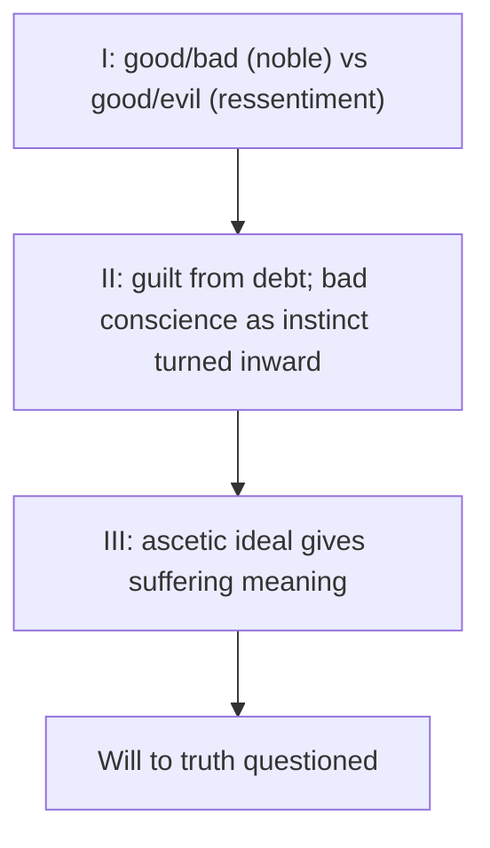

# Nietzsche, *On the Genealogy of Morality*

**Prerequisites:** [[beyond-good-and-evil|*Beyond Good and Evil*]]; [[nietzsche-and-the-death-of-god|Nietzsche and the death of God]]

@@IMG@@

## Dating and form

*Zur Genealogie der Moral: Eine Streitschrift* ("A Polemic") was written in about three weeks in July 1887 at Sils Maria and published that November as a supplement and clarification to [[beyond-good-and-evil|*Beyond Good and Evil*]]. Unlike most of [[friedrich-nietzsche|Nietzsche]]'s books, it consists of three continuous essays. The title is also translated *On the Genealogy of Morals*.

## Outline

- **Preface.** The question: under what conditions did humans invent the value judgments good and evil, and what value do they themselves have? Against the English psychologists' (and his former friend Paul Rée's) naive histories of morality.
- **First Essay: "Good and Evil," "Good and Bad."** Noble, aristocratic peoples called themselves "good" (strong, beautiful, happy) and the lowly "bad". The priestly caste, powerless and full of **[[g:ressentiment|ressentiment]]**, effected a "slave revolt in morality": the strong became "evil", and weakness, humility and suffering became "good". Nietzsche associates this revolt with Judaism and its heir Christianity, a claim much criticized and debated. The image of lambs who call the birds of prey evil.
- **Second Essay: "Guilt," "Bad Conscience," and the Like.** The origin of responsibility in the ability to make promises; guilt (*Schuld*) from debt (*Schulden*), creditor and debtor, punishment as the pleasure of cruelty. "Bad conscience" arises when instincts that cannot discharge outward, once humans are enclosed in society and peace, turn inward. The Christian God as the maximum creditor, and humanity's infinite debt.
- **Third Essay: What Is the Meaning of Ascetic Ideals?** For artists, philosophers, priests and saints, asceticism means different things. The ascetic priest gives suffering a meaning (it is your fault), which is better than meaninglessness: "man would rather will nothingness than not will". Even science, with its unconditional will to truth, is a form of the ascetic ideal; the will to truth must now become conscious of itself as a problem.

## Key ideas

- Moral values have a history rooted in power relations, needs and resentment.
- Guilt and bad conscience originate in debt, punishment and the internalization of aggression.
- The ascetic ideal gave suffering meaning at the cost of turning life against itself; the will to truth is its last form.

## Reception

The *Genealogy* is the most systematic of Nietzsche's books and the most widely taught. It shaped [[sigmund-freud|Freud]]'s ideas about guilt and the superego (whether directly is disputed), Max Scheler's study of ressentiment, and [[michel-foucault|Foucault]]'s genealogical method (*Discipline and Punish*). [[rene-girard|Girard]] reversed its evaluation, arguing that the "slave morality" Nietzsche despised is the Bible's discovery of the innocence of victims. Translations: Walter Kaufmann and R. J. Hollingdale (Vintage); Maudemarie Clark and Alan Swensen (Hackett, with notes); Douglas Smith (Oxford); Carol Diethe (Cambridge).

## Where this leads

- Next era: [[dir:philosophy/history/modern/twentieth-century|The twentieth century]]
- Forward: [[discipline-and-punish|*Discipline and Punish*]], [[i-see-satan-fall-like-lightning|*I See Satan Fall Like Lightning*]], [[civilization-and-its-discontents|*Civilization and Its Discontents*]]
- Glossary: [[g:ressentiment|ressentiment]], [[g:genealogy|genealogy]]
