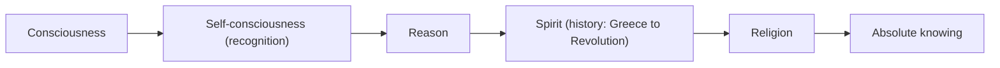

# Hegel, *Phenomenology of Spirit*

**Prerequisites:** [[georg-wilhelm-friedrich-hegel|Hegel]]; [[german-idealism|German idealism]]

@@IMG@@

## Dating and form

Published in Bamberg in 1807 (the preface was finished in January), written mostly in Jena in 1805–06 and completed around the Battle of Jena. It was meant as the introduction and first part of a system of science. "Phenomenology" means the study of how Spirit appears: the book traces consciousness through a series of "shapes" (*Gestalten*), each of which takes itself to have found truth, discovers through its own experience that it has not, and passes into a richer shape. The reader watches consciousness educate itself until it reaches "absolute knowing".

## Outline

- **Preface.** Against Schelling's "night in which all cows are black"; "the true is the whole"; substance must be grasped also as subject.
- **Consciousness.** Sense-certainty (the "this, here, now" turns out to be the emptiest universal); perception (things and their properties); force and understanding (laws behind appearances).
- **Self-consciousness.** Desire; the struggle for recognition, lordship and bondage; Stoicism, Skepticism and the "unhappy consciousness" (a divided self, linked to medieval Christianity).
- **Reason.** Observing reason (including a critique of phrenology: "the being of spirit is a bone"); reason as self-actualizing (pleasure, the law of the heart, virtue); reason as lawgiver and law-tester (a critique of Kantian formalism).
- **Spirit.** Shapes of a whole world: Greek ethical life (Antigone, divine and human law); Roman legal status; culture and alienation; Enlightenment and its struggle with faith; absolute freedom and the Terror of the French Revolution; morality and conscience; "the beautiful soul"; forgiveness.
- **Religion.** Natural religion, art religion (Greek), revealed religion (Christianity) as the picture-thinking form of absolute truth.
- **Absolute knowing.** Spirit knowing itself as Spirit, in conceptual form.

## Key ideas

- Knowledge must be shown to develop from within ordinary consciousness, not presupposed.
- Self-consciousness depends on recognition by another; domination fails to provide it.
- Forms of knowing are tied to forms of social life and history.
- Each shape fails by its own standard and passes into another (determinate negation).

## Reception

The book is notoriously difficult, and its interpretation has shaped whole movements: Kojève's Paris lectures centred on the master–slave dialectic and influenced Sartre, Lacan and de Beauvoir; the young Marx called it the true birthplace and secret of Hegel's philosophy. Translations: A. V. Miller (Oxford, 1977, with J. N. Findlay's analysis); Terry Pinkard (Cambridge, 2018); Michael Inwood (Oxford, 2018). Companion: Robert Stern's *Routledge Philosophy Guidebook to Hegel and the Phenomenology of Spirit*.

## Where this leads

- Next text: [[world-as-will-and-representation|*The World as Will and Representation*]]
- Forward: [[communist-manifesto|*The Communist Manifesto*]], [[the-second-sex|*The Second Sex*]]
- Glossary: [[g:master-slave-dialectic|master–slave dialectic]], [[g:geist|Geist]]
