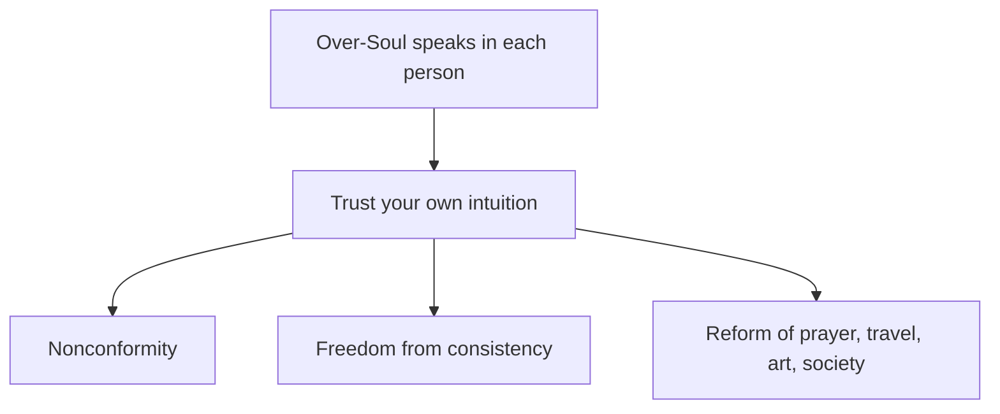

# Emerson, "Self-Reliance"

**Prerequisites:** [[ralph-waldo-emerson|Ralph Waldo Emerson]]; [[transcendentalism|American transcendentalism]]

@@IMG@@

## Dating and form

"Self-Reliance" was published in [[ralph-waldo-emerson|Emerson]]'s *Essays: First Series* (1841), drawing on lectures and journal entries from the 1830s. Like most of his essays, it is built from striking sentences rather than a linear argument; many have become proverbs. It is about twenty pages long and can be read in an hour.

## Movement of the essay

Rather than chapters, it moves through a sequence of themes:

1. **Trust thyself.** Each of us has latent conviction; we dismiss our own thought because it is ours, and later hear it from another with shame. "Trust thyself: every heart vibrates to that iron string."
2. **Nonconformity.** "Whoso would be a man must be a nonconformist." Society demands conformity; virtue is often a penance paid to society. Emerson would write "Whim" on the lintels of his doorpost rather than follow duties he does not feel.
3. **Consistency.** "A foolish consistency is the hobgoblin of little minds." Speak what you think now, and tomorrow speak what tomorrow thinks, even if it contradicts today. "To be great is to be misunderstood."
4. **The source.** Self-reliance is not egoism; it is reliance on the universal Over-Soul speaking in each. The self that relies is the aboriginal Self, intuition, from which all things come.
5. **Applications.** To prayer (which should be a soliloquy of a beholding soul rather than a beggary), creeds, travel ("Travelling is a fool's paradise"), imitation in art, and the idea of social progress ("Society never advances").
6. **Close.** "Nothing can bring you peace but yourself. Nothing can bring you peace but the triumph of principles."

## Key ideas

- Genuine thought and life come from trusting one's own intuitions.
- Conformity and consistency are the main enemies of self-trust.
- Self-reliance is ultimately reliance on the universal spirit within, not on the ego.

## Reception

The essay became a founding text of American individualism, quoted by entrepreneurs and rebels alike, often without its spiritual basis. Nietzsche read it closely. Critics argue that it can license selfishness and ignores the social conditions of self-development; defenders such as Stanley Cavell read it as a demanding ethics of self-transformation and responsibility. It is available in many editions, including the Library of America *Essays and Lectures* and Penguin's *Selected Essays*.

## Where this leads

- Next text: [[walden|*Walden*]]
- Back: [[montaigne-essays|Montaigne's *Essays*]], a model Emerson admired
- Forward: [[thus-spoke-zarathustra|*Thus Spoke Zarathustra*]]
