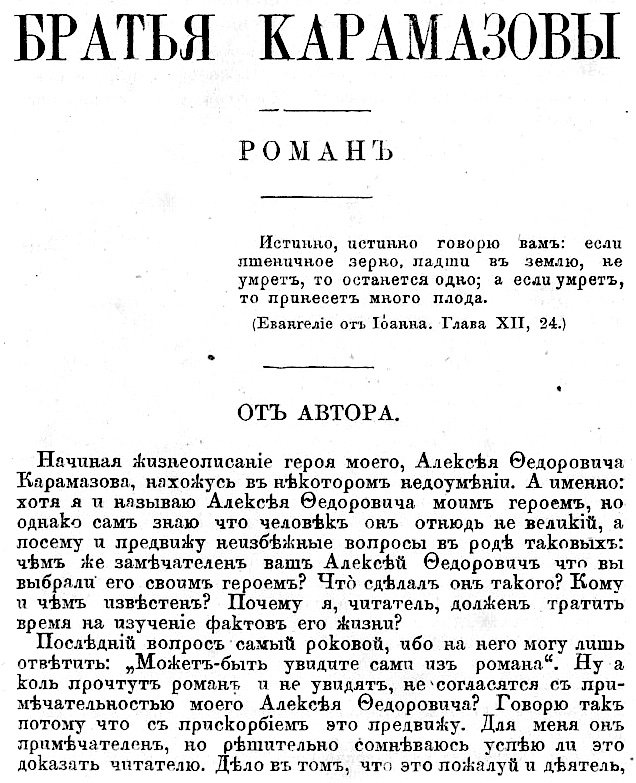
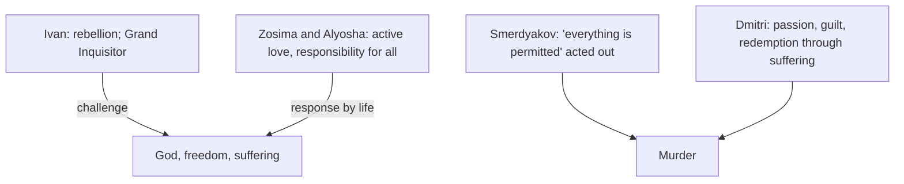

# Dostoevsky, *The Brothers Karamazov*

**Prerequisites:** [Fyodor Dostoevsky](../thinkers/fyodor-dostoevsky.md); [The philosophical novel](../07-the-philosophical-novel.md)

*A novel, included for its philosophical chapters ("Rebellion", "The Grand Inquisitor", Zosima's teaching), which are among the most discussed passages in philosophy of religion.*

*First page of the first edition of *The Brothers Karamazov*. Credit: Russkii Vestnik. License: Public domain. Source: [File:Dostoevsky-Brothers Karamazov.jpg](https://commons.wikimedia.org/wiki/File:Dostoevsky-Brothers_Karamazov.jpg).*

## Dating and context

Serialized in *The Russian Messenger* in 1879–80 and published as a book in late 1880, a few months before [Dostoevsky](../thinkers/fyodor-dostoevsky.md)'s death. It was planned as the first part of a larger work. Grief over the death of his three-year-old son Alyosha in 1878 shaped the book; Dostoevsky visited the Optina monastery afterwards, and its elder Ambrose is one model for Zosima. The epigraph is John 12:24: "Except a corn of wheat fall into the ground and die, it abideth alone: but if it die, it bringeth forth much fruit."

## Story and characters

Fyodor Pavlovich Karamazov, a debauched, buffoonish landowner, has three legitimate sons and probably a fourth, illegitimate one. **Dmitri**, passionate and sensual, quarrels with his father over money and the woman Grushenka. **Ivan**, an intellectual, cannot accept God's world. **Alyosha**, the youngest, is a novice under the elder **Zosima**. **Smerdyakov**, the servant and probable half-brother, absorbs Ivan's idea that "everything is permitted". The father is murdered; Dmitri is accused, tried and convicted; Smerdyakov confesses to Ivan, who breaks down, and then hangs himself. The book ends with Alyosha speaking to a group of boys at the funeral of a child, Ilyusha, about remembering goodness.

## Philosophical centre (Book V–VI)

- **"Rebellion" (Book V, ch. 4).** Ivan tells Alyosha true stories of cruelty to children and argues that no future harmony could justify their suffering. He does not deny God, but "most respectfully" returns his ticket.
- **"The Grand Inquisitor" (Book V, ch. 5).** Ivan's prose poem: Christ returns to sixteenth-century Seville; the aged Inquisitor arrests him and explains that Christ was wrong to reject the devil's three temptations in the desert (bread, miracle, earthly power). People cannot bear freedom; the Church has corrected Christ's work with "miracle, mystery and authority" and made people happy. Christ silently kisses him; the Inquisitor releases him.
- **"The Russian Monk" (Book VI).** Zosima's life and teaching: active love, the claim that each of us is responsible for all and for everything, hell as "the suffering of being unable to love". Dostoevsky intended this as the answer to Ivan, not by argument but by a way of life.

## Reception

Freud called it the most magnificent novel ever written; Einstein and Wittgenstein admired it. The "Rebellion" chapter is a classic statement of the problem of evil; [Camus](../../twentieth-century/thinkers/albert-camus.md) discussed Ivan in *The Rebel*. Translations: Richard Pevear and Larissa Volokhonsky (Vintage); David McDuff (Penguin); Constance Garnett, revised by Ralph Matlaw (Norton Critical).

## Key ideas

- Ivan's rebellion rejects any harmony bought with the suffering of children.
- The Grand Inquisitor argues that humans prefer bread, miracle and authority to freedom.
- Zosima's answer is active love and responsibility of each for all.

## Where this leads

- Next text: [Tolstoy, *A Confession*](a-confession.md)
- Related: [Job](../../../../../religion/abrahamic/christianity/bible/old-testament/books/wisdom-poetry/job.md); [the temptation in the wilderness](../../../../../religion/abrahamic/christianity/bible/new-testament/stories/02-baptism-and-temptation.md)
- Back: [*Candide*](../../early-modern/texts/candide.md)
- Forward: [*The Myth of Sisyphus*](../../twentieth-century/texts/the-myth-of-sisyphus.md), [Girard](../../twentieth-century/texts/i-see-satan-fall-like-lightning.md)
