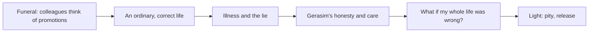

# Tolstoy, *The Death of Ivan Ilyich*

**Prerequisites:** [[leo-tolstoy|Leo Tolstoy]]; helpful: [[a-confession|*A Confession*]]

*A novella, included because it is one of the most widely taught literary reflections on death and the meaning of a life.*

@@IMG@@

## Dating

Published in 1886, the first major fiction [[leo-tolstoy|Tolstoy]] completed after the crisis described in [[a-confession|*A Confession*]]. It is short, twelve chapters, readable in an evening.

## Story

The novella opens after the end: colleagues of Ivan Ilyich Golovin, a judge in St Petersburg, read of his death in the newspaper and immediately think of the promotions it will bring. At the funeral his widow asks his friend Pyotr Ivanovich about the government pension.

Then the story goes back. "Ivan Ilyich's life had been most simple and most ordinary and therefore most terrible." He rose correctly, married suitably, decorated his house in the fashion of everyone of his class. While hanging curtains he falls and bruises his side. The pain grows. Doctors give evasive diagnoses. His family treat his illness as an inconvenience and maintain the lie that he is only ill, not dying. He remembers the syllogism from Kiesewetter's logic textbook: "Caius is a man, men are mortal, therefore Caius is mortal." It was true of Caius, but not of him, little Vanya, with his mother and his toys.

Only the young peasant servant Gerasim, who holds his legs up to ease the pain and speaks frankly of death as something that comes to all, comforts him. In his last days Ivan Ilyich asks: what if my whole life has been wrong? In the final hours, screaming, he feels himself pushed into a black sack; then something strikes him, he sees light, feels pity for his wife and son, and finds that instead of death there is light. "Death is finished," he says to himself. "It is no more."

## Key ideas

- A life lived for propriety and comfort is exposed by the approach of death.
- Abstract knowledge that "all men are mortal" is different from facing one's own death.
- Honesty and compassion, not convention, are what count at the end.

## Reception

The novella is a classic in medical ethics and palliative-care education, and in philosophy of death. [[martin-heidegger|Heidegger]] cites it in a footnote in [[being-and-time|*Being and Time*]] on "the 'they'" and being-toward-death. Translations: Louise and Aylmer Maude; Richard Pevear and Larissa Volokhonsky (in *The Death of Ivan Ilyich and Other Stories*); Lynn Solotaroff (Bantam).

## Where this leads

- Next text: [[thus-spoke-zarathustra|*Thus Spoke Zarathustra*]]
- Forward: [[being-and-time|*Being and Time*]], being-toward-death
- Back: [[c:logic/syllogism-and-the-organon.md|the syllogism]], which Ivan cannot apply to himself
