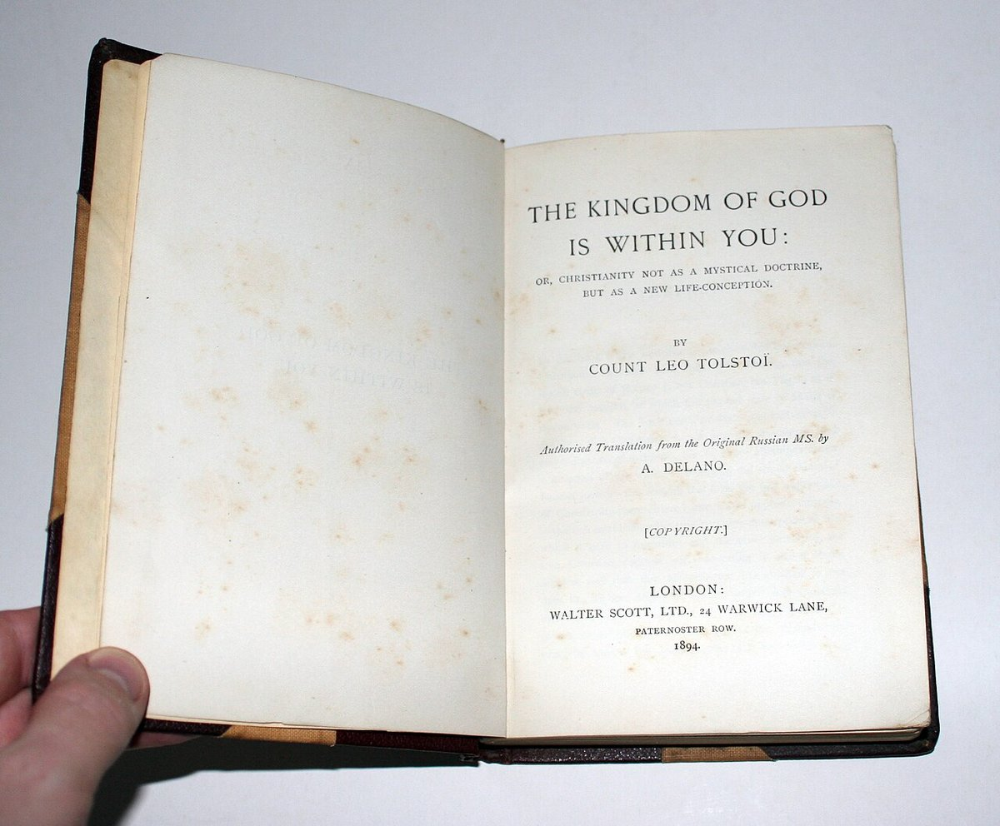

# Tolstoy, *The Kingdom of God Is Within You*

**Prerequisites:** [Leo Tolstoy](../thinkers/leo-tolstoy.md); [The Sermon on the Mount](../../../../../religion/abrahamic/christianity/bible/new-testament/stories/03-sermon-on-the-mount.md)

*An early English edition of Tolstoy's *The Kingdom of God Is Within You*. Credit: Credit as given on Wikimedia Commons. License: [CC BY-SA 2.5](https://creativecommons.org/licenses/by-sa/2.5). Source: [File:Tolstoi1st.jpg](https://commons.wikimedia.org/wiki/File:Tolstoi1st.jpg).*

## Dating and publication

Completed in 1893 and banned in Russia; it was first published in German in Berlin in 1894 and circulated in Russian through clandestine copies and foreign editions. Its title comes from Luke 17:21. Its subtitle: *Christianity Not as a Mystic Religion but as a New Theory of Life*. It developed ideas from *What I Believe* (1884) and was prompted partly by letters from American pacifists, including the abolitionist William Lloyd Garrison's son, who sent Tolstoy his father's "Declaration of Sentiments" (1838) on non-resistance, and by Adin Ballou's writings.

## Argument

1. **Non-resistance.** Jesus's command in the Sermon on the Mount, "resist not evil" (Matthew 5:39), means: never use violence, even against those who do evil. Tolstoy surveys American and Russian non-resistant traditions, including Quakers and the Doukhobors.
2. **Misunderstanding by Church and critics.** Churches have explained away this teaching to justify war and state power; secular critics dismiss it as impractical.
3. **The state rests on violence.** Governments maintain themselves by armies, police, courts and prisons. Universal military conscription, then spreading across Europe, makes every citizen complicit in organized murder.
4. **Hypocrisy.** Modern people profess Christianity and humanitarian ideals while preparing for war; Tolstoy describes troops sent to flog peasants in Tula province in 1892.
5. **Refusal.** The way out is not revolution, which is another violence, but the inner transformation of individuals who refuse to take part: refusing oaths, military service and service of the state. The Kingdom of God is within, and it grows as people live by it.

## Key ideas

- The core of Christianity is the ethical command of non-violent love.
- The state is organized violence; Christians must refuse to cooperate with it.
- Change comes through conscience, not through revolution or force.

## Reception

Gandhi read it in South Africa in 1894 and wrote that it "overwhelmed" him; it became a foundation of his satyagraha. It influenced Christian anarchists, conscientious objectors and Martin Luther King Jr. indirectly through Gandhi. Critics argue that absolute non-resistance abandons victims, and that Tolstoy's reading of the Gospels strips them of their theology. Translation: Constance Garnett (1894), still the most common English version.

## Where this leads

- Next text: [*The Death of Ivan Ilyich*](the-death-of-ivan-ilyich.md)
- Related: [Matthew](../../../../../religion/abrahamic/christianity/bible/new-testament/books/gospels/matthew.md), [Luke](../../../../../religion/abrahamic/christianity/bible/new-testament/books/gospels/luke.md)
- Back: [Thoreau and "Civil Disobedience"](walden.md)
- Forward: [Simone Weil](../../twentieth-century/texts/gravity-and-grace.md); [Girard on non-violence](../../twentieth-century/texts/i-see-satan-fall-like-lightning.md)
- Glossary: [non-resistance](../../../../glossary/modern/non-resistance.md)
