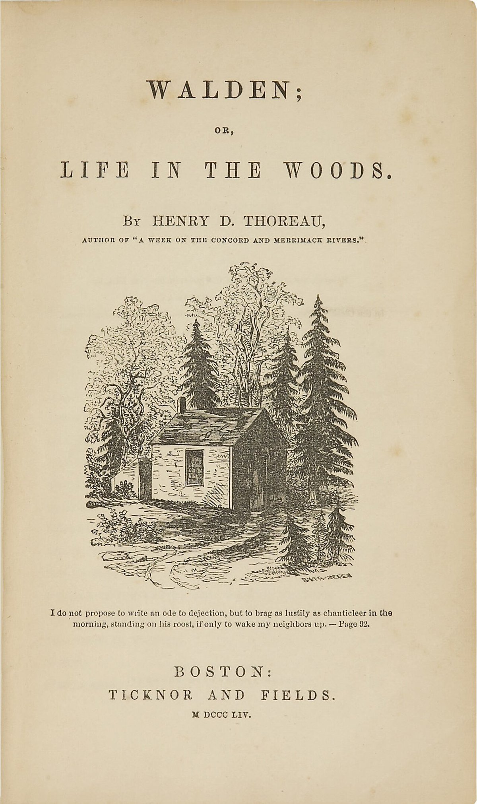

# Thoreau, *Walden*

**Prerequisites:** [Henry David Thoreau](../thinkers/henry-david-thoreau.md); [American transcendentalism](../05-transcendentalism.md)

*Title page of the first edition of *Walden* (1854), with a drawing of Thoreau's cabin by his sister Sophia. Credit: Unknown authorUnknown author. License: Public domain. Source: [File:Walden Thoreau.jpg](https://commons.wikimedia.org/wiki/File:Walden_Thoreau.jpg).*

## Dating and form

*Walden; or, Life in the Woods* was published in Boston in 1854, seven years after [Thoreau](../thinkers/henry-david-thoreau.md) left the cabin at Walden Pond, near Concord, Massachusetts, where he lived from 4 July 1845 to 6 September 1847. He revised it through at least seven drafts. The two years are compressed into a single cycle of seasons, from summer to spring, so the book's structure is itself a symbol of renewal.

## Outline (18 chapters)

- **Economy.** The longest chapter: what life really requires; the costs of Thoreau's house (he lists them, to the half-cent, totalling $28.12½); "the mass of men lead lives of quiet desperation"; "the cost of a thing is the amount of what I will call life which is required to be exchanged for it".
- **Where I Lived, and What I Lived For.** "I went to the woods because I wished to live deliberately…" "Simplify, simplify."
- **Reading; Sounds; Solitude; Visitors; The Bean-Field; The Village.** Classics versus newspapers; the whistle of the train; being alone without loneliness; hoeing beans.
- **The Ponds; Baker Farm; Higher Laws; Brute Neighbors; House-Warming; Former Inhabitants; Winter Visitors; Winter Animals.** Careful natural history, including his survey of the pond's depth (refuting legends that it was bottomless); reflections on hunting, diet and purity; the formerly enslaved people and poor who once lived nearby.
- **The Pond in Winter; Spring.** Ice-cutting; the thawing sand bank as an image of creation; rebirth.
- **Conclusion.** "If a man does not keep pace with his companions, perhaps it is because he hears a different drummer." The book ends: "There is more day to dawn. The sun is but a morning star."

## Key ideas

- Measure things by the life they cost; simplify to free life for what matters.
- Nature, closely observed, is both a field of knowledge and a source of spiritual renewal.
- Each person should find his own way, rather than follow the "quiet desperation" of convention.

## Reception

*Walden* sold slowly but became a classic of American literature, the environmental movement and the "simple living" tradition. Critics have called it self-righteous and noted that Thoreau's experiment depended on Emerson's land and the town nearby; defenders reply that he never claimed to be a hermit and said he left the woods for as good a reason as he went there: he had several more lives to live. Editions: Jeffrey S. Cramer's *Walden: A Fully Annotated Edition* (Yale); Princeton's edition by J. Lyndon Shanley; Penguin and Oxford World's Classics.

## Where this leads

- Next text: [*Notes from Underground*](notes-from-underground.md)
- Back: ["Self-Reliance"](self-reliance.md)
- Related: [Epicurus](../../../ancient/greek/thinkers/epicurus.md) on simple pleasures
