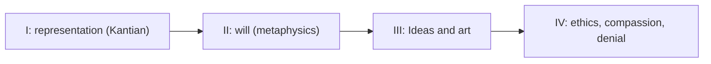

# Schopenhauer, *The World as Will and Representation*

**Prerequisites:** [[arthur-schopenhauer|Arthur Schopenhauer]]; [[pessimism-and-the-will|Pessimism and the will]]

@@IMG@@

## Dating and editions

Published in Leipzig in December 1818 (title page 1819), when [[arthur-schopenhauer|Schopenhauer]] was 30. It sold very few copies. A second edition (1844) added a whole second volume of 50 supplementary essays keyed to the first; a third edition appeared in 1859. Schopenhauer insisted that readers first know Kant's main works and his own dissertation on the principle of sufficient reason, and that they read the book twice. The German title *Die Welt als Wille und Vorstellung* has also been translated *The World as Will and Idea* (Haldane and Kemp, 1883–86).

## Structure of volume 1 (four books)

1. **The world as representation, first aspect.** "The world is my representation": everything that exists for knowledge is object for a subject. Representation is governed by the principle of sufficient reason (space, time, causality). Science explains relations among representations, never their inner nature.
2. **The world as will, first aspect.** We know our bodies also from within as will. By analogy the inner nature of all things is will, which objectifies itself in grades: natural forces, plants, animals, humans. The will is one, groundless and aimless; its multiplication in individuals belongs to appearance.
3. **The world as representation, second aspect.** The Platonic Ideas are the immediate objectivations of the will. In aesthetic contemplation, the subject becomes "pure, will-less, painless, timeless subject of knowledge". Genius; the beautiful and the sublime; the arts in ascending order; music as a copy of the will itself.
4. **The world as will, second aspect.** Ethics. Life is suffering; affirmation and denial of the will to live; eternal justice; compassion as the root of virtue; asceticism, resignation and the saint; the book ends with the "nothing" that remains for those in whom the will has turned and denied itself, which, for them, is all this very real world with its suns and galaxies.

## Key ideas

- The world as known is representation; its inner essence is one blind will.
- Existence is suffering; art gives temporary relief; compassion and denial of the will give lasting release.
- Music expresses the will directly.

## Reception

The book influenced Wagner, Nietzsche, Tolstoy, Hardy, Mann, Freud, Wittgenstein and Borges. Translations: E. F. J. Payne (Dover, two volumes, long the standard), and the Cambridge Edition by Judith Norman, Alistair Welchman and Christopher Janaway. Bryan Magee's *The Philosophy of Schopenhauer* and Christopher Janaway's *Schopenhauer: A Very Short Introduction* are good companions.

## Where this leads

- Next text: [[fear-and-trembling|*Fear and Trembling*]]
- Back: [[critique-of-pure-reason|*Critique of Pure Reason*]]
- Forward: [[thus-spoke-zarathustra|Nietzsche's *Zarathustra*]], [[the-interpretation-of-dreams|Freud's *Interpretation of Dreams*]]
- Glossary: [[g:will-to-live|will to live]]
