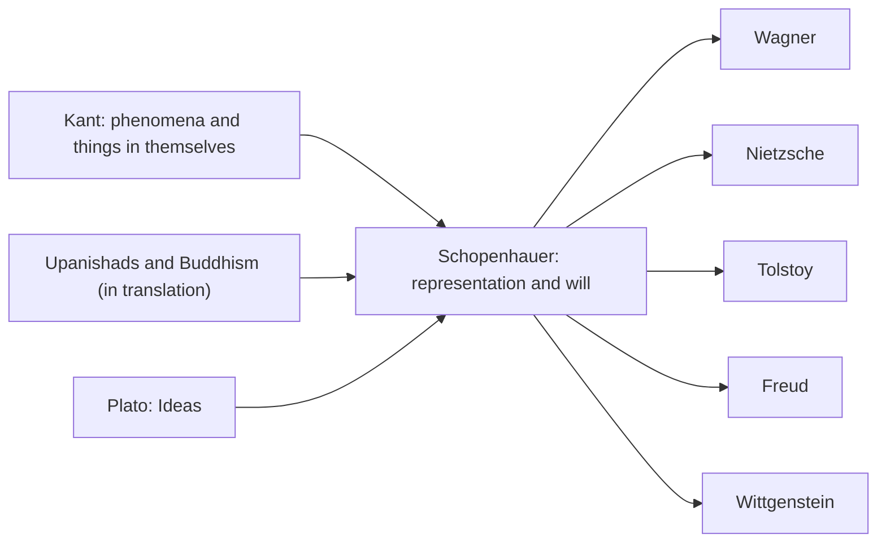

# Arthur Schopenhauer

**Prerequisites:** [Pessimism and the will](../02-pessimism-and-the-will.md)

@@IMG@@

## Life and context

Arthur Schopenhauer (1788–1860) was born in Danzig (now Gdańsk) to a wealthy merchant family. His father, who wanted him to become a merchant, took him on long European travels as a teenager, where he was struck by the misery he saw. After his father's death (possibly suicide) in 1805, Arthur left commerce for study. His mother Johanna became a successful novelist and hosted a salon in Weimar frequented by Goethe; mother and son quarrelled bitterly and stopped meeting after 1814. He studied at Göttingen, where a teacher advised him to read Plato and Kant, and at Berlin, and wrote his dissertation *On the Fourfold Root of the Principle of Sufficient Reason* (1813). His main work, [*The World as Will and Representation*](../texts/world-as-will-and-representation.md), appeared in December 1818 (dated 1819) and sold almost nothing. As a lecturer in Berlin he scheduled his lectures at the same hour as Hegel's; almost no students came. A private income let him live as an independent scholar, from 1833 in Frankfurt, with a series of poodles. Fame came only after the essays of *Parerga and Paralipomena* (1851). He died in Frankfurt in 1860.

## Core ideas

**The world as representation.** Following Kant, the world we experience is representation: objects for a subject, ordered by space, time and causality (the forms of the principle of sufficient reason).

**The world as will.** The thing in itself, which Kant left unknown, is will: blind, aimless striving. We know it directly in our own bodily willing and by analogy in all nature.

**Pessimism.** Willing is lack, and lack is suffering; satisfaction is brief and gives way to boredom. "Life swings like a pendulum backwards and forwards between pain and boredom."

**Art.** Aesthetic contemplation suspends willing. Music, which copies not Ideas but the will itself, is the highest art.

**Ethics of compassion.** The basis of morality is compassion, arising when we see through individuation and recognize ourselves in other beings, including animals (he was an early advocate of animal welfare). His prize essay *On the Basis of Morality* (written 1839–40) attacked Kant's ethics of duty.

**Denial of the will.** The highest state is resignation: quieting the will to live, as in ascetic saints of Christianity, Hinduism and Buddhism.

## Influence and criticism

Schopenhauer was one of the first major Western philosophers to engage seriously with Indian thought, and he anticipated psychoanalytic ideas about unconscious drives and repression. He shaped music (Wagner) and literature (Tolstoy, Hardy, Proust, Conrad, Mann, Beckett). His prose is clear and witty, unlike most German philosophy of his time. Critics point to inconsistencies (how can the will, as thing in itself, be known? how can it deny itself?), to his misogyny ("On Women"), and to his contempt for Hegel, which was more personal than argued. [Nietzsche](friedrich-nietzsche.md) began as a disciple and ended as a critic of his "no" to life.

## Key ideas

- The world is my representation, and in itself it is will.
- Existence is suffering; happiness is merely the absence of pain.
- Art, compassion and ascetic denial of the will bring release.
- He influenced Wagner, Nietzsche, Tolstoy, Freud and Wittgenstein.

## Where this leads

- Text: [*The World as Will and Representation*](../texts/world-as-will-and-representation.md)
- Next thinker: [Søren Kierkegaard](soren-kierkegaard.md)
- Forward: [Nietzsche](friedrich-nietzsche.md), [Freud](../../twentieth-century/thinkers/sigmund-freud.md)
- Glossary: [will to live](../../../../glossary/modern/will-to-live.md), [pessimism](../../../../glossary/modern/pessimism.md)
