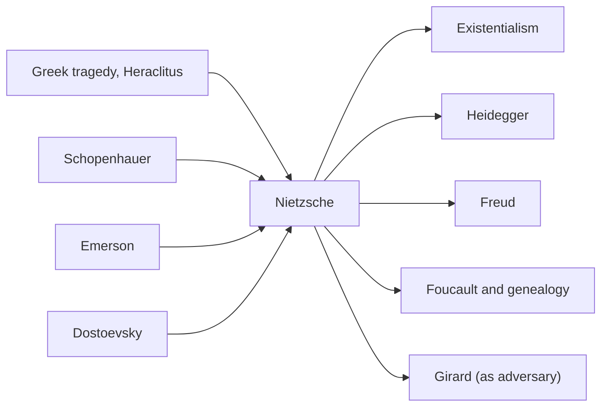

# Friedrich Nietzsche

**Prerequisites:** [[nietzsche-and-the-death-of-god|Nietzsche and the death of God]]; [[arthur-schopenhauer|Arthur Schopenhauer]]

@@IMG@@

## Life and context

Friedrich Wilhelm Nietzsche (1844–1900) was born in Röcken, Prussian Saxony, son of a Lutheran pastor who died when Friedrich was four. He was educated at the elite boarding school Schulpforta and studied theology briefly and then classical philology at Bonn and Leipzig, where in 1865 he discovered [[arthur-schopenhauer|Schopenhauer]] in a second-hand bookshop. In 1869, aged 24 and before completing his doctorate, he was appointed professor of classical philology at Basel and renounced his Prussian citizenship. He befriended Richard Wagner, whose music and personality dominated his early years, and served briefly as a medical orderly in the Franco-Prussian War, where he contracted dysentery and diphtheria. His first book, *The Birth of Tragedy* (1872), was attacked by philologists. Ill health (migraines, eye trouble, digestive problems) forced him to retire on a pension in 1879. For ten years he lived as a wanderer in Swiss and Italian boarding houses (Sils Maria, Genoa, Nice, Turin), writing a book almost every year, with very few readers. He broke with Wagner, and later with his sister Elisabeth over her antisemitic husband Bernhard Förster. A failed friendship with Lou Salomé and Paul Rée in 1882 left him bitter. In January 1889 he collapsed in Turin (a story says he embraced a horse being beaten in the street) and never recovered his sanity, living in the care of his mother and then his sister until his death in Weimar in 1900. The cause of his illness is disputed (syphilis was long assumed; other diagnoses have been proposed).

## Phases of work

- **Early:** *The Birth of Tragedy* contrasts the Apollonian (form, dream, individuation) and the Dionysian (intoxication, unity, dissolution) in Greek tragedy. *Untimely Meditations* (1873–76), including "Schopenhauer as Educator".
- **Middle ("free spirit") period:** *Human, All Too Human* (1878), *Daybreak* (1881), *The Gay Science* (1882; book V 1887): aphoristic, psychological, scientific in spirit.
- **Mature:** [[thus-spoke-zarathustra|*Thus Spoke Zarathustra*]] (1883–85), [[beyond-good-and-evil|*Beyond Good and Evil*]] (1886), [[on-the-genealogy-of-morality|*On the Genealogy of Morality*]] (1887).
- **1888:** *The Case of Wagner*, *Twilight of the Idols*, *The Antichrist*, *Ecce Homo* (published 1908), *Nietzsche contra Wagner*.

## Core ideas

- **Death of God** and the coming of nihilism (see [[nietzsche-and-the-death-of-god|lesson]]).
- **Revaluation of all values.** Values must be examined for what they express about the life that holds them: do they come from strength and abundance or from weakness and resentment?
- **Master and slave morality**, **ressentiment**, the **ascetic ideal**.
- **Will to power**: life as self-overcoming, not mere self-preservation.
- **Übermensch**, **eternal recurrence**, **amor fati**.
- **Perspectivism**: there are no facts, only interpretations (a notebook line); every philosophy is the confession of its author.
- **Style.** Aphorism, parable, polemic and poetry: Nietzsche wanted readers to think, not to agree.

## Reception and criticism

Fame came only after his collapse. Elisabeth assembled the posthumous *Will to Power* from his notes and promoted a nationalist, antisemitic Nietzsche; the Nazis adopted him selectively. Walter Kaufmann's *Nietzsche: Philosopher, Psychologist, Antichrist* (1950) and his translations, with R. J. Hollingdale's, presented a different figure: a critic of nationalism, antisemitism and mass culture. Interpretations remain diverse: existentialist, Heideggerian (the last metaphysician), postmodern (Deleuze, Derrida, Foucault), naturalist (Brian Leiter), and virtue-ethical. Critics charge him with aristocratic contempt for equality and democracy, misogynistic passages, and an ethic that might license cruelty. [[rene-girard|Girard]] argued that Nietzsche understood Christianity's defence of victims better than its defenders and chose Dionysus, the god of the sacrificial mob, against it.

## Key ideas

- Nietzsche diagnosed the death of God and the threat of nihilism.
- He traced moral values to their origins in power, weakness and resentment, and called for their revaluation.
- His positive ideal is the affirmation of life: will to power, the Übermensch, eternal recurrence, amor fati.
- His work was distorted by his sister and the Nazis and has been read in many conflicting ways since.

## Where this leads

- Texts: [[thus-spoke-zarathustra|*Zarathustra*]], [[beyond-good-and-evil|*Beyond Good and Evil*]], [[on-the-genealogy-of-morality|*Genealogy*]]
- Next era: [[dir:philosophy/history/modern/twentieth-century|The twentieth century]]
- Forward: [[martin-heidegger|Heidegger]], [[michel-foucault|Foucault]], [[rene-girard|Girard]]
- Back: [[gk:heraclitus.md|Heraclitus]], [[gk:socrates.md|Socrates]] (whom he attacked)
- Glossary: [[g:will-to-power|will to power]], [[g:ubermensch|Übermensch]], [[g:eternal-recurrence|eternal recurrence]]
