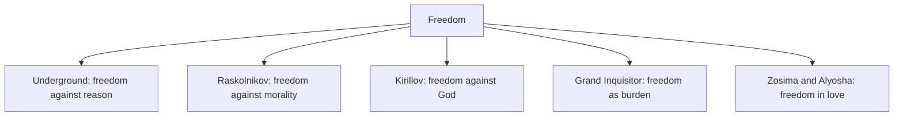

# Fyodor Dostoevsky

**Prerequisites:** [The philosophical novel](../07-the-philosophical-novel.md); [Existential beginnings](../06-existential-beginnings.md)

*Dostoevsky was a novelist, not a philosopher by profession. He appears here because his fiction dramatizes philosophical questions with lasting influence on existentialism, ethics and philosophy of religion.*

@@IMG@@

## Life and context

Fyodor Mikhailovich Dostoevsky (1821–1881) was born in Moscow, son of a doctor at a hospital for the poor; his father was later killed, possibly by his own serfs. Trained as a military engineer, he left the service for literature, and his first novel, *Poor Folk* (1846), made him famous overnight. In 1849 he was arrested for membership in the Petrashevsky Circle, which discussed socialist ideas and banned literature. He and others were taken to Semyonovsky Square for execution; at the last moment a pardon from Tsar Nicholas I, staged in advance, commuted the sentences. He spent four years in a prison camp in Omsk, where his only permitted book was a New Testament, and then served as a soldier in Siberia. He returned to St Petersburg in 1859 changed: hostile to the radical intelligentsia, devoted to Russian Orthodoxy and the Russian people. He suffered from epilepsy, gambled compulsively (especially in Germany in the 1860s), and was often in debt; *The Gambler* (1866) was dictated in a month to meet a contract, to a stenographer, Anna Snitkina, who became his second wife and managed his affairs. His Pushkin speech of 1880 was a national sensation. He died in St Petersburg in January 1881.

## Philosophical themes

**Freedom against rational determinism.** [*Notes from Underground*](../texts/notes-from-underground.md) (1864) attacks the idea that if people knew their true interests they would act rationally. The Underground Man insists that human beings value freedom, even the freedom to act against their advantage, above any rational utopia ("the Crystal Palace").

**The extraordinary man and moral limits.** *Crime and Punishment* (1866) tests the idea that a superior individual may transgress morality for a greater good.

**Nihilism.** *Demons* (1871–72) shows ideas loosed from moral and religious roots turning murderous. Kirillov reasons that if there is no God, he must assert his self-will by suicide.

**God and suffering.** In [*The Brothers Karamazov*](../texts/the-brothers-karamazov.md) (1880), Ivan presents the suffering of children as an objection no future harmony can answer, and hands back his ticket. The phrase "if there is no God, everything is permitted" summarizes a view discussed by the characters, though that exact sentence does not appear in the novel. The answer the novel offers is not an argument but the life of the elder Zosima and the brother Alyosha: active love and the conviction that each is responsible for all.

**Christ and freedom.** The Grand Inquisitor parable imagines Christ returning to Seville; the Inquisitor reproaches him for giving humans a freedom they cannot bear, and claims the Church has corrected his work with miracle, mystery and authority.

## Influence and criticism

Nietzsche called him the only psychologist from whom he had something to learn. Freud wrote an essay on him ("Dostoevsky and Parricide", 1928). Existentialists ([Camus](../../twentieth-century/thinkers/albert-camus.md), [Sartre](../../twentieth-century/thinkers/jean-paul-sartre.md), Berdyaev) claimed him; [Girard](../../twentieth-century/thinkers/rene-girard.md) built his early theory of desire on him; Bakhtin's theory of polyphony came from reading him. Critics note his Russian nationalism, his antisemitism (present in his journalism and some fiction) and his hostility to Catholics and socialists.

## Key ideas

- Freedom is central to human dignity and its abuse; rational utopias deny it.
- Ideas detached from moral and religious roots can become destructive.
- The suffering of innocents is the strongest objection to theodicy, met not by argument but by active love.
- His polyphonic novels give opposing views full voice.

## Where this leads

- Texts: [*Notes from Underground*](../texts/notes-from-underground.md), [*The Brothers Karamazov*](../texts/the-brothers-karamazov.md)
- Next thinker: [Leo Tolstoy](leo-tolstoy.md)
- Forward: [Camus](../../twentieth-century/thinkers/albert-camus.md), [Girard](../../twentieth-century/thinkers/rene-girard.md)
- Related: [Jesus](../../../../../religion/abrahamic/christianity/bible/glossary/people/jesus.md) in the Grand Inquisitor; [Job](../../../../../religion/abrahamic/christianity/bible/old-testament/books/wisdom-poetry/job.md)
