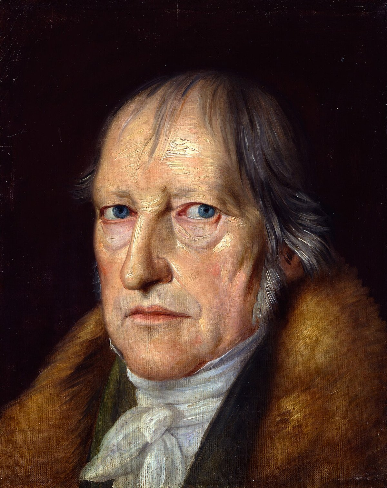
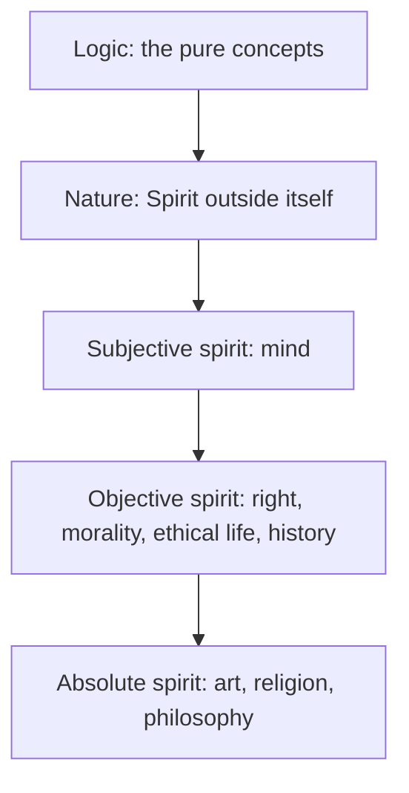

# Georg Wilhelm Friedrich Hegel

**Prerequisites:** [German idealism](../01-german-idealism.md); [contradiction and dialectic](../../../../concepts/logic/contradiction-and-dialectic.md)

*Jakob Schlesinger, portrait of G. W. F. Hegel (1831). Credit: Jakob Schlesinger. License: Public domain. Source: [File:Jakob Schlesinger - Hegel 1831.jpg](https://commons.wikimedia.org/wiki/File:Jakob_Schlesinger_-_Hegel_1831.jpg).*

## Life and context

G. W. F. Hegel (1770–1831) was born in Stuttgart, in the Duchy of Württemberg, the son of a revenue official. At the Protestant seminary in Tübingen he shared rooms with the poet Friedrich Hölderlin and the younger prodigy Schelling; the three greeted the French Revolution with enthusiasm (a story, possibly legendary, says they planted a liberty tree). After years as a house tutor in Bern and Frankfurt, he joined Schelling at Jena in 1801. He finished the [*Phenomenology of Spirit*](../texts/phenomenology-of-spirit.md) in 1806 as Napoleon's army defeated Prussia at Jena; in a letter he described seeing the emperor, "this world-soul", riding through the town. He then edited a newspaper in Bamberg, was headmaster of a Gymnasium in Nuremberg (where he wrote the *Science of Logic*), and became professor at Heidelberg and, from 1818, Berlin, where he dominated German philosophy. He died in Berlin in 1831, probably of cholera.

## Core ideas

**Philosophy as system.** "The true is the whole." Any partial truth, taken as final, contradicts itself and points beyond itself. Philosophy must show how every standpoint is a moment in a single development.

**Dialectic.** A concept or form of consciousness, thought through, reveals an internal contradiction; resolving it produces a richer concept that preserves the truth of the first while overcoming its one-sidedness. Hegel's word for this movement is *Aufhebung* (sublation).

**Spirit (*Geist*).** Reality is ultimately Spirit coming to know itself. Spirit develops through **subjective spirit** (the individual mind), **objective spirit** (law, morality, institutions) and **absolute spirit** (art, religion and philosophy, in which Spirit knows itself). Nature is Spirit in its "otherness".

**Recognition.** In the *Phenomenology*, self-consciousness needs recognition by another. The struggle for recognition leads to lordship and bondage: the lord gets recognition from someone he does not recognize as equal; the bondsman, working on things, gains a real self-understanding. This passage influenced Marx, Alexandre Kojève's famous Paris lectures (1933–39), Sartre and de Beauvoir.

**History.** "World history is the progress of the consciousness of freedom." The "cunning of reason" uses individuals' passions to accomplish purposes beyond their intentions.

**Ethical life (*Sittlichkeit*).** In the *Philosophy of Right* (1820), freedom is realized concretely in the family, civil society (the market economy, which Hegel analysed with knowledge of Adam Smith and Steuart) and the state. Its preface contains two famous lines: "What is rational is actual, and what is actual is rational", and "the owl of Minerva spreads its wings only with the falling of dusk": philosophy understands an era only when it is ending.

## Key works

[*Phenomenology of Spirit*](../texts/phenomenology-of-spirit.md) (1807); *Science of Logic* (1812–16); *Encyclopedia of the Philosophical Sciences* (1817, revised 1827 and 1830); *Elements of the Philosophy of Right* (1820); lectures on history, aesthetics, religion and the history of philosophy, published posthumously from notes.

## Influence and criticism

After his death, Hegelians split into right and left; [Marx](karl-marx.md) came from the left. [Kierkegaard](soren-kierkegaard.md) attacked the system in the name of the existing individual; [Schopenhauer](arthur-schopenhauer.md) called him a charlatan. British idealists (Bradley, McTaggart) revived him in the late nineteenth century, provoking Russell and Moore. [Popper](../../twentieth-century/thinkers/karl-popper.md) in *The Open Society and Its Enemies* accused him of preparing totalitarianism; scholars such as Walter Kaufmann, Charles Taylor and Robert Pippin have rejected that reading and stressed his account of freedom and recognition. His notorious obscurity remains a barrier and a stimulus.

## Key ideas

- The true is the whole; partial truths develop dialectically into fuller ones.
- Reality is Spirit realizing and knowing itself through nature, society, history, art, religion and philosophy.
- Self-consciousness requires mutual recognition; the master–slave dialectic is its famous drama.
- Freedom is realized in ethical institutions; philosophy comprehends its time in thought.

## Where this leads

- Text: [*Phenomenology of Spirit*](../texts/phenomenology-of-spirit.md)
- Next thinker: [Arthur Schopenhauer](arthur-schopenhauer.md)
- Forward: [Marx](karl-marx.md), [Kierkegaard](soren-kierkegaard.md), [de Beauvoir](../../twentieth-century/thinkers/simone-de-beauvoir.md)
- Back: [Heraclitus](../../../ancient/greek/thinkers/heraclitus.md), whom Hegel claimed as a forerunner
