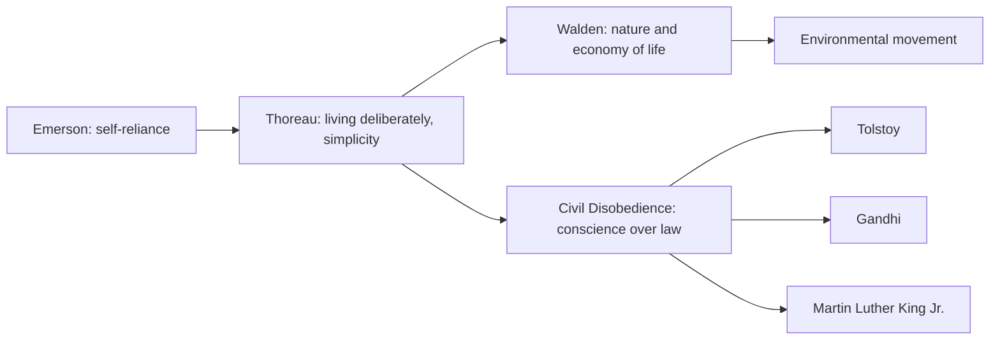

# Henry David Thoreau

**Prerequisites:** [[transcendentalism|American transcendentalism]], [[ralph-waldo-emerson|Ralph Waldo Emerson]]

@@IMG@@

## Life and context

Henry David Thoreau (1817–1862) was born in Concord, Massachusetts, where his family made pencils. He graduated from Harvard in 1837, taught briefly (resigning rather than flog pupils), and opened a progressive school with his brother John, who died of tetanus in 1842. He became a friend and protégé of Emerson, lived in Emerson's household for periods as handyman and tutor, and joined the transcendentalist circle. He worked as a surveyor and in the family pencil business, improving its pencils. On 4 July 1845 he moved into a small cabin he had built on Emerson's land at Walden Pond, living there for two years and two months. In July 1846 he was arrested and spent a night in jail for refusing to pay the poll tax, in protest against slavery and the Mexican–American War; someone, probably his aunt, paid it against his wishes. He lectured on the episode, published as "Resistance to Civil Government" (1849), later known as [[g:civil-disobedience|"Civil Disobedience"]]. *A Week on the Concord and Merrimack Rivers* (1849) sold so poorly that he joked he had a library of nearly 900 volumes, over 700 of which he wrote himself. [[walden|*Walden*]] appeared in 1854. He defended John Brown after the Harpers Ferry raid in 1859, kept a journal of some two million words full of natural observation, and died of tuberculosis at 44.

## Core ideas

**Living deliberately.** "I went to the woods because I wished to live deliberately, to front only the essential facts of life, and see if I could not learn what it had to teach, and not, when I came to die, discover that I had not lived." Thoreau asked what life actually requires (food, shelter, clothing, fuel) and calculated the costs, concluding that most people trade their lives for things they do not need. "The mass of men lead lives of quiet desperation."

**Simplicity and economy.** The cost of a thing is the amount of life which is required to be exchanged for it. The first chapter of *Walden* is titled "Economy", an ironic but serious account of a different economics of life.

**Nature.** Wildness is a resource for the spirit ("in Wildness is the preservation of the World", from the essay "Walking"). His detailed natural history observations, including records of when plants flowered in Concord, have been used by modern ecologists to study climate change.

**Conscience and the state.** "Civil Disobedience" argues that individuals must not lend themselves to the wrong they condemn. "Under a government which imprisons any unjustly, the true place for a just man is also a prison." Law should not override conscience; majority rule is not the same as justice.

## Influence and criticism

Thoreau was little known in his lifetime. "Civil Disobedience" influenced [[leo-tolstoy|Tolstoy]], Gandhi (who read it in South Africa) and Martin Luther King Jr., who wrote that it was his first intellectual contact with nonviolent resistance. *Walden* became a classic of American literature and environmental thought. Critics note that his solitude was relative (he walked to Concord often and his mother reportedly brought him food and did laundry), that his individualist politics provide little guidance for collective action, and that his contempt for ordinary working lives can sound privileged.

## Key ideas

- Live deliberately; count the cost of things in units of life.
- Simplicity frees time for what matters; nature is a source of renewal.
- Conscience can require refusing cooperation with an unjust state, accepting the penalty.
- He shaped nonviolent resistance and environmentalism.

## Where this leads

- Text: [[walden|*Walden*]]
- Next thinker: [[fyodor-dostoevsky|Fyodor Dostoevsky]]
- Forward: [[the-kingdom-of-god-is-within-you|Tolstoy's *The Kingdom of God Is Within You*]]
- Back: [[gk:diogenes-and-the-cynics.md|Diogenes and the Cynics]], an ancient simplicity
