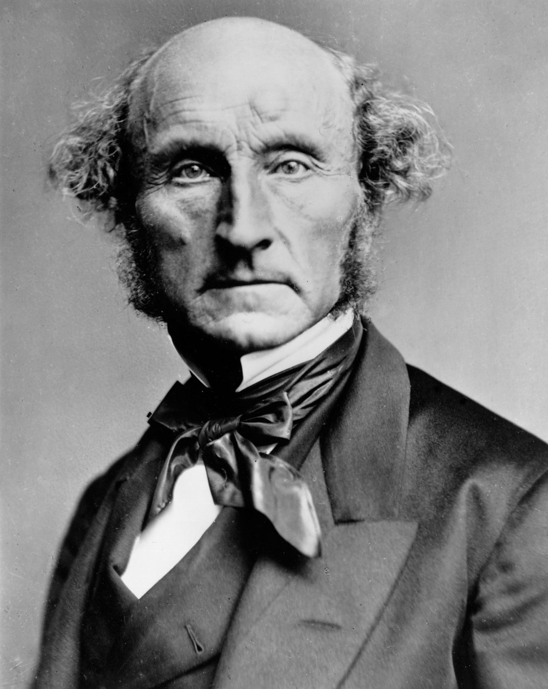
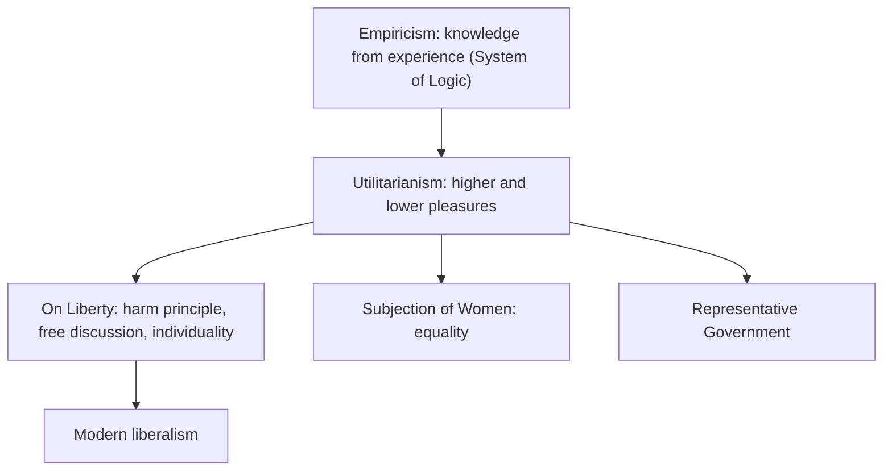

# John Stuart Mill as philosopher

**Prerequisites:** [Utilitarianism and liberalism](../03-utilitarianism-and-liberalism.md); the economics-side profile is [Mill in the history of economic thought](../../../../../economics/microeconomics/10-history-of-thought/thinkers/03-john-stuart-mill.md)

*John Stuart Mill, photographed by the London Stereoscopic Company (c. 1870). Credit: London Stereoscopic Company. License: Public domain. Source: [File:John Stuart Mill by London Stereoscopic Company, c1870.jpg](https://commons.wikimedia.org/wiki/File:John_Stuart_Mill_by_London_Stereoscopic_Company,_c1870.jpg).*

## Life and context

John Stuart Mill (1806–1873) was born in London, eldest son of the philosopher and historian James Mill, a close ally of Jeremy Bentham. His father educated him at home in a famously intense regime: Greek at three, Latin at eight, logic and political economy by thirteen. In 1823 he joined the East India Company, where he worked for 35 years, rising to head of the examiner's office, until the Company's dissolution in 1858. In 1826 he suffered the mental crisis recounted in his *Autobiography* (1873): he asked himself whether achieving all his reforming goals would make him happy, and an irrepressible self-consciousness answered no. Poetry, especially Wordsworth's, helped him recover, and he concluded that the cultivation of feelings matters as much as analysis. In 1830 he met Harriet Taylor, then married; after her husband's death they married in 1851. He described her as a co-author of much of his later work, notably [*On Liberty*](../texts/on-liberty.md). She died in Avignon in 1858, where Mill afterward spent much of his time. He was a Member of Parliament for Westminster (1865–68), where he proposed votes for women. He died in Avignon in 1873.

## Core ideas

**Logic and empiricism.** *A System of Logic* (1843) was the most influential English work on logic and scientific method of its century. Mill held that all knowledge, even of mathematics, rests ultimately on experience and induction. His "methods" of agreement, difference, residues and concomitant variation systematized causal inference, developing [Bacon](../../early-modern/thinkers/francis-bacon.md)'s tables.

**Utilitarianism.** The right action promotes happiness; but pleasures differ in quality, and a competent judge prefers the higher ones. Moral rules are summaries of experience; justice protects the most vital human interests.

**Liberty.** The harm principle: society may coerce individuals only to prevent harm to others. Freedom of thought and discussion is necessary because we may be wrong, because truth often lies between views, and because unchallenged truths become dead dogmas. Individuality, "experiments in living", is an element of well-being. Mill feared social tyranny of opinion more than formal law.

**Representative government.** *Considerations on Representative Government* (1861) defended democracy as educative of citizens' capacities, while worrying about majority tyranny; he supported proportional representation.

**Equality of women.** *The Subjection of Women* (1869) argued that the legal subordination of women was wrong in itself and a hindrance to human improvement, and that we cannot know women's "nature" while it is shaped by subordination.

## Influence and criticism

Mill was the leading English philosopher of the mid-nineteenth century. His *Principles of Political Economy* (1848) was the standard economics text for decades. *On Liberty* remains a foundation of liberal thought. Critics included James Fitzjames Stephen (*Liberty, Equality, Fraternity*, 1873), who argued that society must enforce morality; Frege, who ridiculed his empiricist account of arithmetic; and later critics of his defence of British rule in India as suitable for peoples not yet "civilized", a position he held as a Company official and which postcolonial scholars have examined.

## Key ideas

- All knowledge, including mathematics, rests on experience; Mill systematized inductive methods.
- Happiness is the standard of morality, with qualitative differences among pleasures.
- Liberty may be limited only to prevent harm to others; free discussion and individuality are vital.
- He argued for women's equality and representative democracy.

## Where this leads

- Text: [*On Liberty*](../texts/on-liberty.md)
- Next thinker: [Ralph Waldo Emerson](ralph-waldo-emerson.md)
- Economics: [Mill (economics)](../../../../../economics/microeconomics/10-history-of-thought/thinkers/03-john-stuart-mill.md)
- Forward: [Rawls](../../twentieth-century/thinkers/john-rawls.md), who criticized utilitarianism
- Glossary: [utilitarianism](../../../../glossary/modern/utilitarianism.md), [harm principle](../../../../glossary/modern/harm-principle.md)
