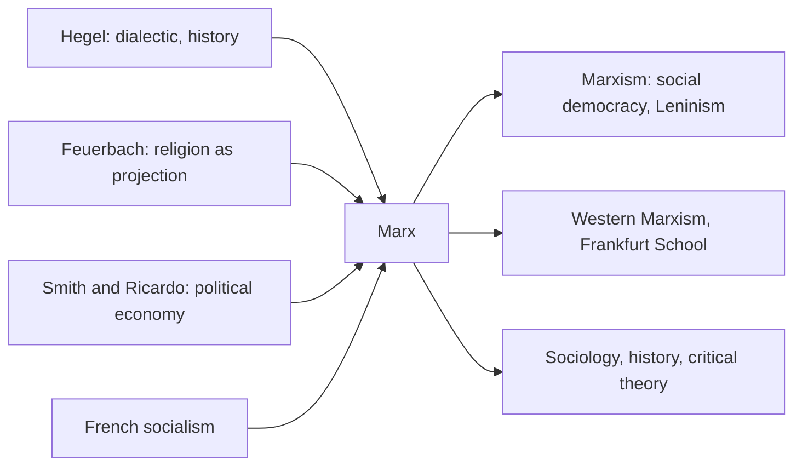

# Karl Marx as philosopher

**Prerequisites:** [Marx and historical materialism](../04-marx-and-historical-materialism.md); the economics-side profile is [Karl Marx in the history of economic thought](../../../../../economics/microeconomics/10-history-of-thought/thinkers/04-karl-marx.md)

@@IMG@@

## Life and context

Karl Marx (1818–1883) was born in Trier, in the Prussian Rhineland, to a family descended from rabbis; his father, a lawyer, converted to Protestantism before Karl's birth, apparently to keep practising law under Prussian restrictions on Jews. He studied law in Bonn and Berlin, where he joined the Young Hegelians, and took a doctorate from Jena in 1841 with a dissertation on the difference between the natural philosophies of [Democritus](../../../ancient/greek/thinkers/democritus-and-leucippus.md) and [Epicurus](../../../ancient/greek/thinkers/epicurus.md). Barred from an academic career by his radicalism, he edited the *Rheinische Zeitung* until the Prussian censors closed it in 1843. He married Jenny von Westphalen and moved to Paris, where he began his lifelong partnership with Friedrich Engels, and then Brussels. With Engels he wrote [*The Communist Manifesto*](../texts/communist-manifesto.md) for the Communist League (1848). After the failed revolutions of 1848–49 he settled in London, where he lived in poverty for years, supported by Engels and by journalism (including as European correspondent for the *New-York Daily Tribune*), researching in the British Museum Reading Room. Several of his children died young. *Capital*, volume 1, appeared in 1867; Engels edited volumes 2 and 3 after Marx's death. He helped lead the International Workingmen's Association (1864–1876). He is buried in Highgate Cemetery, London.

## The philosophical Marx

The economics branch covers Marx's theory of value and capitalism. This page focuses on his philosophy.

**Critique of religion.** Following Feuerbach, Marx held that "man makes religion, religion does not make man". But he wanted to go further: criticism of heaven must become criticism of earth. Religion is "the sigh of the oppressed creature, the heart of a heartless world… the opium of the people".

**Alienation.** In the 1844 *Manuscripts*, human beings are "species-beings" whose nature is free, conscious, creative production in community. Under capitalism labour becomes alienated: from its product, from the activity itself, from human nature and from others.

**Materialism and practice.** The *Theses on Feuerbach* (1845) criticize all previous materialism for treating reality only as an object of contemplation, not as human sensuous activity, practice. Thesis 11: "The philosophers have only interpreted the world, in various ways; the point is to change it."

**Historical materialism.** *The German Ideology* (written 1845–46 with Engels, published 1932) and the 1859 *Preface* outline the theory that modes of production and class struggle drive history, and that the ruling ideas are the ideas of the ruling class.

**Freedom.** Marx's critique presupposes an idea of freedom: the realm of freedom begins where labour determined by necessity ends. Communism would be an association in which the free development of each is the condition for the free development of all (*Manifesto*).

## Influence and criticism

Few thinkers have changed the world as much. Political movements and states claiming his name shaped the twentieth century, including regimes responsible for mass repression. Philosophers debate the relation between the humanist "young Marx" of the *Manuscripts* and the "scientific" Marx of *Capital* (Louis Althusser argued for an "epistemological break"). Critics such as [Popper](../../twentieth-century/thinkers/karl-popper.md) attacked historicism and unfalsifiability; Hayek and Mises argued that socialism could not calculate prices rationally (see [Hayek](../../../../../economics/microeconomics/10-history-of-thought/thinkers/11-friedrich-hayek.md)); [Arendt](../../twentieth-century/thinkers/hannah-arendt.md) criticized his elevation of labour. His concepts of class, ideology and alienation remain widely used.

## Key ideas

- Religion and ideas must be explained from real human conditions; criticism must become practice.
- Alienated labour estranges people from their products, activity, nature and each other.
- History is driven by material production and class struggle.
- Freedom requires overcoming class society: "the free development of each is the condition for the free development of all".

## Where this leads

- Text: [*The Communist Manifesto*](../texts/communist-manifesto.md)
- Next thinker: [John Stuart Mill](john-stuart-mill.md)
- Economics: [Marx (economics)](../../../../../economics/microeconomics/10-history-of-thought/thinkers/04-karl-marx.md)
- Glossary: [alienation](../../../../glossary/modern/alienation.md), [historical materialism](../../../../glossary/modern/historical-materialism.md), [ideology](../../../../glossary/modern/ideology.md)
