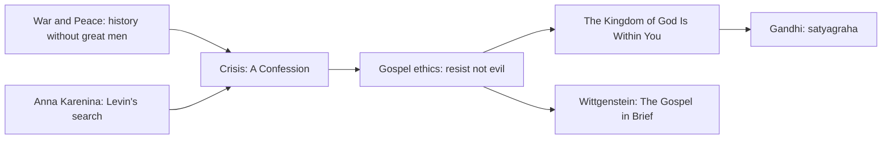

# Leo Tolstoy

**Prerequisites:** [The philosophical novel](../07-the-philosophical-novel.md); helpful: [the Sermon on the Mount](../../../../../religion/abrahamic/christianity/bible/new-testament/stories/03-sermon-on-the-mount.md)

*Tolstoy was primarily a novelist. He appears here because of his philosophy of history, his crisis of meaning and his religious-ethical writings, which shaped non-violent resistance.*

@@IMG@@

## Life and context

Count Lev Nikolayevich Tolstoy (1828–1910) was born at Yasnaya Polyana, his family estate south of Moscow, and orphaned young. He left Kazan University without a degree, lived dissolutely for a time, then served as an army officer in the Caucasus and in the Crimean War, at the siege of Sevastopol, which he described in *Sevastopol Sketches*. He opened schools for peasant children on his estate and wrote on education. In 1862 he married Sophia Behrs, who bore him thirteen children and copied out his manuscripts. He wrote *War and Peace* (1865–69) and *Anna Karenina* (1875–77). Then, around 1879, came the crisis recorded in [*A Confession*](../texts/a-confession.md). He reinterpreted Christianity as an ethical teaching centred on the Sermon on the Mount, rejecting the Church's dogmas, sacraments and miracles, and he advocated non-violence, vegetarianism, chastity and the renunciation of property. He gave up copyrights to his later works, a source of bitter conflict with his wife. The Russian Orthodox Church excommunicated him in 1901. In November 1910, aged 82, he left home secretly and died of pneumonia days later at the railway station of Astapovo.

## Ideas

**Philosophy of history.** *War and Peace* includes essays arguing that history is not made by great men like Napoleon, but by the sum of countless individual actions; the "great man" is a label attached after the fact. Isaiah Berlin's essay *The Hedgehog and the Fox* (1953) explored the tension between Tolstoy's gift for seeing particulars and his longing for a single explanatory principle.

**The meaning of life.** *A Confession* asks: is there any meaning in my life that the inevitable death awaiting me does not destroy? Neither science nor philosophy (including [Schopenhauer](arthur-schopenhauer.md) and [Ecclesiastes](../../../../../religion/abrahamic/christianity/bible/old-testament/books/wisdom-poetry/ecclesiastes.md), which he quotes) gave an answer. He found it first in the faith by which ordinary working people lived.

**Christianity as ethics.** In *What I Believe* (1884) and [*The Kingdom of God Is Within You*](../texts/the-kingdom-of-god-is-within-you.md) (1894), he took Jesus's commandment "resist not evil" (Matthew 5:39) literally: never use violence, even against evildoers. Since the state rests on violence (armies, police, prisons, taxation enforced by force), true Christians must refuse military service, oaths and participation in government. This is often called Christian anarchism.

**Art.** *What Is Art?* (1897) argued that art is the transmission of feeling from artist to audience, and that good art unites people in feelings of brotherhood; he condemned much elite art, including some of his own earlier work.

**Death.** [*The Death of Ivan Ilyich*](../texts/the-death-of-ivan-ilyich.md) (1886) shows a conventional life exposed by mortal illness.

## Influence and criticism

Tolstoy corresponded with Gandhi in 1909–10; Gandhi called *The Kingdom of God Is Within You* overwhelming and named his commune near Johannesburg "Tolstoy Farm". Tolstoyan communities spread internationally. Wittgenstein's reading of Tolstoy's *Gospel in Brief* in 1914 deeply affected him. Critics, including Russian religious philosophers such as Vladimir Solovyov and Ivan Ilyin, argued that absolute non-resistance abandons victims to evil; others found his rejection of the supernatural made his Christianity a moralism. His family conflicts sit uneasily with his ideals, as he himself acknowledged.

## Key ideas

- History is made by the sum of countless individual actions, not by great men.
- Life's meaning must withstand death; Tolstoy found it in faith lived by ordinary people.
- Christianity is an ethic of non-violence and love that rejects the coercive state.
- He influenced Gandhi, non-violent movements and Wittgenstein.

## Where this leads

- Texts: [*A Confession*](../texts/a-confession.md), [*The Kingdom of God Is Within You*](../texts/the-kingdom-of-god-is-within-you.md), [*The Death of Ivan Ilyich*](../texts/the-death-of-ivan-ilyich.md)
- Next thinker: [Friedrich Nietzsche](friedrich-nietzsche.md)
- Related: [Matthew](../../../../../religion/abrahamic/christianity/bible/new-testament/books/gospels/matthew.md) (the Sermon on the Mount)
- Glossary: [non-resistance](../../../../glossary/modern/non-resistance.md)
