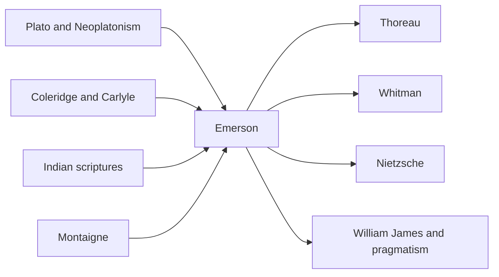

# Ralph Waldo Emerson

**Prerequisites:** [[transcendentalism|American transcendentalism]]

@@IMG@@

## Life and context

Ralph Waldo Emerson (1803–1882) was born in Boston, son of a Unitarian minister who died when Ralph was eight. He studied at Harvard, taught school, and in 1829 became junior pastor of Boston's Second Church. That year he married Ellen Tucker, who died of tuberculosis in 1831, aged nineteen. In 1832 he resigned his pulpit, saying he could no longer administer the Lord's Supper in good conscience. He travelled to Europe, met Coleridge, Wordsworth and Thomas Carlyle (who became a lifelong correspondent), and visited the Jardin des Plantes in Paris, where the classification of natural specimens moved him deeply. He settled in Concord, Massachusetts, remarried, and published *Nature* (1836), the founding document of transcendentalism. His "American Scholar" address (1837), which Oliver Wendell Holmes called America's intellectual Declaration of Independence, and his "Divinity School Address" (1838), which scandalized Harvard, followed. He earned his living as a lecturer, travelling widely in the United States and Britain. His essays were collected in *Essays: First Series* (1841), including [[self-reliance|"Self-Reliance"]] and "The Over-Soul", and *Second Series* (1844). His son Waldo died at five in 1842, the occasion of the essay "Experience". He supported Thoreau, encouraged Whitman, and became a public opponent of slavery. His memory failed in his last decade.

## Core ideas

**Nature and spirit.** Nature is a symbol of spirit; every natural fact corresponds to a spiritual fact. Each person can have an "original relation to the universe".

**The Over-Soul.** Within each person is a universal mind, the same in all, in which we participate. Hence intuition is a source of truth, and each person is potentially great.

**Self-reliance.** Society everywhere is in conspiracy against the manhood of every one of its members; conformity is the vice. "Whoso would be a man must be a nonconformist." Trust your own thought, because "To believe your own thought, to believe that what is true for you in your private heart is true for all men, — that is genius."

**Compensation and the moral law.** The universe has a moral balance; every act rewards or punishes itself.

**Experience and skepticism.** Later essays ("Experience", "Fate", "Montaigne; or, the Skeptic") are more somber, acknowledging illusion, temperament and limitation, and admiring Montaigne's honesty.

## Influence and criticism

Emerson shaped American literature and thought: Thoreau, Whitman, Emily Dickinson, William James and the pragmatists. [[friedrich-nietzsche|Nietzsche]] read him repeatedly and annotated his essays. Stanley Cavell revived him as a serious philosopher of "moral perfectionism". Critics fault his optimism as blind to evil and suffering, his individualism as antisocial, and his style as aphoristic rather than argued. Melville and Hawthorne were sceptical; later historians debate his early views on race and his eventual abolitionism.

## Key ideas

- Nature symbolizes spirit; each person can have an original relation to the universe.
- A universal Over-Soul in each person grounds intuition and self-trust.
- Self-reliance and nonconformity are the conditions of genuine thought and life.
- His later essays temper optimism with experience and skepticism.

## Where this leads

- Text: [[self-reliance|"Self-Reliance"]]
- Next thinker: [[henry-david-thoreau|Henry David Thoreau]]
- Forward: [[friedrich-nietzsche|Nietzsche]]
- Back: [[michel-de-montaigne|Montaigne]], [[gk:plotinus.md|Plotinus]]
- Glossary: [[g:transcendentalism|transcendentalism]]
