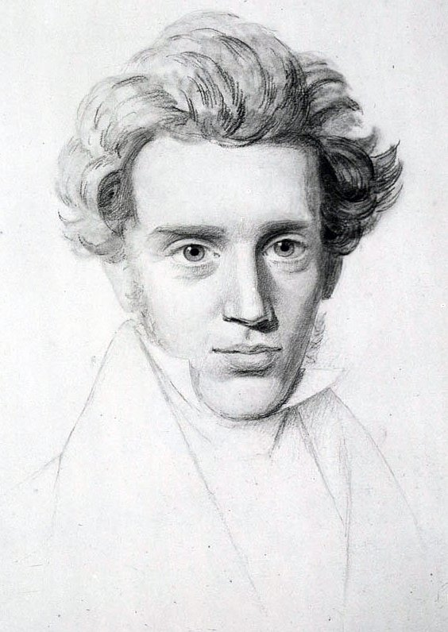

# Søren Kierkegaard

**Prerequisites:** [Existential beginnings](../06-existential-beginnings.md)

*Unfinished sketch of Søren Kierkegaard by his cousin Niels Christian Kierkegaard (c. 1840). Credit: La Biblioteca Real de Dinamarca. License: Public domain. Source: [File:Søren Kierkegaard (1813-1855) - (cropped).jpg](https://commons.wikimedia.org/wiki/File:Søren_Kierkegaard_(1813-1855)_-_(cropped).jpg).*

## Life and context

Søren Aabye Kierkegaard (1813–1855) was born in Copenhagen, the youngest of seven children of a wealthy, melancholy, deeply religious hosier, Michael Pedersen Kierkegaard. Five of the siblings and his mother died before he was 21, which his father seems to have taken as divine punishment. Kierkegaard studied theology at the University of Copenhagen and wrote a dissertation *On the Concept of Irony with Continual Reference to Socrates* (1841). In 1840 he became engaged to Regine Olsen and broke the engagement a year later, an event that haunted him and his writing. Living on his inheritance, he produced an enormous body of work between 1843 and 1855, much of it under pseudonyms (Johannes de Silentio, Johannes Climacus, Victor Eremita, Anti-Climacus). He was mocked in the satirical paper *The Corsair* in 1846, an experience that deepened his critique of "the public". In his last year he launched a ferocious attack on the Danish established church for comfortable "Christendom" that had nothing to do with New Testament Christianity. He collapsed in the street and died at 42.

## Indirect communication

Kierkegaard believed that existential truth cannot be transmitted like information. A teacher can only, like Socrates, help the learner discover it for themselves. His pseudonymous works each present a viewpoint from inside, so that readers confront choices rather than receiving doctrines. Reading him means paying attention to which pseudonym is speaking.

## Core ideas

**The stages of existence.** Aesthetic (living for the interesting moment), ethical (committing to universal duty) and religious (relation to God as an individual). *Either/Or* (1843) contrasts the first two; *Stages on Life's Way* (1845) all three.

**Faith and the teleological suspension of the ethical.** [*Fear and Trembling*](../texts/fear-and-trembling.md) (1843) asks whether Abraham, willing to sacrifice Isaac at God's command, is a murderer or the father of faith. If faith is real, the individual can stand in an absolute relation to God above the universal ethical.

**Truth is subjectivity.** In the *Concluding Unscientific Postscript* (1846), Climacus argues that objective approaches to Christianity (historical scholarship, speculative systems) miss the point; what matters is the individual's passionate appropriation.

**The absurd and paradox.** The eternal God existing in time as a human being is a paradox to reason (*Philosophical Fragments*, 1844). Faith holds to it against understanding.

**Anxiety and despair.** Anxiety is the "dizziness of freedom" (*The Concept of Anxiety*, 1844). Despair, "the sickness unto death" (1849), is failing to be oneself before God.

**Works of Love.** Under his own name he published many "upbuilding discourses" and *Works of Love* (1847), on the commandment to love the neighbour.

## Influence and criticism

Little read outside Denmark until the early twentieth century, Kierkegaard then shaped dialectical theology (Karl Barth), existentialism ([Heidegger](../../twentieth-century/thinkers/martin-heidegger.md), Jaspers, [Sartre](../../twentieth-century/thinkers/jean-paul-sartre.md), [Camus](../../twentieth-century/thinkers/albert-camus.md), who criticized his leap as "philosophical suicide"), [Wittgenstein](../../twentieth-century/thinkers/ludwig-wittgenstein.md) (who called him by far the most profound thinker of the nineteenth century) and modern psychology. Critics accuse him of irrationalism and of an individualism that neglects social and political life; others find in *Works of Love* a profound social ethic.

## Key ideas

- Existential truth must be appropriated by the individual; hence indirect communication and pseudonyms.
- Life can be lived in aesthetic, ethical and religious spheres.
- Faith is a passionate leap beyond reason, potentially above the universal ethical.
- Anxiety and despair reveal the self's freedom and its relation to God.

## Where this leads

- Text: [*Fear and Trembling*](../texts/fear-and-trembling.md)
- Next thinker: [Karl Marx](karl-marx.md)
- Forward: [Existentialism](../../twentieth-century/03-existentialism.md), [Camus](../../twentieth-century/thinkers/albert-camus.md)
- Glossary: [leap of faith](../../../../glossary/modern/leap-of-faith.md), [anxiety](../../../../glossary/modern/anxiety.md), [teleological suspension of the ethical](../../../../glossary/modern/teleological-suspension-of-the-ethical.md)
- Related: [The binding of Isaac](../../../../../religion/abrahamic/christianity/bible/old-testament/stories/01-the-binding-of-isaac.md)
