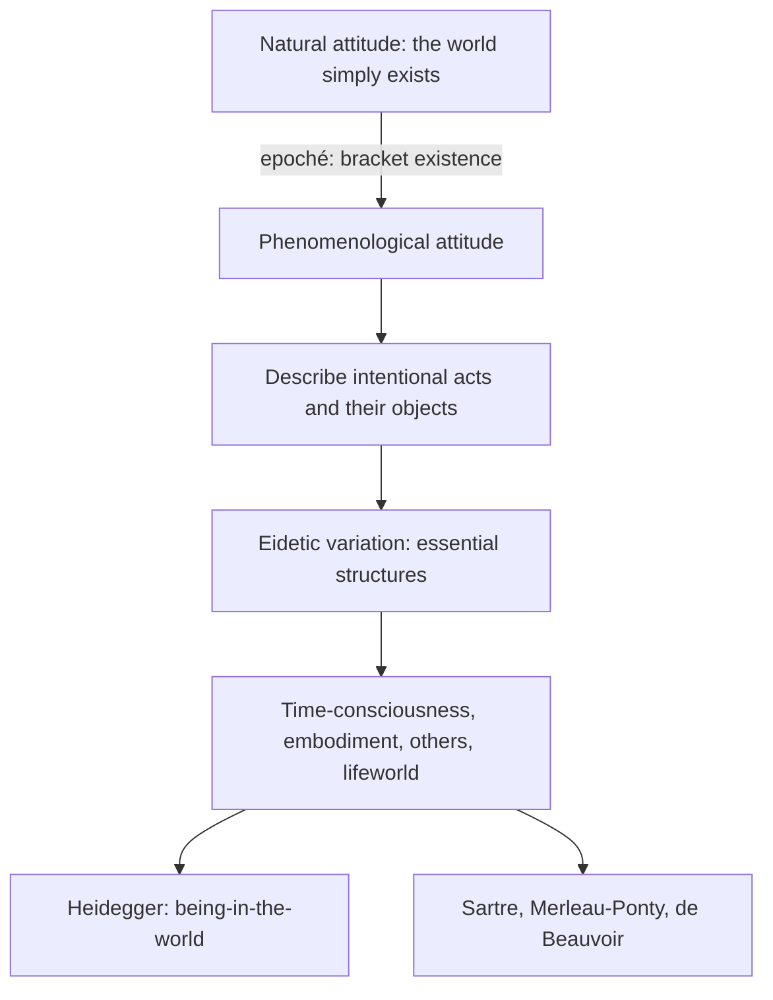

# Phenomenology: back to the things themselves

**Prerequisites:** [Kant's Copernican revolution](../early-modern/07-kants-copernican-revolution.md), [Descartes](../early-modern/thinkers/rene-descartes.md); helpful: [skepticism and epoché](../../../concepts/epistemology/skepticism-and-epoche.md)

@@IMG@@

## The problem

By 1900 philosophy seemed squeezed. The natural sciences explained more and more, and a popular view, **psychologism**, held that even logic and mathematics were just facts about how human brains happen to work. If that were true, the laws of logic would be no more necessary than the laws of digestion. Meanwhile, the grand idealist systems had lost credibility. Was there anything left for philosophy to do that science could not?

[Edmund Husserl](thinkers/edmund-husserl.md) (1859–1938), a mathematician turned philosopher, answered yes. Before any science, before any theory about brains or atoms, there is experience itself: the way things show up for us, as perceived, remembered, imagined, valued, meant. That field can be described rigorously, and its structures are not empirical facts about particular brains but essential features of any consciousness. The method for describing it is **phenomenology** (from Greek *phainomenon*, "what appears"). Its slogan: "back to the things themselves" (*zu den Sachen selbst*).

## Basic tools

**[Intentionality](../../../glossary/modern/intentionality.md).** Consciousness is always consciousness *of* something. You do not just see; you see a cup. You do not just fear; you fear the dog. Husserl took this idea from his teacher Franz Brentano and made it central. Every act of consciousness has a structure: the act (perceiving, remembering, judging) and its object as intended (the cup as seen from here, with its back side hidden but co-meant).

**The epoché.** To study experience as such, Husserl asks us to "bracket" the natural attitude, our everyday assumption that the world exists independently, without denying it. We suspend judgment about existence in order to attend to how things are given. The term deliberately echoes ancient skepticism's [epoché](../../../concepts/epistemology/skepticism-and-epoche.md), but the aim is description, not doubt.

**Eidetic variation.** To find the essence of, say, perceiving a physical thing, imagine varying it freely; what cannot be varied without the experience ceasing to be that kind of experience is its essence. (A physical thing must always show itself in profiles, one side at a time.)

**The lifeworld.** In his late work *The Crisis of European Sciences* (1936), Husserl argued that the mathematical sciences, since Galileo, had forgotten their roots in the **[lifeworld](../../../glossary/modern/lifeworld.md)** (*Lebenswelt*), the world of everyday experience from which all their abstractions begin.

## Heidegger's transformation

Husserl's assistant [Martin Heidegger](thinkers/martin-heidegger.md) (1889–1976) turned phenomenology from consciousness to existence. In [*Being and Time*](texts/being-and-time.md) (1927) he argued that we are not primarily minds observing objects but "being-in-the-world": already engaged, using tools, caring about things, with moods that disclose our situation. A hammer shows up first as something to hammer with, "ready-to-hand", and only when it breaks as a mere object with properties, "present-at-hand". The Cartesian picture of a subject facing objects is derivative. Heidegger's guiding question was the meaning of Being itself, which he thought philosophy since Plato had forgotten.

## Spread

Phenomenology spread to France in the 1930s. [Sartre](thinkers/jean-paul-sartre.md) heard about it from Raymond Aron over apricot cocktails, according to [de Beauvoir](thinkers/simone-de-beauvoir.md)'s memoir, and went to Berlin to study Husserl. Maurice Merleau-Ponty's *Phenomenology of Perception* (1945) centred the lived body. Emmanuel Levinas made the face of the other the starting point of ethics. Edith Stein, Husserl's assistant, wrote on empathy, converted to Catholicism, became a Carmelite nun, and was murdered at Auschwitz in 1942.

## Criticisms

Analytic philosophers doubted that introspective description could reach essential truths, and logical positivists dismissed Heidegger's language as meaningless (Rudolf Carnap's famous attack on "the nothing nothings"). Others asked whether the epoché is possible or whether consciousness can be described without already interpreting it. Today, phenomenology informs cognitive science ("embodied cognition"), nursing, psychiatry and qualitative research.

## Key ideas

- Phenomenology describes how things appear in experience, prior to scientific theory.
- Consciousness is intentional: always of something.
- Husserl's epoché brackets existence to reveal the structures of experience.
- Heidegger reframed phenomenology as the analysis of being-in-the-world and the question of Being.

## Where this leads

- Next: [The analytic turn](02-analytic-turn.md)
- Thinkers: [Husserl](thinkers/edmund-husserl.md), [Heidegger](thinkers/martin-heidegger.md)
- Text: [*Being and Time*](texts/being-and-time.md)
- Forward: [Existentialism](03-existentialism.md)
- Glossary: [phenomenology](../../../glossary/modern/phenomenology.md), [Dasein](../../../glossary/modern/dasein.md)
