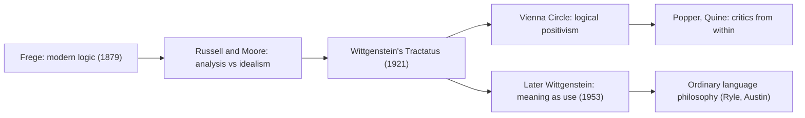

# The analytic turn: logic and language

**Prerequisites:** [[empiricism|Empiricism]], [[kants-copernican-revolution|Kant]]; [[g:logic|logic]], [[c:logic/syllogism-and-the-organon.md|the syllogism]]

@@IMG@@

## A new tool

For over two thousand years, logic largely meant Aristotle's [[c:logic/syllogism-and-the-organon.md|syllogistic]]. It handled "All men are mortal; Socrates is a man; so Socrates is mortal", but struggled with relations ("everyone loves someone") and with mathematics. In 1879 the German mathematician Gottlob Frege published the *Begriffsschrift* ("concept-script"), a formal language with quantifiers ("for all x", "there is an x") and functions that could express any mathematical reasoning. It was the biggest advance in logic since Aristotle.

With the new logic came a new idea of what philosophy is. Many philosophical problems, the analytic philosophers suspected, arise because ordinary grammar misleads us about logical form. Analyse the sentence correctly, and the problem may dissolve. This "linguistic turn" made the philosophy of language central.

## Russell: the logical form beneath grammar

[[bertrand-russell|Bertrand Russell]] (1872–1970) and G. E. Moore (1873–1958), young Cambridge philosophers, revolted around 1898 against the British idealism of F. H. Bradley, which held that reality is a single whole and relations are unreal. Russell's 1905 paper "On Denoting" became the paradigm of analysis. Consider "The present King of France is bald." France has no king, so is the sentence true or false, and what is it about? Russell showed that its logical form is: there is exactly one thing that is presently King of France, and that thing is bald. It is simply false, and no mysterious non-existent king is needed.

Russell and Alfred North Whitehead tried in *Principia Mathematica* (1910–13) to derive mathematics from logic (logicism). Russell had discovered in 1901 a paradox in Frege's system (the set of all sets that are not members of themselves), which forced complex repairs.

## Wittgenstein: two philosophies

[[ludwig-wittgenstein|Ludwig Wittgenstein]] (1889–1951), Russell's student, wrote the [[tractatus-logico-philosophicus|*Tractatus Logico-Philosophicus*]] (1921): the world is the totality of facts; a sentence pictures a possible fact; logic shows the structure of all possible pictures; what cannot be said (ethics, aesthetics, the mystical) can only be shown. "Whereof one cannot speak, thereof one must be silent." Later, in the [[philosophical-investigations|*Philosophical Investigations*]] (1953), he rejected his own picture theory: meaning is use; words get their sense from "language-games" embedded in forms of life; philosophical problems arise "when language goes on holiday".

## Logical positivism

In the 1920s the **Vienna Circle** (Moritz Schlick, Rudolf Carnap, Otto Neurath and others), inspired by the *Tractatus*, science and [[david-hume|Hume]], proposed the **verification principle**: a statement is meaningful only if it is either true by logic and definition or verifiable in principle by experience. Metaphysics, theology and ethics, they concluded, are literally meaningless: expressions of feeling, not claims. A. J. Ayer's *Language, Truth and Logic* (1936) brought the doctrine to English readers. Its difficulties soon showed: the principle itself seems neither logically true nor empirically verifiable. [[karl-popper|Popper]] proposed falsifiability as a criterion for science, not meaning. W. V. O. Quine's "Two Dogmas of Empiricism" (1951) attacked the analytic–synthetic distinction itself.

## Ordinary language

After the war, Oxford philosophers including Gilbert Ryle and J. L. Austin, influenced partly by later Wittgenstein, studied the subtle distinctions of ordinary language. Ryle's *The Concept of Mind* (1949) attacked Cartesian dualism as "the ghost in the machine"; Austin's *How to Do Things with Words* (1962) showed that some utterances ("I promise") perform acts rather than describe facts.

## What came of it

Analytic philosophy became the dominant style in English-speaking universities, valued for clarity and rigour. From the 1960s it returned to metaphysics, ethics and politics ([[john-rawls|Rawls]]) with its tools. Critics argue it can become technical hair-splitting cut off from the questions that drew people to philosophy, the same charge the humanists made against [[scholasticism|scholasticism]].

## Key ideas

- Frege's new logic made it possible to analyse the logical form behind grammar.
- Russell's theory of descriptions became the model of philosophical analysis.
- Early Wittgenstein: language pictures facts; later Wittgenstein: meaning is use in language-games.
- Logical positivism declared unverifiable statements meaningless, and was undone by its own criterion.

## Where this leads

- Next: [[existentialism|Existentialism]]
- Thinkers: [[bertrand-russell|Russell]], [[ludwig-wittgenstein|Wittgenstein]]
- Texts: [[the-problems-of-philosophy|*The Problems of Philosophy*]], [[tractatus-logico-philosophicus|*Tractatus*]], [[philosophical-investigations|*Investigations*]]
- Forward: [[philosophy-of-science|Philosophy of science]]; [[analytic-and-continental|Analytic and continental]]
- Glossary: [[g:logical-positivism|logical positivism]], [[g:language-game|language-game]]
