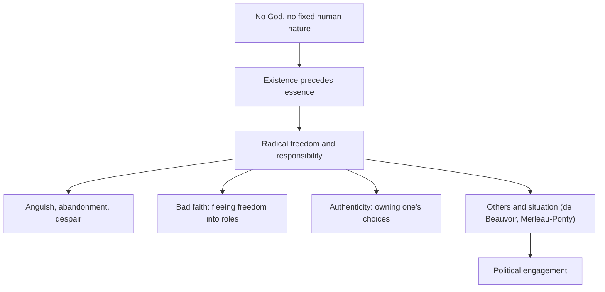

# Existentialism: existence precedes essence

**Prerequisites:** [[existential-beginnings|Existential beginnings]], [[phenomenology|Phenomenology]], [[nietzsche-and-the-death-of-god|Nietzsche and the death of God]]

@@IMG@@

## From first principles: what is a person "for"?

A paper knife is made by a craftsman who first had an idea of what a paper knife is for. Its essence, its purpose and definition, comes before its existence. For centuries, many people thought of human beings the same way: God, the craftsman, had an idea of human nature, and each of us realizes it. Even atheist philosophers of the Enlightenment, [[jean-paul-sartre|Sartre]] argued, kept the idea of a fixed human nature.

Existentialism, in Sartre's formula, reverses this: for human beings, **existence precedes essence**. We first exist, find ourselves in the world, and only afterwards define ourselves by what we do. There is no human nature given in advance, because there is no God to conceive it. "Man is nothing else but what he makes of himself" ([[existentialism-is-a-humanism|*Existentialism Is a Humanism*]], 1945, a popular lecture Sartre later partly regretted).

The word "existentialism" was coined in the 1940s and attached to Sartre, [[simone-de-beauvoir|Simone de Beauvoir]], [[albert-camus|Albert Camus]] (who rejected it), Maurice Merleau-Ponty and others, with Kierkegaard, Dostoevsky, Nietzsche, Jaspers and [[martin-heidegger|Heidegger]] (who also rejected it) named as forerunners. It became a cultural phenomenon in postwar Paris: cafés of Saint-Germain-des-Prés, novels, plays, jazz.

## Core themes

**Freedom and responsibility.** We are "condemned to be free": we did not choose to exist, but once thrown into the world, we are responsible for everything we do. Not choosing is also a choice. And in choosing for myself, Sartre claimed, I choose an image of what a human being should be, so I am responsible for all.

**Anguish, abandonment, despair.** Anguish is the feeling of that responsibility; abandonment is the realization that there is no God and no fixed values to lean on; despair is acting without guarantees that things will turn out as we hope.

**[[g:bad-faith|Bad faith]].** We flee freedom by pretending we are things with fixed natures. Sartre's examples in [[being-and-nothingness|*Being and Nothingness*]] (1943): a café waiter who plays at being a waiter with exaggerated precision, as if he were nothing but a waiter; a woman on a date who leaves her hand in a man's hand while pretending not to notice, treating it as a thing.

**[[g:authenticity|Authenticity]].** Living with a lucid acceptance of one's freedom and situation, rather than hiding in roles or the anonymous "they" (Heidegger's *das Man*).

**The Other.** Being looked at reveals me as an object for another freedom ("the look"). In Sartre's play *No Exit* (1944) a character says, "Hell is other people", often misread as misanthropy; Sartre said he meant that our relations with others become hellish when we depend entirely on their judgments.

**Situation and embodiment.** De Beauvoir and Merleau-Ponty insisted, more than early Sartre, that freedom is always situated: in a body, a history, a sex, a class. In *The Ethics of Ambiguity* (1947) de Beauvoir argued that my freedom requires willing the freedom of others. In [[the-second-sex|*The Second Sex*]] (1949) she applied existentialist ideas to women: "One is not born, but rather becomes, a woman."

## Politics

Postwar existentialists believed writers must be "engaged". Sartre moved toward Marxism and defended the Soviet Union for years, breaking with Camus in 1952 over Camus's critique of revolutionary violence in *The Rebel*. Both opposed colonial rule in Algeria in different ways. De Beauvoir became a founding figure of second-wave feminism.

## Religious existentialism

Existentialist themes were not confined to atheists. Gabriel Marcel, a Catholic, wrote on presence, fidelity and hope; Karl Jaspers on "limit situations" and transcendence; theologians such as Paul Tillich and Rudolf Bultmann drew on Heidegger. [[soren-kierkegaard|Kierkegaard]], the great forerunner, was a Christian.

## Criticisms

Critics argued that radical freedom ignores the weight of biology, society and the unconscious (structuralists and psychoanalysts); that "choose your values" gives no guidance (if choice creates value, why is any choice better?); and that Sartre's own ethics was never completed. Heidegger, in his "Letter on Humanism" (1947), rejected Sartre's reading of him. Still, existentialism's insistence on responsibility, authenticity and the lived situation shaped psychotherapy, literature and popular thought.

## Key ideas

- Existence precedes essence: humans define themselves through action, not a given nature.
- We are condemned to be free and responsible; bad faith is the flight from freedom.
- De Beauvoir and Merleau-Ponty stressed situation, embodiment and others' freedom.
- Existentialism had atheist and religious forms and a strong political dimension.

## Where this leads

- Next: [[the-absurd|The absurd: Camus]]
- Thinkers: [[jean-paul-sartre|Sartre]], [[simone-de-beauvoir|de Beauvoir]]
- Texts: [[being-and-nothingness|*Being and Nothingness*]], [[existentialism-is-a-humanism|*Existentialism Is a Humanism*]], [[the-second-sex|*The Second Sex*]]
- Glossary: [[g:existence-precedes-essence|existence precedes essence]], [[g:bad-faith|bad faith]]
