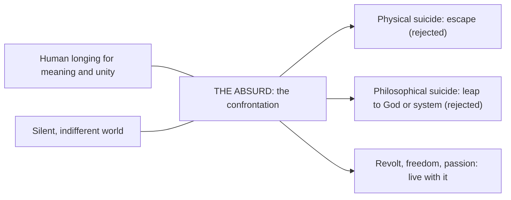

# The absurd: Camus and the question of suicide

**Prerequisites:** [Existentialism](03-existentialism.md); helpful: [Tolstoy's *A Confession*](../nineteenth-century/texts/a-confession.md), [Ecclesiastes](../../../../religion/abrahamic/christianity/bible/old-testament/books/wisdom-poetry/ecclesiastes.md)

@@IMG@@

## The first question

[*The Myth of Sisyphus*](texts/the-myth-of-sisyphus.md) (1942) begins: "There is but one truly serious philosophical problem, and that is suicide. Judging whether life is or is not worth living amounts to answering the fundamental question of philosophy." Everything else, whether the world has three dimensions or the mind nine or twelve categories, comes afterwards. [Albert Camus](thinkers/albert-camus.md) (1913–1960) asks whether, if life has no ultimate meaning, it is still worth living, and answers yes.

## What "absurd" means

Camus uses "absurd" precisely. It is not a property of the world alone or of humans alone, but of their **confrontation**. On one side, the human mind longs for clarity, unity and meaning: it wants the world to make sense, and it wants to live forever. On the other side, the world is silent, opaque and indifferent; it gives no answer. The absurd is born of this confrontation between the human need and the unreasonable silence of the world.

People often meet it suddenly. "Rising, streetcar, four hours in the office or the factory, meal, streetcar, four hours of work, meal, sleep" and the same rhythm Monday through Saturday; then one day the "why" arises. Or a person realizes that they belong to time, that tomorrow, which they long for, brings death closer.

## Two escapes rejected

**Physical suicide** settles the absurd by eliminating one of its terms, the human. It is a confession that life is too much. Camus rejects it.

**Philosophical suicide** settles the absurd by eliminating the other term, by leaping to a meaning beyond reason. Camus examines existential thinkers (Jaspers, Shestov, [Kierkegaard](../nineteenth-century/thinkers/soren-kierkegaard.md), Husserl) and argues that at the decisive moment each makes a leap: Kierkegaard's faith "by virtue of the absurd" turns the absurd into a sign of God. For Camus this is an evasion; one must keep the absurd alive, not resolve it.

## Living with the absurd

What remains is to live lucidly without appeal. Camus draws three consequences: **revolt** (a constant refusal to accept either false hope or resignation), **freedom** (with no eternal tomorrow, I am freed from the rules that a future would impose) and **passion** (living as much as possible, a quantity of lucid experiences). His figures of absurd life include Don Juan, the actor, the conqueror and the artist.

The final image is Sisyphus, condemned by the gods to roll a rock up a mountain forever. Camus is interested in the moment Sisyphus walks back down. Conscious of his fate and refusing to be crushed by it, he is superior to it. "The struggle itself toward the heights is enough to fill a man's heart. One must imagine Sisyphus happy."

## From revolt to limits

During the war, Camus edited the Resistance newspaper *Combat*. His later work moved from the individual to the collective. *The Plague* (1947) depicts solidarity against an absurd evil. *The Rebel* (1951) argued that genuine revolt affirms a shared human dignity ("I rebel, therefore we exist") and therefore sets limits; revolutions that justify murder in the name of history betray revolt. This led to his public break with [Sartre](thinkers/jean-paul-sartre.md).

## Camus and existentialism

Camus repeatedly denied being an existentialist. He did not accept Sartre's "existence precedes essence", and he thought there is a human nature, revealed in revolt. He also called himself not a philosopher but an artist. His novel *The Stranger* (1942) is the literary companion of *Sisyphus*.

## Criticisms

Philosophers have objected that the "absurd" depends on a demand for meaning that one could simply give up, or that it presupposes the very rational order it denies. Religious critics argue that rejecting the leap is itself a choice of faith. Others find his rejection of suicide asserted more than argued. Camus's readers continue to value his combination of lucidity, moderation and refusal of murder.

## Key ideas

- The absurd is the confrontation between the human need for meaning and the world's silence.
- Neither physical suicide nor the "leap" of faith is an honest response.
- Lucid revolt, freedom and passion make life worth living; one must imagine Sisyphus happy.
- Camus's later ethics of revolt sets limits on violence, against revolutionary absolutism.

## Where this leads

- Next: [Psychoanalysis and depth psychology](05-psychoanalysis-and-depth-psychology.md)
- Thinker: [Albert Camus](thinkers/albert-camus.md); text: [*The Myth of Sisyphus*](texts/the-myth-of-sisyphus.md)
- Back: [*The Brothers Karamazov*](../nineteenth-century/texts/the-brothers-karamazov.md) (Ivan, Kirillov)
- Glossary: [the absurd](../../../glossary/modern/the-absurd.md)
