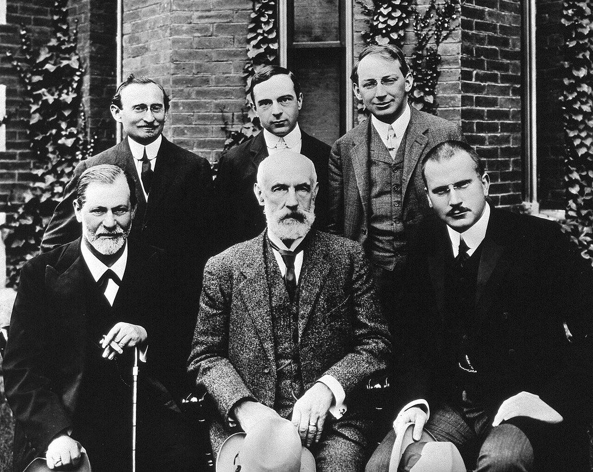
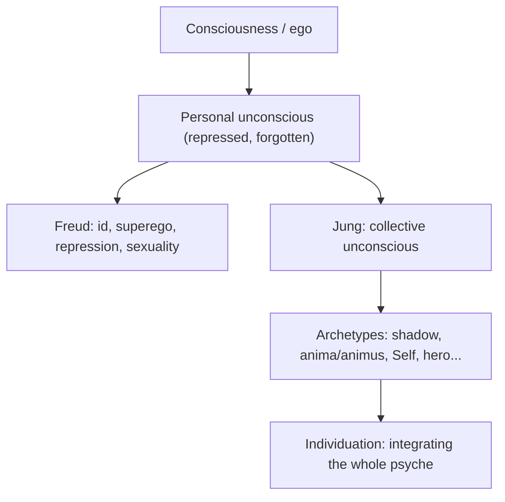

# Psychoanalysis and depth psychology: the unconscious mind

**Prerequisites:** [Schopenhauer: pessimism and the will](../nineteenth-century/02-pessimism-and-the-will.md), [Nietzsche](../nineteenth-century/08-nietzsche-and-the-death-of-god.md); [mind](../../../glossary/general/mind.md), [soul](../../../glossary/general/soul.md)

*Freud and Jung were physicians and psychologists, not philosophers by training. They appear in this branch because their theories of the unconscious changed how philosophers, theologians and critics think about the self, morality, religion and culture.*

*Freud, G. Stanley Hall and Jung (front row) with Brill, Jones and Ferenczi at Clark University, Worcester, Massachusetts (1909). Credit: Unknown authorUnknown author. License: Public domain. Source: [File:Hall Freud Jung in front of Clark 1909.jpg](https://commons.wikimedia.org/wiki/File:Hall_Freud_Jung_in_front_of_Clark_1909.jpg).*

## The assumption they challenged

[Descartes](../early-modern/thinkers/rene-descartes.md) treated the mind as transparent to itself: whatever I think, I can know I think. Much of modern philosophy assumed that conscious reasons are the real reasons for what we do. But ordinary experience is full of counterexamples: slips of the tongue, forgotten names, dreams, irrational fears, compulsions, the way we sometimes discover what we felt only long afterwards. Philosophers including [Schopenhauer](../nineteenth-century/thinkers/arthur-schopenhauer.md) (the blind will beneath intellect) and [Nietzsche](../nineteenth-century/thinkers/friedrich-nietzsche.md) (consciousness as the surface of drives) had already suggested that conscious reasoning is often a servant or mask of deeper forces.

**Depth psychology** turned this suggestion into clinical theory and practice: the claim that much of mental life is **[unconscious](../../../glossary/modern/unconscious.md)** in a dynamic sense, actively kept out of awareness, and that it shapes behaviour, symptoms and culture.

## Freud: psychoanalysis

[Sigmund Freud](thinkers/sigmund-freud.md) (1856–1939), a Viennese neurologist, developed psychoanalysis from work with patients suffering from "hysteria" (physical symptoms without organic cause). Patients improved when they were encouraged to talk freely ("free association") and recovered painful memories and wishes.

- **Repression.** Wishes and memories unacceptable to the conscious self are pushed out of awareness but remain active and return in disguised form: symptoms, dreams, slips. See [*The Interpretation of Dreams*](texts/the-interpretation-of-dreams.md) (1899): a dream is the disguised fulfilment of a repressed wish.
- **Sexuality and development.** Freud traced adult neuroses to childhood sexual development, including the Oedipus complex, the child's rivalry with one parent for the other.
- **The structural model.** In *The Ego and the Id* (1923): the **id** (drives), the **ego** (the organizing self that deals with reality) and the **superego** (internalized parental and social authority, conscience). As he later put it in the *New Introductory Lectures* (1933), the poor ego "serves three severe masters": the external world, the superego and the id.
- **Drives.** Later Freud posited two basic drives: Eros (life, binding) and a death drive (aggression, undoing).
- **Culture and religion.** *The Future of an Illusion* (1927) argued religion is wish-fulfilment rooted in infantile helplessness; [*Civilization and Its Discontents*](texts/civilization-and-its-discontents.md) (1930) that civilization demands renunciation of instincts and produces guilt.

## Jung: analytical psychology

[Carl Gustav Jung](thinkers/carl-jung.md) (1875–1961), a Swiss psychiatrist, was Freud's closest collaborator from 1907 and designated heir, until they broke in 1912–13, partly over Jung's broader view of libido as general psychic energy and his interest in religion and myth.

- **The collective unconscious.** Beneath the personal unconscious lies a layer shared by all humans, inherited, containing **[archetypes](../../../glossary/modern/archetype.md)**: universal patterns such as the mother, the hero, the wise old man, the trickster, the child. They show up in myths, religions, dreams and fantasies across cultures. See [*The Archetypes and the Collective Unconscious*](texts/archetypes-and-the-collective-unconscious.md).
- **The [shadow](../../../glossary/modern/shadow.md).** The rejected, unacknowledged side of the personality, which we often project onto others.
- **Persona, anima/animus, Self.** The social mask; the contrasexual image in the psyche; the archetype of wholeness.
- **[Individuation](../../../glossary/modern/individuation.md).** The lifelong process of integrating conscious and unconscious, becoming a whole person; often the task of life's second half.
- **Psychological types.** Introversion and extraversion (his terms), and four functions: thinking, feeling, sensation, intuition.

## Why philosophers care

Psychoanalysis challenged the self-transparency of reason, offered genealogies of morality and religion that parallel Nietzsche's, and shaped twentieth-century thought: the Frankfurt School combined Freud with Marx; Paul Ricœur called Marx, Nietzsche and Freud the "masters of suspicion"; Jacques Lacan reread Freud through structural linguistics; [Girard](thinkers/rene-girard.md) criticized Freud's Oedipus theory while drawing on *Totem and Taboo*. Jung influenced religious studies, literary criticism (archetypal criticism), the study of myth (Joseph Campbell) and popular psychology.

## Criticisms

[Karl Popper](thinkers/karl-popper.md) took psychoanalysis as a prime example of an unfalsifiable theory: any behaviour can be explained after the fact. Adolf Grünbaum argued, more specifically, that its clinical evidence is contaminated by suggestion. Research has supported some broad ideas (unconscious processes, defence mechanisms) more than specific theories (the Oedipus complex). Jung's archetypes are criticized as unfalsifiable and his inheritance claims as biologically unsupported; his statements about "Jewish psychology" in the 1930s and his role in a Nazi-aligned psychotherapy society have been examined critically, with scholars divided on how to judge them.

## Key ideas

- Depth psychology holds that much of mental life is dynamically unconscious and shapes behaviour and culture.
- Freud: repression, sexuality, id/ego/superego, religion as illusion, civilization's demand for renunciation.
- Jung: the collective unconscious, archetypes, the shadow and individuation.
- Both influenced philosophy deeply, and both face serious questions about scientific testability.

## Where this leads

- Next: [Philosophy of science: Popper and Kuhn](06-philosophy-of-science.md)
- Thinkers: [Sigmund Freud](thinkers/sigmund-freud.md), [Carl Jung](thinkers/carl-jung.md)
- Texts: [*The Interpretation of Dreams*](texts/the-interpretation-of-dreams.md), [*Civilization and Its Discontents*](texts/civilization-and-its-discontents.md), [*The Archetypes and the Collective Unconscious*](texts/archetypes-and-the-collective-unconscious.md)
- Related: [heuristics and biases](../../../../economics/microeconomics/09-behavioural-economics/03-heuristics-and-biases.md), a modern experimental cousin
