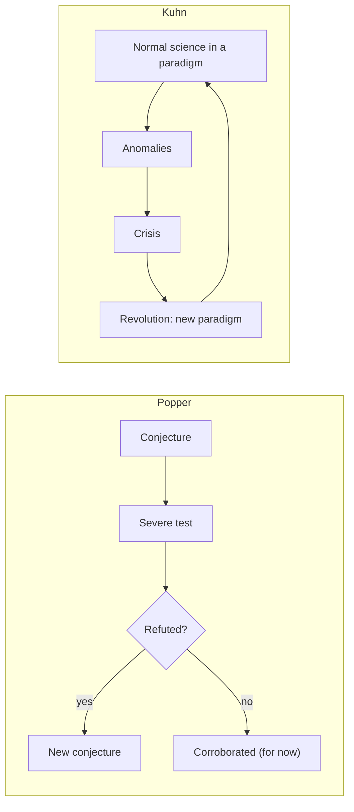

# Philosophy of science: Popper and Kuhn

**Prerequisites:** [[scientific-revolution-and-method|The scientific revolution]], [[empiricism|Empiricism]] (Hume on induction), [[analytic-turn|The analytic turn]]

@@IMG@@

## What makes science science?

Astronomy and astrology both make claims about the heavens. Chemistry and alchemy both study substances. Some theories seem scientific, others not. What is the difference? This is the **demarcation problem**. And a second question: how does science actually change? By steady accumulation, or by revolutions?

The logical positivists answered the first question with **verification**: a scientific statement is one that experience can confirm. But [[david-hume|Hume]] had shown that no number of observations can prove a universal law: a thousand white swans do not prove "all swans are white". That is the [[g:problem-of-induction|problem of induction]].

## Popper: conjecture and refutation

[[karl-popper|Karl Popper]] (1902–1994) turned the problem around in [[the-logic-of-scientific-discovery|*The Logic of Scientific Discovery*]] (1934, English 1959). No number of white swans verifies "all swans are white", but one black swan **falsifies** it. Science does not proceed by induction from observations to theories. It proceeds by bold **conjectures** that are then exposed to severe tests that could **refute** them. A theory is scientific if it is **falsifiable**: if it forbids certain observations. Theories that survive tests are "corroborated", never proved.

Popper's examples came from Vienna around 1919. Einstein's general relativity predicted that starlight would bend near the sun by a definite amount; the 1919 eclipse observations could have refuted it, and did not. By contrast, Marxist history and the psychoanalysis of Freud and Adler seemed able to explain any outcome; their apparent strength, Popper argued, was really a weakness. "Irrefutability is not a virtue of a theory but a vice."

Popper extended this to politics in *The Open Society and Its Enemies* (1945), attacking Plato, Hegel and Marx for "historicism", the belief in laws of historical destiny, and defending piecemeal social engineering open to correction.

## Kuhn: paradigms and revolutions

[[thomas-kuhn|Thomas Kuhn]] (1922–1996), a physicist turned historian, looked at how science had actually developed. In [[the-structure-of-scientific-revolutions|*The Structure of Scientific Revolutions*]] (1962) he argued:

- **Normal science.** Most of the time scientists work within a **[[g:paradigm|paradigm]]**: a shared framework of theory, exemplary problems, methods and standards. They solve puzzles; they do not try to refute the paradigm.
- **Anomalies.** Results that do not fit accumulate. At first they are set aside.
- **Crisis.** When anomalies become serious, confidence erodes and alternatives appear.
- **Revolution.** A new paradigm replaces the old (Copernicus, Newton, Lavoisier, Einstein). It is not adopted by straightforward proof; it involves a change in how scientists see the world, more like a gestalt switch.
- **Incommensurability.** Rival paradigms may use terms differently and value different problems, so there is no neutral algorithm for choosing between them.

## The debate and after

Popper and his followers saw Kuhn's account as making science irrational, a matter of "mob psychology"; Kuhn replied that his account explained science's success and that values like accuracy, simplicity and fruitfulness guide choice without fixing it. Imre Lakatos proposed "research programmes" with a protected hard core; Paul Feyerabend argued in *Against Method* (1975) that no single method fits the history of science ("anything goes"). Later work moved to Bayesian confirmation theory, scientific realism debates and the social study of science.

## Key ideas

- Popper: science advances by falsifiable conjectures and attempted refutations, not by induction.
- Unfalsifiable theories (as Popper judged Marxism and psychoanalysis) are not scientific.
- Kuhn: science alternates between normal puzzle-solving within paradigms and revolutionary shifts.
- The Popper–Kuhn debate raised lasting questions about rationality, progress and the history of science.

## Where this leads

- Next: [[political-philosophy-after-catastrophe|Political philosophy after catastrophe]]
- Thinkers: [[karl-popper|Popper]], [[thomas-kuhn|Kuhn]]
- Texts: [[the-logic-of-scientific-discovery|*The Logic of Scientific Discovery*]], [[the-structure-of-scientific-revolutions|*The Structure of Scientific Revolutions*]]
- Back: [[novum-organum|*Novum Organum*]]
- Related: [[micro:01-foundations/11-models-and-economic-method.md|models and economic method]]
