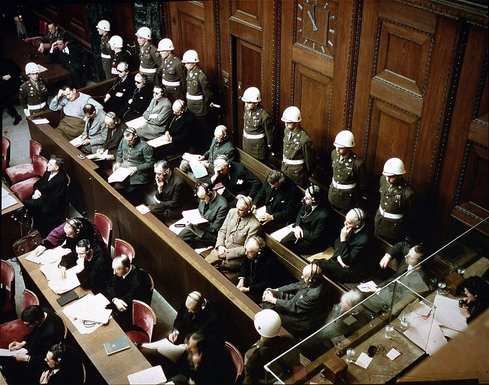
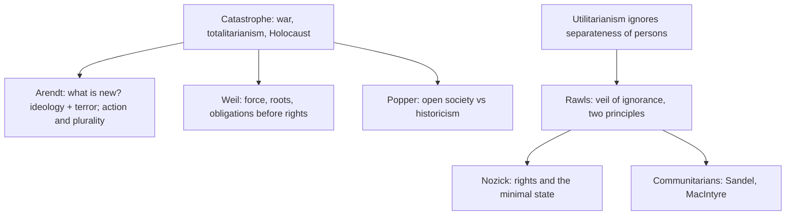

# Political philosophy after catastrophe: Arendt, Weil and Rawls

**Prerequisites:** [The social contract](../early-modern/05-social-contract-and-the-state.md), [Utilitarianism and liberalism](../nineteenth-century/03-utilitarianism-and-liberalism.md), [Marx](../nineteenth-century/04-marx-and-historical-materialism.md)

*Defendants in the dock at the Nuremberg trials (1945–46). Credit: Raymond D’Addario. License: Public domain. Source: [File:Defendants in the dock at nuremberg trials.jpg](https://commons.wikimedia.org/wiki/File:Defendants_in_the_dock_at_nuremberg_trials.jpg).*

## Why the twentieth century forced new questions

Between 1914 and 1945 Europe passed through two world wars, the Russian Revolution, Stalin's terror and famines, the rise of Fascism and Nazism, and the Holocaust. The Enlightenment confidence that reason and progress would make politics humane seemed shattered. Political philosophers had to ask: How was this possible? What is new about these regimes? What, if anything, can ground justice and freedom now?

This lesson follows three answers: [Hannah Arendt](thinkers/hannah-arendt.md) on totalitarianism and action, [Simone Weil](thinkers/simone-weil.md) on force, roots and obligation, and [John Rawls](thinkers/john-rawls.md) on justice as fairness. A fourth thread, [Popper](thinkers/karl-popper.md)'s defence of the "open society", appears in the [previous lesson](06-philosophy-of-science.md).

## Arendt: totalitarianism and the human condition

[Arendt](thinkers/hannah-arendt.md) (1906–1975), a German-Jewish student of Heidegger and Jaspers who fled Nazi Germany, argued in [*The Origins of Totalitarianism*](texts/the-origins-of-totalitarianism.md) (1951) that Nazism and Stalinism were a genuinely new form of government, not just extreme tyranny. Totalitarianism aims at **total domination**: it uses ideology (a single idea, of race or of history, from which everything is deduced) and terror to make human beings superfluous, and its laboratory is the concentration camp. Its preconditions included modern antisemitism, imperialism, the collapse of the class system into "masses", and the plight of stateless people who had lost "the right to have rights".

In *The Human Condition* (1958) she distinguished **labour** (meeting biological necessity), **work** (making a durable world of things) and **action** (appearing among others in speech and deed, beginning something new). Politics is the realm of action and plurality; its root is **natality**, the human capacity to begin. Modernity, she argued, had elevated labour and consumption and lost the public realm.

Reporting on the 1961 trial of Adolf Eichmann, she described "the [banality of evil](../../../glossary/modern/banality-of-evil.md)": Eichmann was not a demonic monster but a thoughtless careerist who spoke in clichés. Evil on a vast scale could come from the failure to think. See [*Eichmann in Jerusalem*](texts/eichmann-in-jerusalem.md) (1963), which caused bitter controversy.

## Weil: force, attention and roots

[Simone Weil](thinkers/simone-weil.md) (1909–1943), a French philosopher who worked in factories and fought briefly in the Spanish Civil War, wrote "The Iliad, or the Poem of Force" (1940): force turns anyone subjected to it into a thing, and it intoxicates those who wield it. In *The Need for Roots* (written 1943 for the Free French), she argued that obligations come before rights, and that uprootedness (from land, work, tradition and community) is the most dangerous disease of modern societies, a breeding ground for totalitarianism. Her religious writings, gathered in [*Gravity and Grace*](texts/gravity-and-grace.md), centre on attention and the renunciation of self.

## Rawls: justice as fairness

In the Anglo-American world, utilitarianism had dominated political thinking. [John Rawls](thinkers/john-rawls.md) (1921–2002) argued in [*A Theory of Justice*](texts/a-theory-of-justice.md) (1971) that utilitarianism "does not take seriously the distinction between persons": it could sacrifice some for the greater total. He revived the [social contract](../early-modern/05-social-contract-and-the-state.md) in a new form.

Imagine choosing principles of justice in an **original position**, behind a **[veil of ignorance](../../../glossary/modern/veil-of-ignorance.md)**: you do not know your sex, race, class, talents or conception of the good life. What principles would you choose? Rawls argued for two:

1. Each person has an equal right to the most extensive scheme of equal basic liberties compatible with a similar scheme for all.
2. Social and economic inequalities are permissible only if (a) attached to positions open to all under fair equality of opportunity, and (b) to the greatest benefit of the least advantaged (the **difference principle**).

## Debate

Robert Nozick's *Anarchy, State, and Utopia* (1974) replied from the libertarian side: justice concerns how holdings arose, not their pattern. Communitarians (Michael Sandel, Alasdair MacIntyre, Charles Taylor) argued that Rawls's chooser behind the veil is an "unencumbered self" stripped of the communities that constitute us. Feminists such as Susan Moller Okin asked about justice within the family. Rawls's later *Political Liberalism* (1993) addressed how citizens with deep religious and philosophical disagreements can share principles. Arendt and Weil remain inspirations for thinking about political evil, citizenship and the limits of rights talk.

## Key ideas

- Totalitarianism, Arendt argued, is a new form of rule through ideology and terror; politics is action among plural equals.
- The banality of evil names wrongdoing that comes from thoughtlessness rather than demonic intent.
- Weil analysed force and argued that rootedness and obligations precede rights.
- Rawls revived the social contract: principles chosen behind a veil of ignorance protect liberty and the least advantaged.

## Where this leads

- Next: [Structuralism and after: Foucault](08-structuralism-and-after.md)
- Thinkers: [Arendt](thinkers/hannah-arendt.md), [Weil](thinkers/simone-weil.md), [Rawls](thinkers/john-rawls.md)
- Texts: [*Origins of Totalitarianism*](texts/the-origins-of-totalitarianism.md), [*Eichmann in Jerusalem*](texts/eichmann-in-jerusalem.md), [*A Theory of Justice*](texts/a-theory-of-justice.md), [*Gravity and Grace*](texts/gravity-and-grace.md)
- Economics: [welfare economics](../../../../economics/microeconomics/08-welfare-economics/README.md)
