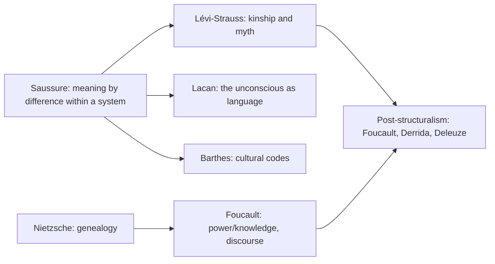

# Structuralism and after: Foucault, power and knowledge

**Prerequisites:** [Existentialism](03-existentialism.md), [Nietzsche](../nineteenth-century/08-nietzsche-and-the-death-of-god.md) (genealogy), [Marx](../nineteenth-century/04-marx-and-historical-materialism.md)

@@IMG@@

## A reaction against the subject

Existentialism put the free, choosing individual at the centre. In the 1950s and 1960s many French thinkers turned against that picture. They argued that what we take to be free individual choices are largely shaped by systems that operate behind our backs: language, kinship rules, economic relations, unconscious structures, institutions. This broad movement is called **[structuralism](../../../glossary/modern/structuralism.md)**, and the thinkers who extended and criticized it are often grouped (loosely and to their annoyance) as **post-structuralists**.

## Structuralism from first principles

The model came from linguistics. Ferdinand de Saussure's *Course in General Linguistics* (published 1916 from students' notes) argued that a language is a system of signs, each defined not by a link to a thing but by its **differences** from other signs. "Cat" means what it means because it differs from "hat", "cap", "dog". Meaning is relational and systematic.

Claude Lévi-Strauss applied the model to anthropology: kinship systems and myths, across cultures, are variations on underlying structures of binary oppositions (raw/cooked, nature/culture). Roland Barthes applied it to fashion, advertising and literature; Jacques Lacan to the unconscious, which he said is "structured like a language"; Louis Althusser to Marxism. Structuralism promised a science of culture in which the individual subject was an effect, not a source.

## Foucault: histories of the present

[Michel Foucault](thinkers/michel-foucault.md) (1926–1984) refused the structuralist label but shared its suspicion of the sovereign subject. He wrote historical studies of madness, medicine, the human sciences, prisons and sexuality. His method combined two approaches:

- **Archaeology** (*The Order of Things*, 1966): uncovering the deep rules, which he called an *episteme*, that determine what counts as knowledge in an era. He ended that book predicting that "man", as an object of knowledge invented around 1800, might be erased "like a face drawn in sand at the edge of the sea".
- **[Genealogy](../../../glossary/modern/genealogy.md)** (after Nietzsche): tracing how present practices and identities emerged from contingent struggles, not from reason or necessity, so that what seems natural can be seen as historical and changeable.

His key concept is **power/knowledge**. Power is not only the sovereign's right to punish or the state's repression; modern power is "productive": it operates through institutions (schools, hospitals, barracks, prisons), through norms and examinations, producing knowledge about individuals and shaping them into certain kinds of subjects. In [*Discipline and Punish*](texts/discipline-and-punish.md) (1975) he traced the shift from spectacular public torture to the disciplined, observed prison, symbolized by Bentham's design for a **Panopticon**, a prison where inmates can be watched at any time without knowing when. "Discourses" (systematic ways of speaking about madness, crime, sexuality) do not merely describe their objects; they help constitute them.

In his last works (*The History of Sexuality*, vols. 2–3, 1984) Foucault turned to ancient ethics as "care of the self", taking up Greek and Roman practices that recall [Stoic and Epicurean exercises](../../../concepts/ethics/ataraxia-and-apatheia.md).

## Others

Jacques Derrida's "deconstruction" examined how philosophical texts depend on hierarchical oppositions (speech/writing, presence/absence) that they cannot fully maintain. Gilles Deleuze developed a philosophy of difference and becoming, drawing on Spinoza, Nietzsche and Bergson.

## Criticisms

Critics such as Jürgen Habermas argued that Foucault's account of power undermines the normative standards it relies on to criticize domination. Historians have questioned the accuracy of some of his histories. Analytic philosophers charged post-structuralism with obscurity; the "Sokal affair" (1996) fed a broader debate about rigour. Defenders reply that these thinkers exposed the historical contingency of categories (madness, criminality, sexuality) that had seemed natural, with real effects on psychiatry, criminology and politics.

## Key ideas

- Structuralism treats meaning and culture as systems of differences that shape individuals.
- Post-structuralists, including Foucault and Derrida, extended and criticized structuralism.
- Foucault's genealogies show how modern power operates through institutions, norms and knowledge.
- Critics question whether such analyses leave room for normative critique.

## Where this leads

- Next: [Mimetic theory: René Girard](09-mimetic-theory.md)
- Thinker: [Michel Foucault](thinkers/michel-foucault.md); text: [*Discipline and Punish*](texts/discipline-and-punish.md)
- Back: [Nietzsche's *Genealogy*](../nineteenth-century/texts/on-the-genealogy-of-morality.md)
- Glossary: [power/knowledge](../../../glossary/modern/power-knowledge.md), [panopticism](../../../glossary/modern/panopticism.md), [discourse](../../../glossary/modern/discourse.md)
