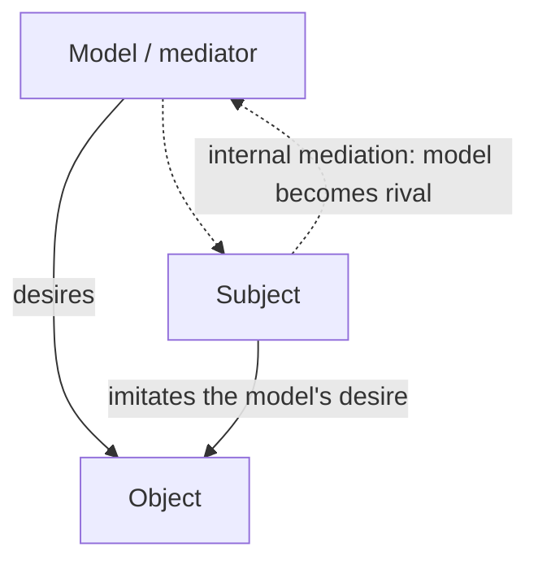
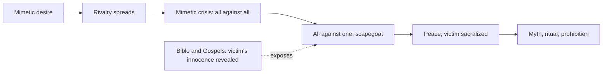

# Mimetic theory: René Girard on desire, violence and the scapegoat

**Prerequisites:** [[the-philosophical-novel|The philosophical novel]], [[psychoanalysis-and-depth-psychology|Psychoanalysis]]; helpful: [[g:mimesis|mimesis]], [[bib:old-testament/books/law-torah/genesis.md|Genesis]], [[bib:new-testament/stories/06-passion-week.md|Passion week]]

@@IMG@@

## Start with a nursery

Put a room full of toys in front of two small children. Very often, both want the same toy, and usually the one the other child has just picked up. The toy did not become more attractive by itself. It became desirable because someone else desired it.

[[rene-girard|René Girard]] (1923–2015), a French literary critic and anthropologist who spent his career in American universities, built a whole theory of culture on this observation. Its three parts are mimetic desire, the scapegoat mechanism, and the biblical revelation.

## 1. Mimetic desire

The common picture of desire is a straight line: a subject wants an object because of the object's qualities. Girard argued that, beyond basic appetites, human desire is **triangular**: we desire according to the desire of another, a **model** or **mediator**. We want what others want, because they want it. He called this **[[g:mimetic-desire|mimetic desire]]**, from Greek *mimesis*, imitation.

He found this first in novels. In *Deceit, Desire and the Novel* (1961) he argued that the great novelists (Cervantes, Stendhal, Flaubert, Proust, [[fyodor-dostoevsky|Dostoevsky]]) discovered what Romantic writers concealed: the "romantic lie" says my desires are spontaneously my own; the "novelistic truth" reveals they are borrowed. Don Quixote desires through Amadis of Gaul, his model of knighthood; Emma Bovary through the heroines of her novels.

- With **external mediation**, the model is far away (a legendary knight, a celebrity), and no rivalry arises.
- With **internal mediation**, the model is near (a neighbour, a colleague, a brother), and desiring the same object makes the model a rival. The closer and more equal the rivals, the more they imitate each other, until they become "doubles", locked in escalating rivalry in which the original object may be forgotten.

## 2. The scapegoat mechanism

If desire is mimetic, rivalry is contagious. In a community, mimetic conflicts multiply until they threaten to dissolve it in a war of all against all, a **mimetic crisis** in which differences collapse and everyone becomes everyone's double. How did early human groups survive?

Girard's hypothesis, set out in [[violence-and-the-sacred|*Violence and the Sacred*]] (1972), is that just as desire is imitated, so is accusation. At the height of the crisis, the "all against all" turns spontaneously into "all against one". The community unites against a single victim, often someone marked as different (a stranger, a cripple, a king), whom everyone comes to believe is responsible for the disorder. The victim is killed or expelled. Peace returns, because the community is now united. This is the **[[g:scapegoat-mechanism|scapegoat mechanism]]**.

Because the peace seems to come from the victim, the victim is seen as both the cause of the disorder and the source of order: both accursed and sacred. Girard argued that this is the origin of the sacred and of religion:

- **Myth** retells the founding murder from the persecutors' viewpoint, presenting the victim as guilty (Oedipus really did cause the plague).
- **Ritual** re-enacts the sacrifice in controlled form, with substitute victims, to renew the peace.
- **Prohibition** forbids the mimetic behaviours that led to the crisis.

Crucially, the mechanism works only if the persecutors do not see it: they must believe in the victim's guilt. That is why, for Girard, it is a "méconnaissance", a misrecognition.

## 3. The biblical revelation

In *Things Hidden Since the Foundation of the World* (1978) and [[i-see-satan-fall-like-lightning|*I See Satan Fall Like Lightning*]] (1999), Girard argued that the Hebrew Bible and the Gospels progressively expose the scapegoat mechanism by telling the story from the **victim's** point of view. Abel is innocent and his blood cries out; Joseph is innocent before his brothers; Job protests his innocence against friends who insist he must be guilty; the Psalms give voice to persecuted individuals; the Suffering Servant of Isaiah is innocent. In the Passion, the crowd, the authorities and even the disciples unite against Jesus as a classic scapegoat, but the Gospels insist he is innocent, and the resurrection vindicates the victim. The Gospels thus reveal "things hidden since the foundation of the world" (Matthew 13:35) and make the mechanism harder to use. Girard read "Satan" in the Gospels as a name for the mimetic process of rivalry and accusation (the Hebrew *satan* means "accuser").

## Consequences and connections

Girard saw modern concern for victims as a product of this revelation, one that Nietzsche, he argued, understood and rejected (preferring Dionysus to "the Crucified"). He also warned that without the old sacrificial mechanisms, mimetic violence could escalate (his last book, *Battling to the End*, 2007, on Clausewitz). His ideas influenced theology (Raymund Schwager, James Alison), literary criticism, and some economists and technologists (Peter Thiel, a former student, has cited him on competition and imitation in business).

## Criticisms

Anthropologists object that the single-mechanism theory of religion is unfalsifiable and too sweeping, and that it fits some myths better than others. Critics also question his reading of Freud and his treatment of non-biblical religions, and some theologians reject his early rejection of sacrificial language for Christ's death (he later softened this). Defenders reply that the theory's explanatory reach across literature, myth and violence is its strength.

## Key ideas

- Human desire is mimetic: we desire according to models, and nearby models become rivals.
- Mimetic rivalry spreads into crisis, resolved when the community unites against a scapegoat.
- Myth, ritual and prohibition grow from the founding murder seen from the persecutors' view.
- The Bible, culminating in the Gospels, reveals the victim's innocence and exposes the mechanism.

## Where this leads

- Next: [[analytic-and-continental|Analytic and continental: a map]]
- Thinker: [[rene-girard|René Girard]]
- Texts: [[violence-and-the-sacred|*Violence and the Sacred*]], [[i-see-satan-fall-like-lightning|*I See Satan Fall Like Lightning*]]
- Related: [[bib:glossary/people/satan.md|Satan]], [[bib:old-testament/books/wisdom-poetry/job.md|Job]], [[bib:new-testament/stories/06-passion-week.md|Passion week]]
- Back: [[gt:poetics.md|Aristotle's *Poetics*]] (mimesis); [[thomas-hobbes|Hobbes]] (war of all against all)
