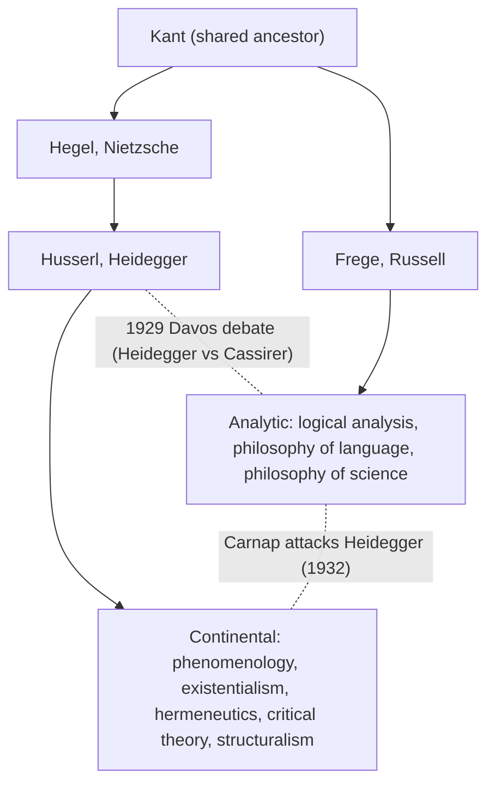

# Analytic and continental: a map of the divide

**Prerequisites:** [The analytic turn](02-analytic-turn.md), [Phenomenology](01-phenomenology.md), [Existentialism](03-existentialism.md)

@@IMG@@

## The puzzle of two philosophies

If you studied philosophy in Oxford or Princeton in 1970 and then in Paris or Frankfurt, you might have wondered whether you were studying the same subject. In one place, seminars dissected the logical form of sentences about belief, proposed counterexamples to definitions of knowledge, and argued in numbered premises. In the other, lectures read Hegel, Heidegger and Freud, discussed history, power and the subject, and prized interpretation over formal proof. The labels **analytic** and **continental** name this split. Both are misleading (one is a method, the other a geography; many "continental" thinkers were not on the continent, and analytic philosophy began with the German Frege and the Austrian Wittgenstein), but they mark a real difference in style, canon and questions that shaped twentieth-century philosophy.

## How the split happened

Both traditions descend from [Kant](../early-modern/thinkers/immanuel-kant.md). One line ran through German idealism, [Nietzsche](../nineteenth-century/thinkers/friedrich-nietzsche.md), [Husserl](thinkers/edmund-husserl.md) and [Heidegger](thinkers/martin-heidegger.md); the other through Frege, [Russell](thinkers/bertrand-russell.md), [Wittgenstein](thinkers/ludwig-wittgenstein.md) and the Vienna Circle. Around 1930 the lines diverged sharply. Rudolf Carnap's 1932 paper "The Elimination of Metaphysics through Logical Analysis of Language" used sentences from Heidegger's lecture "What Is Metaphysics?" as examples of meaningless pseudo-statements. When many logical empiricists fled Nazism to Britain and America, analytic philosophy became dominant in English-speaking universities, while phenomenology, existentialism and their successors flourished in France and Germany.

## Characteristic differences (tendencies, not rules)

| | Analytic | Continental |
|---|---|---|
| Model discipline | Logic, mathematics, natural science | History, literature, the human sciences |
| Typical unit | The argument, the counterexample | The text, the reading, the history |
| Key questions | Meaning, reference, knowledge, mind, justification | Existence, history, power, the subject, interpretation |
| Attitude to history of philosophy | Often reconstructs past arguments as contemporary positions | Treats philosophy as inseparable from its history |
| Style | Plain, explicit, often formal | Often literary, allusive, dense |
| Representative figures | Frege, Russell, Wittgenstein, Quine, Rawls | Husserl, Heidegger, Sartre, de Beauvoir, Foucault, Derrida, Habermas |

## Bridges and borderlands

The divide was never total. Late Wittgenstein's attention to forms of life is often read alongside Heidegger. Some analytic philosophers took up Hegel (Robert Brandom, John McDowell) and phenomenology (Hubert Dreyfus, Dan Zahavi). Habermas engaged with analytic speech-act theory; Paul Ricœur wrote on analytic philosophy of action. [Rawls](thinkers/john-rawls.md) and Habermas debated political liberalism. Some thinkers in this branch fit neither camp well: [Arendt](thinkers/hannah-arendt.md), [Weil](thinkers/simone-weil.md), [Girard](thinkers/rene-girard.md) and [Kuhn](thinkers/thomas-kuhn.md).

## Is the divide still useful?

Many philosophers now treat the labels as historical. Some argue the real difference is between philosophy that aims to be continuous with science and philosophy that aims at self-understanding of human practices; both need each other. Bernard Williams, an analytic philosopher, argued that philosophy must be a humanistic discipline that takes history seriously. For a reader, the practical lesson is to notice which style one is reading and to read each on its own terms.

## Key ideas

- The analytic/continental split marks a twentieth-century divergence of style, canon and questions, rooted in reactions to Kant.
- Analytic philosophy emphasizes logical analysis and argument; continental philosophy emphasizes history, interpretation and existence.
- The divide hardened around 1930 and spread with emigration, but was never absolute.
- Many important thinkers, and much recent work, cross it.

## Where this leads

- Back to the start of this era: [Phenomenology](01-phenomenology.md)
- The branch overview: [Modern philosophy](../README.md)
- Back to the ancient roots: [Ancient philosophy](../../ancient/README.md)
- Glossary: [analytic philosophy](../../../glossary/modern/analytic-philosophy.md), [continental philosophy](../../../glossary/modern/continental-philosophy.md)
