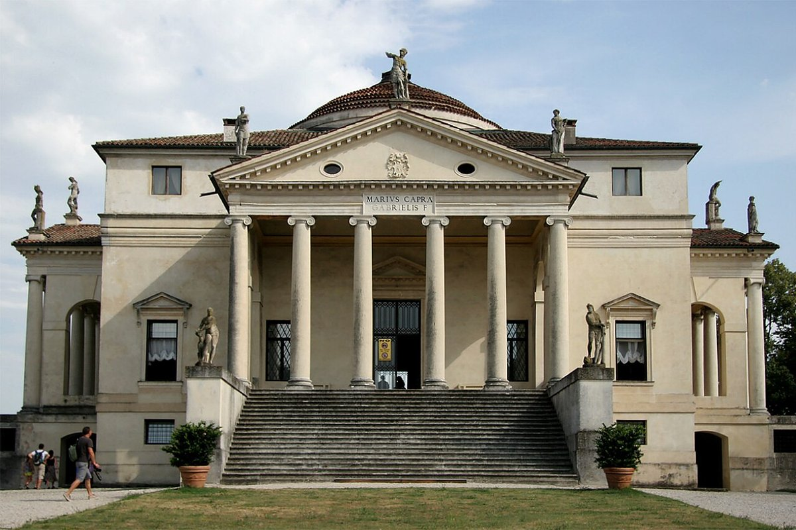
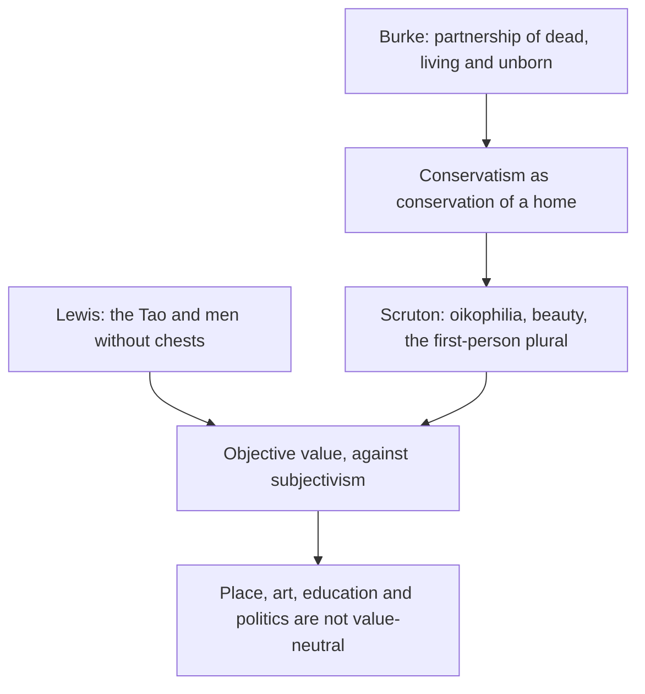

# Conservatism, tradition and beauty

**Prerequisites:** [Political philosophy after catastrophe](07-political-philosophy-after-catastrophe.md); helpful: [Kant's Copernican revolution](../early-modern/07-kants-copernican-revolution.md)

*Andrea Palladio's Villa Almerico Capra, "La Rotonda", near Vicenza. Classical architecture of this kind was, for Roger Scruton, a model of how buildings can help us feel at home in the world. Credit: Quinok. License: [CC BY-SA 4.0](https://creativecommons.org/licenses/by-sa/4.0). Source: [File:07-Villa-Rotonda-Palladio.jpg](https://commons.wikimedia.org/wiki/File:07-Villa-Rotonda-Palladio.jpg).*

## A missing strand

The political philosophy in this path has so far run mainly through catastrophe and liberal reconstruction: [Arendt](thinkers/hannah-arendt.md) on totalitarianism, [Weil](thinkers/simone-weil.md) on roots and obligations, [Rawls](thinkers/john-rawls.md) on justice as fairness. Those are essential twentieth-century arguments. They are not the only ones. There was also a conservative philosophical tradition, asking not first "what principles would we choose from nowhere?" but "what is already here that is worth keeping, and how is it kept?"

The classic starting point is Edmund Burke, writing against the French Revolution. Society, Burke argued, is a partnership not only among the living but between the dead, the living and the yet unborn. Inheritance — law, manners, "prejudice" in the sense of inherited practical wisdom — is a form of social knowledge. To tear it up in the name of abstract rights is to disenfranchise both ancestors and descendants. One need not accept Burke's politics in every particular to see the philosophical claim: political reason is historically situated, and some goods exist only as traditions.

## Home, "we" and oikophilia

[Roger Scruton](thinkers/roger-scruton.md) (1944–2020) was the most substantial late-twentieth-century English philosopher of this tradition. Conservatism, as he defined it, is not simply a preference for markets, and not mere nostalgia. It is an attempt to conserve the settlements that make a first-person plural possible: family, voluntary association, common law, nation, landscape. The motive he called **[oikophilia](../../../glossary/modern/oikophilia.md)**, love of home. Its counterpart, **[oikophobia](../../../glossary/modern/oikophobia.md)**, is the educated impulse to denigrate one's own inheritance, as if belonging were a moral mistake.

That starting point has consequences. The environment, on this view, is not first a global ledger of costs and benefits; it is a particular place people love and know how to mind. The nation is not only a market or a racial essence, but a historic "we" that can include newcomers if they can share its first-person plural. The market and the state are both useful and both corrosive when they dissolve the associations that sit between them. [*How to Be a Conservative*](texts/how-to-be-a-conservative.md) tries to harvest what is true in nationalism, socialism, capitalism, liberalism and environmentalism without surrendering that emphasis on home.

## Beauty is not a luxury

Scruton's other main body of work is [aesthetics](../../../glossary/general/aesthetics.md). In [*Beauty*](texts/beauty.md) and in his books on architecture and music, he argued that beauty is a real value, not a private liking we have no reason to share. Following [Kant](../early-modern/thinkers/immanuel-kant.md), a judgment of beauty is not a deduction from a rule, yet it claims more than "I happen to like this": we point, we invite others to see, and we can be educated in seeing. Beautiful buildings, streets, rituals and works of art help people settle in the world. Ugly or merely shocking ones, and a culture of kitsch, turn the public realm into something no one is expected to love.

This is why aesthetics belongs in a political lesson. If value is only subjective, the built environment and the arts become instruments of utility, profit or self-expression, and the "we" has nothing in common to care for. [*The Aesthetics of Music*](texts/the-aesthetics-of-music.md) makes a parallel case in sound: music is heard as *tone* — movement and meaning in a tonal space — not as a mere sequence of noises, and some forms of music sustain that hearing better than others.

## Lewis and the Tao

A generation earlier, [C. S. Lewis](thinkers/c-s-lewis.md) had made a closely related argument in a different idiom. [*The Abolition of Man*](texts/the-abolition-of-man.md) attacked textbooks that taught children to treat value statements as mere expressions of emotion. Lewis defended a transcultural moral order he called the **[Tao](../../../glossary/modern/the-tao.md)**, his name for what natural-law thinkers had called the law of nature. If education starves the trained emotions — the "chest" that, in a Platonic picture, joins the head to the belly — the result is "[men without chests](../../../glossary/modern/men-without-chests.md)", and then a class of "conditioners" who treat everyone else as raw material. Lewis was a Christian apologist, not a conservative philosopher in Scruton's sense, but both are defenders of objective value against a modern subjectivism that presents itself as sophistication.

## Objections

The criticisms are serious, and this path should not hide them. Conservatism can become a defence of unjust inheritances — of class, racial hierarchy, the subordination of women, or imperial power — by calling them "tradition". Appeal to home can shrink into xenophobia; Scruton tried to separate oikophilia from that, but not every reader is convinced he succeeded. "Oikophobia" can be used to wave away justified criticism of one's country. On beauty, tastes do in fact differ, and it is not obvious that disagreement can always be settled by "looking again"; some will say Scruton confused a historically specific (often European, often high-cultural) canon with value as such. His polemical writings on popular culture, Islam and sexual ethics have been widely judged unfair.

None of that erases the philosophical question he and Lewis pose: whether a culture can treat all value as subjective and still have reasons to care for a shared world. [Rawls](thinkers/john-rawls.md) asked how we can share principles despite deep disagreement; Scruton asked what shared loves and places have to be in place before such a question even makes sense. Reading them together is more useful than choosing a camp.

## Key ideas

- Philosophical conservatism, from Burke to Scruton, treats society as an inherited partnership and asks what is worth conserving and how.
- Scruton's keywords are oikophilia (love of home) and the first-person plural; he set them against oikophobia and against reducing politics to the market or the state.
- Beauty, for him, is a real value that helps us settle in the world; architecture and music are political in that broad sense.
- Lewis's *Abolition of Man* is a parallel defence of objective value (the Tao) against educational subjectivism.
- The tradition is open to serious criticism when "inheritance" shields injustice or a local canon is mistaken for value itself.

## Where this leads

- Thinkers: [Roger Scruton](thinkers/roger-scruton.md), [C. S. Lewis](thinkers/c-s-lewis.md)
- Texts: [*How to Be a Conservative*](texts/how-to-be-a-conservative.md), [*Beauty*](texts/beauty.md), [*The Abolition of Man*](texts/the-abolition-of-man.md)
- Back: [Political philosophy after catastrophe](07-political-philosophy-after-catastrophe.md), [Kant](../early-modern/thinkers/immanuel-kant.md), [Rawls, *A Theory of Justice*](texts/a-theory-of-justice.md)
- Glossary: [conservatism](../../../glossary/modern/conservatism.md), [oikophilia](../../../glossary/modern/oikophilia.md), [oikophobia](../../../glossary/modern/oikophobia.md), [the Tao (Lewis)](../../../glossary/modern/the-tao.md), [natural law](../../../glossary/modern/natural-law.md)
