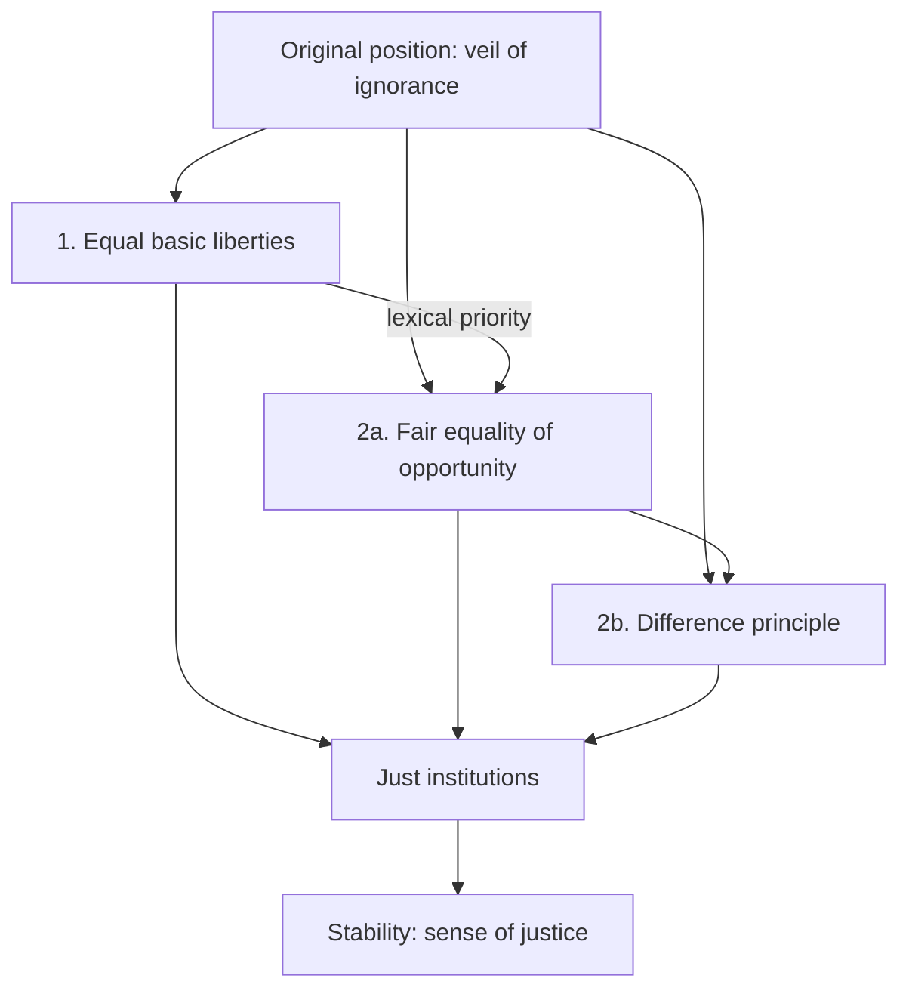

# Rawls, *A Theory of Justice*

**Prerequisites:** [[john-rawls|John Rawls]]; [[the-social-contract|Rousseau's *Social Contract*]]

@@IMG@@

## Dating and form

*A Theory of Justice* was published by Harvard University Press in 1971, after nearly twenty years of articles in which [[john-rawls|Rawls]] developed "justice as fairness". It is long (about 600 pages) and systematic. A revised edition (1999) incorporated changes Rawls made for the 1975 German translation. He later restated his views in *Political Liberalism* (1993) and *Justice as Fairness: A Restatement* (2001).

## Outline (three parts)

- **Part One: Theory.** "Justice is the first virtue of social institutions, as truth is of systems of thought." Each person possesses an inviolability founded on justice that even the welfare of society as a whole cannot override. The subject of justice is the basic structure of society. Rawls presents the original position: rational parties, behind a [[g:veil-of-ignorance|veil of ignorance]] about their own place in society, natural talents and conception of the good, choose principles for their society. They would choose two principles: equal basic liberties for all; and social and economic inequalities arranged to the greatest benefit of the least advantaged (the difference principle) and attached to positions open to all under fair equality of opportunity. The first principle has lexical priority over the second. Under uncertainty so grave, the parties would reason by "maximin", choosing the alternative whose worst outcome is best, and would reject utilitarianism, which could sacrifice some for the greater sum. Principles are justified by "reflective equilibrium" with our considered judgments.
- **Part Two: Institutions.** How the principles apply: a constitutional democracy protecting equal liberty (conscience, political participation), a fair economy with background institutions, a just savings principle between generations, a "four-stage sequence" from the original position to constitution, legislation and application, and a theory of civil disobedience and conscientious objection in a nearly just society.
- **Part Three: Ends.** Rawls argues that a just society would be stable: its members would develop a sense of justice, and acting justly would be part of their good ("goodness as rationality", the "Aristotelian principle" that we enjoy exercising our developed capacities). Justice and the good are "congruent". Self-respect is perhaps the most important primary good.

## Key ideas

- Principles of justice are those that free and equal persons would choose in a fair initial situation.
- Liberty comes first; inequalities are justified only if they benefit the least advantaged.
- Utilitarianism fails to respect the separateness of persons.

## Reception

The book revived systematic political philosophy and became perhaps the most discussed work of political philosophy in the twentieth century. It provoked Robert Nozick's libertarian reply (*Anarchy, State, and Utopia*, 1974), communitarian critiques (Michael Sandel, *Liberalism and the Limits of Justice*, 1982), economists' debates about maximin (John Harsanyi), the capabilities approach (Amartya Sen, Martha Nussbaum) and feminist critique (Susan Moller Okin).

## Where this leads

- Next text: [[discipline-and-punish|*Discipline and Punish*]]
- Back: [[second-treatise-of-government|Locke's *Second Treatise*]], [[groundwork-of-the-metaphysics-of-morals|Kant's *Groundwork*]], [[on-liberty|Mill's *On Liberty*]]
- Glossary: [[g:veil-of-ignorance|veil of ignorance]], [[g:social-contract|social contract]], [[g:utilitarianism|utilitarianism]]
