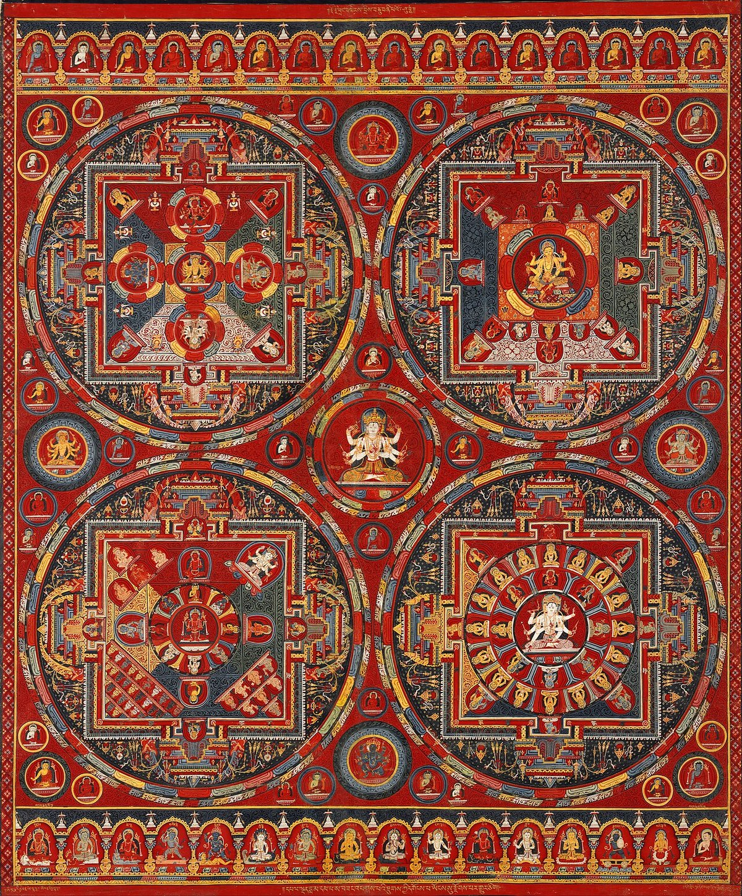
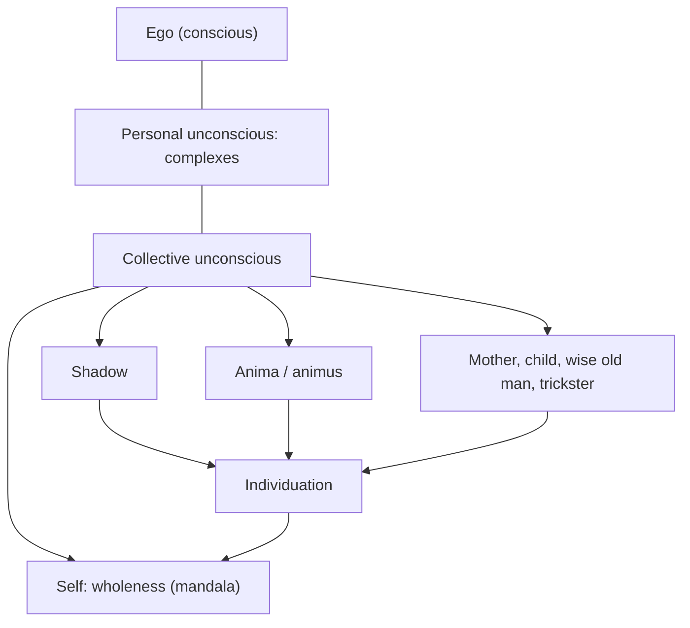

# Jung, *The Archetypes and the Collective Unconscious*

**Prerequisites:** [Carl Jung](../thinkers/carl-jung.md)

*Four mandalas of the Vajravali series, Ngor Monastery, Tibet (c. 1430): the kind of circular image Jung read as a symbol of the Self. Credit: Tibetan, Central Tibet, Tsang (Ngor Monastery), Sakya order Details on Google Art Project. License: Public domain. Source: [File:Tibetan, Central Tibet, Tsang (Ngor Monastery), Sakya order - Four Mandalas of the Vajravali Series - Google Art Project.jpg](https://commons.wikimedia.org/wiki/File:Tibetan,_Central_Tibet,_Tsang_(Ngor_Monastery),_Sakya_order_-_Four_Mandalas_of_the_Vajravali_Series_-_Google_Art_Project.jpg).*

*Jung was a psychiatrist and psychologist, not a philosopher; this volume gathers his main essays on the theory that most shaped philosophical and cultural discussion of his work.*

## Dating and form

This is volume 9, Part I, of Jung's *Collected Works*, published in English in 1959 (second edition 1968) in the Bollingen Series by Princeton University Press, translated by R. F. C. Hull. It collects essays and lectures written between the 1930s and 1950s, several revised by [Jung](../thinkers/carl-jung.md) for the edition, and is illustrated with mandala drawings by patients. It is not a single treatise; readers often start with the first two essays.

## Main essays

- **"Archetypes of the Collective Unconscious"** (originally 1934, revised 1954). Beyond the personal unconscious lies a deeper layer common to all humans. Its contents are archetypes, which appear in myths, fairy tales, religions and dreams across cultures.
- **"The Concept of the Collective Unconscious"** (a 1936 lecture in London). The collective unconscious is not acquired through personal experience but inherited; archetypes are like instincts, forms without content that structure experience. Jung distinguishes the archetype as such (unknowable) from archetypal images.
- **"Concerning the Archetypes, with Special Reference to the Anima Concept."** The anima (the feminine image in a man's psyche) and animus (the masculine in a woman's) mediate between ego and unconscious.
- **"Psychological Aspects of the Mother Archetype"**, **"Concerning Rebirth"**, **"The Psychology of the Child Archetype"**, **"The Phenomenology of the Spirit in Fairytales"** (the wise old man) and **"On the Psychology of the Trickster-Figure"**. Studies of particular archetypes.
- **"Conscious, Unconscious, and Individuation"**, **"A Study in the Process of Individuation"** and **"Concerning Mandala Symbolism"**. Individuation is the lifelong process of integrating unconscious contents (including the shadow) into a whole personality centred on the Self; mandalas, circular images, express that wholeness.

## Key ideas

- There is a collective unconscious shared by humanity, alongside the personal unconscious.
- Archetypes are inherited forms that shape images in myth, religion and dreams.
- Individuation integrates unconscious contents into a whole Self.

## Reception

Readers new to Jung often find the volume easier after a shorter introduction such as *Man and His Symbols* (1964), the illustrated book he planned for general readers shortly before his death, or Anthony Stevens's *Jung: A Very Short Introduction*. Within the volume, the essays on the trickster and on the child archetype are among the most readable; the case study of individuation through a patient's paintings shows the theory applied.

The theory influenced comparative mythology (Joseph Campbell's *The Hero with a Thousand Faces*), literary criticism (Northrop Frye), religious studies and popular psychology. Scientists and many psychologists consider the inheritance of archetypes untestable; anthropologists criticize the use of cross-cultural parallels without context. Defenders such as Anthony Stevens have tried to connect archetypes to evolutionary psychology.

## Where this leads

- Next text: [*Being and Nothingness*](being-and-nothingness.md)
- Glossary: [archetype](../../../../glossary/modern/archetype.md), [collective unconscious](../../../../glossary/modern/collective-unconscious.md), [shadow](../../../../glossary/modern/shadow.md), [individuation](../../../../glossary/modern/individuation.md)
