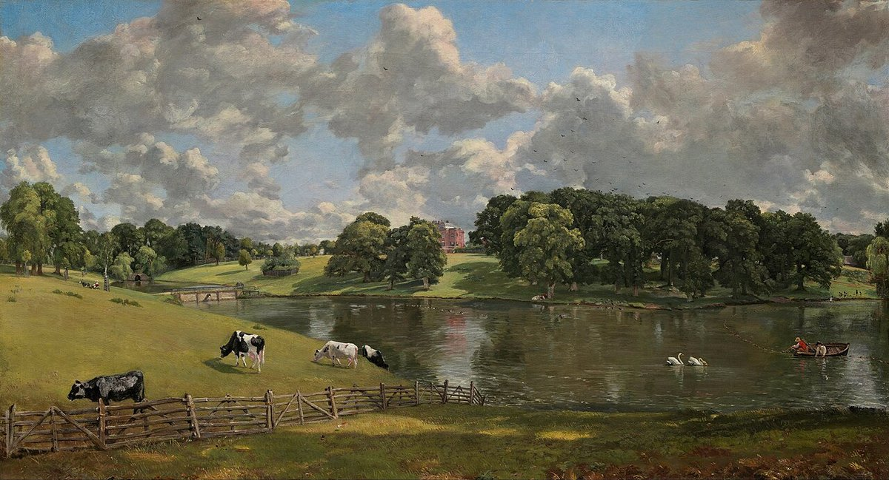
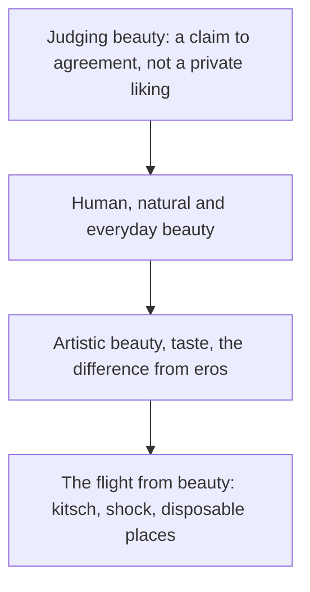

# Scruton, *Beauty*

**Prerequisites:** [Roger Scruton](../thinkers/roger-scruton.md); helpful: [aesthetics](../../../../glossary/general/aesthetics.md)

*John Constable, *Wivenhoe Park, Essex* (1816). Scruton's book treats natural and everyday beauty — a settled landscape, a cared-for place — as seriously as the beauty of art. Credit: John Constable. License: Public domain. Source: [File:John Constable - Wivenhoe Park, Essex - Google Art Project.jpg](https://commons.wikimedia.org/wiki/File:John_Constable_-_Wivenhoe_Park,_Essex_-_Google_Art_Project.jpg).*

## Dating and form

*Beauty* was published by Oxford University Press in 2009 and reissued, with the same chapter plan, as *Beauty: A Very Short Introduction* (2011). It is a short, illustrated essay rather than a treatise, and the best way into Scruton's aesthetics before [*The Aesthetics of Music*](the-aesthetics-of-music.md) or *The Aesthetics of Architecture*. The governing question is not "what do I like?" but "what are we doing when we judge something to be beautiful, and why does that judgment matter?"

## Outline

- **1. Judging Beauty.** Beauty is a real value, not a private sensation. Following [Kant](../../early-modern/thinkers/immanuel-kant.md)'s *Critique of Judgment*, Scruton treats an aesthetic judgment as free of concepts in one sense (there is no rule that can prove a thing beautiful) and yet as a claim to agreement: we point and say "look", and we can be right or wrong.
- **2–4. Human, natural and everyday beauty.** The beauty of the human face and form; of landscape and living things; and of ordinary arrangements — a table, a street, a well-made door — in which life is fitted to a place. Everyday beauty is, for him, politically important: it is how a community feels at home.
- **5–7. Artistic beauty; Taste and Order; Art and Eros.** Art as a way of presenting a subject for contemplation, not only for use or shock. Taste can be educated. He distinguishes aesthetic interest from sexual interest, and worries about art that collapses the distinction.
- **8–9. The Flight from Beauty; Concluding Thoughts.** A diagnosis of modern refusals of beauty: kitsch, a cult of transgression, disposable building. The loss, he argues, is a loss of settlement and of a shared public world, not a mere change of fashion.

## Key ideas

- Judgments of beauty claim a kind of objectivity, in a Kantian register: not proof from a rule, but more than preference.
- Beauty is not confined to galleries; everyday and natural beauty belong to the same family of value.
- A culture that flees beauty is, on this view, damaging its capacity to make a home.

## Reception

The book is widely read by a general audience and used as a teaching text in aesthetics. Professional aestheticians have questioned whether Kantian "subjective universality" can carry as much as Scruton wants, and whether his examples quietly elevate a European classical and vernacular canon. The chapter on the "flight from beauty" is the most polemical and the most disputed. Read beside [Lewis](../thinkers/c-s-lewis.md)'s [*Abolition of Man*](the-abolition-of-man.md), it is another twentieth-century defence of objective value, this time centred on the visible and audible world rather than on the moral law.

## Where this leads

- Next: [*The Aesthetics of Music*](the-aesthetics-of-music.md)
- Lesson: [Conservatism, tradition and beauty](../11-conservatism-and-beauty.md)
- Back: [Kant](../../early-modern/thinkers/immanuel-kant.md), [*The Abolition of Man*](the-abolition-of-man.md)
- Glossary: [aesthetics](../../../../glossary/general/aesthetics.md), [oikophilia](../../../../glossary/modern/oikophilia.md)
