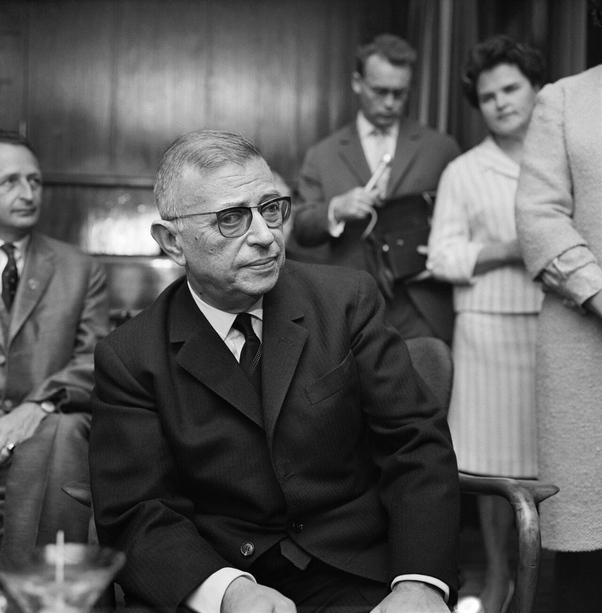
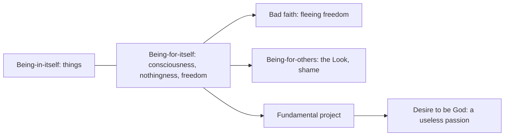

# Sartre, *Being and Nothingness*

**Prerequisites:** [Jean-Paul Sartre](../thinkers/jean-paul-sartre.md); [*Being and Time*](being-and-time.md)

*Jean-Paul Sartre in 1965. Credit: https://finna.fi/Record/museovirasto.fca18402-801e-43bc-879b-5abce0a77093. License: [CC BY 4.0](https://creativecommons.org/licenses/by/4.0). Source: [File:The French Philosopher Jean-Paul Sartre 1965 (JOKAHBL3E F08-3).tif](https://commons.wikimedia.org/wiki/File:The_French_Philosopher_Jean-Paul_Sartre_1965_(JOKAHBL3E_F08-3).tif).*

## Dating and form

*L'Être et le néant: Essai d'ontologie phénoménologique* was published by Gallimard in Paris in 1943, during the German occupation, and runs to over 700 pages. [Sartre](../thinkers/jean-paul-sartre.md) drew on [Husserl](../thinkers/edmund-husserl.md), [Heidegger](../thinkers/martin-heidegger.md) and [Hegel](../../nineteenth-century/thinkers/georg-wilhelm-friedrich-hegel.md), read largely during his time in Berlin (1933–34) and in a POW camp (1940–41). English translations: Hazel Barnes (1956) and Sarah Richmond (2018).

## Outline (four parts)

- **Introduction: the pursuit of being.** Two regions of being: being-in-itself (*en-soi*), solid, self-identical, simply what it is; and being-for-itself (*pour-soi*), consciousness, which is never simply what it is.
- **Part One: the problem of nothingness.** Consciousness introduces negation into the world. Sartre arrives at the café to meet Pierre, who is not there: Pierre's absence haunts the café. Freedom is consciousness's power to detach from what is. Anguish is the awareness of this freedom. [Bad faith](../../../../glossary/modern/bad-faith.md) is lying to oneself about it: the waiter who plays at being a waiter as if he were a thing; the woman who lets her hand rest in her companion's hand while pretending not to notice.
- **Part Two: being-for-itself.** Consciousness is a lack, always projecting toward a future; temporality and transcendence.
- **Part Three: being-for-others.** "The Look": caught looking through a keyhole, I suddenly hear footsteps and feel shame; I become an object for another subject. Relations with others oscillate between trying to possess the other's freedom (love, language, masochism) and trying to dominate them (indifference, desire, hatred, sadism). The body is lived from inside and seen from outside.
- **Part Four: having, doing and being.** Freedom is absolute within a situation: a crag is an obstacle only in light of my project of climbing. Humans are "condemned to be free". "Existential psychoanalysis" seeks a person's fundamental project rather than Freudian drives. The human project is to become in-itself-for-itself, God, an impossible synthesis: "Man is a useless passion."

## Key ideas

- Consciousness is not a thing; it is freedom and negation.
- We are responsible for our choices; denying this is bad faith.
- Others objectify us through their gaze, creating conflict.
- Freedom is always exercised within a situation.

## Reception

The book became the philosophical charter of existentialism. Critics found its account of freedom too absolute and its view of human relations too bleak; [de Beauvoir](../thinkers/simone-de-beauvoir.md) and Merleau-Ponty developed more situated and embodied views. Analytic philosophers often found its style obscure. Sartre's later *Critique of Dialectical Reason* (1960) gave far more weight to social and material conditions.

## Where this leads

- Next text: [*Existentialism Is a Humanism*](existentialism-is-a-humanism.md)
- Glossary: [existence precedes essence](../../../../glossary/modern/existence-precedes-essence.md), [bad faith](../../../../glossary/modern/bad-faith.md), [anxiety](../../../../glossary/modern/anxiety.md)
