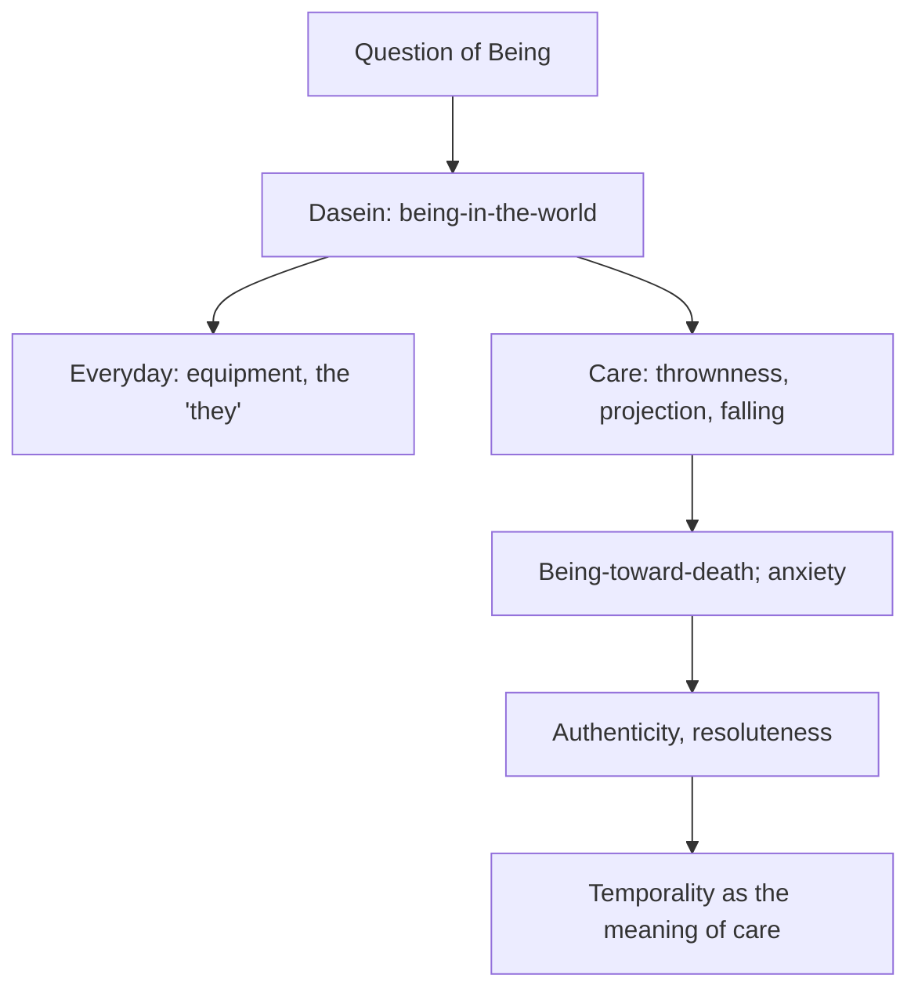

# Heidegger, *Being and Time*

**Prerequisites:** [[martin-heidegger|Martin Heidegger]]; [[phenomenology|Phenomenology]]

@@IMG@@

## Dating and form

*Sein und Zeit* appeared in 1927, in the *Jahrbuch für Philosophie und phänomenologische Forschung* edited by [[edmund-husserl|Husserl]], and simultaneously as a book. It was dedicated to Husserl "in friendship and admiration". It was published partly to secure Heidegger's appointment as professor at Marburg. What appeared was only the first two of three planned divisions of Part One; Part Two, a "destruction" of the history of ontology through Kant, Descartes and Aristotle, was never published as such, though lecture courses such as *Kant and the Problem of Metaphysics* (1929) cover some of it. The book is notoriously difficult, coining or repurposing many German terms. English translations: John Macquarrie and Edward Robinson (1962) and Joan Stambaugh (1996, revised by Dennis Schmidt 2010).

## Outline

- **Introduction.** The question of the meaning of Being has been forgotten. Because we already have a vague understanding of Being, the inquiry should start from the entity that asks the question, the human being, which Heidegger calls [[g:dasein|Dasein]] ("being-there"). Dasein is the entity for which its own Being is an issue.
- **Division One: preparatory analysis of Dasein.** Dasein is [[g:being-in-the-world|being-in-the-world]]. We first encounter things as "ready-to-hand" equipment (the hammer in hammering), not as "present-at-hand" objects of detached observation; the world is a web of practical relations. Dasein is with others, mostly in the mode of "the they" (*das Man*), doing what "one" does. It is disclosed through moods (*Befindlichkeit*), understanding and discourse; it is [[g:thrownness|thrown]] into a situation and projects itself into possibilities. Its being is "care" (*Sorge*). Anxiety discloses Dasein's being-in-the-world as such, stripping away everyday absorption.
- **Division Two: Dasein and temporality.** Being-toward-death: death is Dasein's ownmost, non-relational, certain yet indefinite possibility. Facing it, Dasein can be [[g:authenticity|authentic]], owning its existence rather than losing itself in "the they". Conscience calls Dasein to itself; resoluteness answers. Care is grounded in temporality: future, having-been and present unified ecstatically. History and historicality follow.

## Key ideas

- The question of Being must begin with the being who asks it: Dasein.
- We are primarily engaged in a practical world, not detached subjects observing objects.
- Facing death and anxiety makes authentic existence possible.
- Time is the horizon for understanding Being.

## Reception

*Being and Time* influenced existentialism ([[jean-paul-sartre|Sartre]]), hermeneutics (Gadamer), deconstruction (Derrida), cognitive science critiques of AI (Hubert Dreyfus) and theology (Bultmann). Analytic critics like Rudolf Carnap mocked Heidegger's language (in Carnap's 1932 essay on "The Elimination of Metaphysics"); others have debated whether the analysis of authenticity and the "they" connects to his later Nazism. Hubert Dreyfus's *Being-in-the-World* (1991) is a standard commentary on Division One.

## Where this leads

- Next text: [[tractatus-logico-philosophicus|*Tractatus Logico-Philosophicus*]]
- Related: [[being-and-nothingness|*Being and Nothingness*]]
