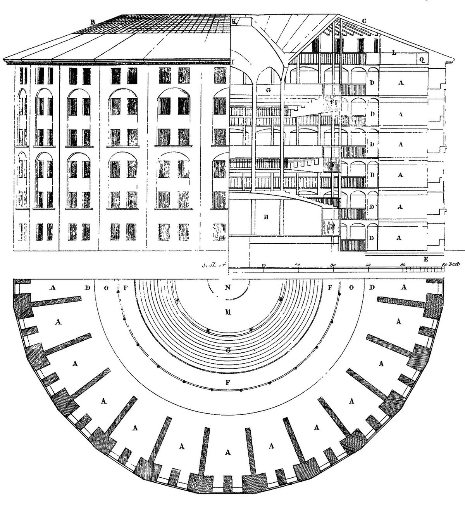

# Foucault, *Discipline and Punish*

**Prerequisites:** [Michel Foucault](../thinkers/michel-foucault.md)

*Jeremy Bentham's plan of the Panopticon (1791), drawn by Willey Reveley. Credit: Jeremy Bentham. License: Public domain. Source: [File:Panopticon.jpg](https://commons.wikimedia.org/wiki/File:Panopticon.jpg).*

## Dating and form

*Surveiller et punir: Naissance de la prison* ("to watch and punish: the birth of the prison") was published by Gallimard in 1975. [Foucault](../thinkers/michel-foucault.md) wrote it after his work with the Prison Information Group (1971–72), during a wave of prison revolts in France. The English translation by Alan Sheridan (1977) appeared as *Discipline and Punish: The Birth of the Prison*. Foucault called it a "history of the present".

## Outline (four parts)

- **Part One: Torture.** The book opens with the public torture and execution in 1757 of Robert-François Damiens, who had attempted to kill King Louis XV, described in gruesome detail from contemporary accounts. It then quotes a timetable for young prisoners in Paris some eighty years later, regulating every hour of their day. Within less than a century, punishment shifted from a spectacle on the body, displaying the sovereign's power, to a discreet regulation of time and behaviour.
- **Part Two: Punishment.** Eighteenth-century reformers wanted gentler, more certain punishment, representing the crime as signs to deter others. But the prison, which they had not chiefly proposed, became the general form of punishment.
- **Part Three: Discipline.** "Docile bodies": in armies, schools, workshops and hospitals, disciplinary techniques distribute bodies in space, control activity through timetables and drill, and train them. The means of "correct training" are hierarchical observation, normalizing judgment and the examination, which makes each person a "case". Bentham's Panopticon, a circular prison with a central tower from which every cell can be seen while the inmates cannot see the observer, is the diagram of a power that makes people discipline themselves because they might be watched. See [panopticism](../../../../glossary/modern/panopticism.md).
- **Part Four: Prison.** Prisons have failed to reduce crime since their beginnings, yet persist: they produce "delinquency", a manageable, observable illegality. The "carceral archipelago" extends disciplinary techniques throughout society, beginning (Foucault says) with the opening of the agricultural colony for juvenile delinquents at Mettray in 1840.

## Key ideas

- Modern punishment targets the "soul", behaviour and normality, rather than the body as spectacle.
- Disciplinary power is productive: it trains, classifies and normalizes individuals.
- Surveillance induces self-discipline; the prison is one node in a wider disciplinary society.
- "The soul is the prison of the body."

## Reception

The book influenced criminology, sociology, history, education and surveillance studies; discussions of CCTV and digital tracking often invoke the Panopticon. Historians (for example in the debate collected by Michelle Perrot in *L'Impossible prison*, 1980) disputed its chronology and generalizations; Habermas and others asked from what normative standpoint Foucault criticized discipline. Some argue that today's societies of data and control differ from discipline (Gilles Deleuze, "Postscript on the Societies of Control", 1990).

## Where this leads

- Next text: [*Violence and the Sacred*](violence-and-the-sacred.md)
- Glossary: [power/knowledge](../../../../glossary/modern/power-knowledge.md), [panopticism](../../../../glossary/modern/panopticism.md)
