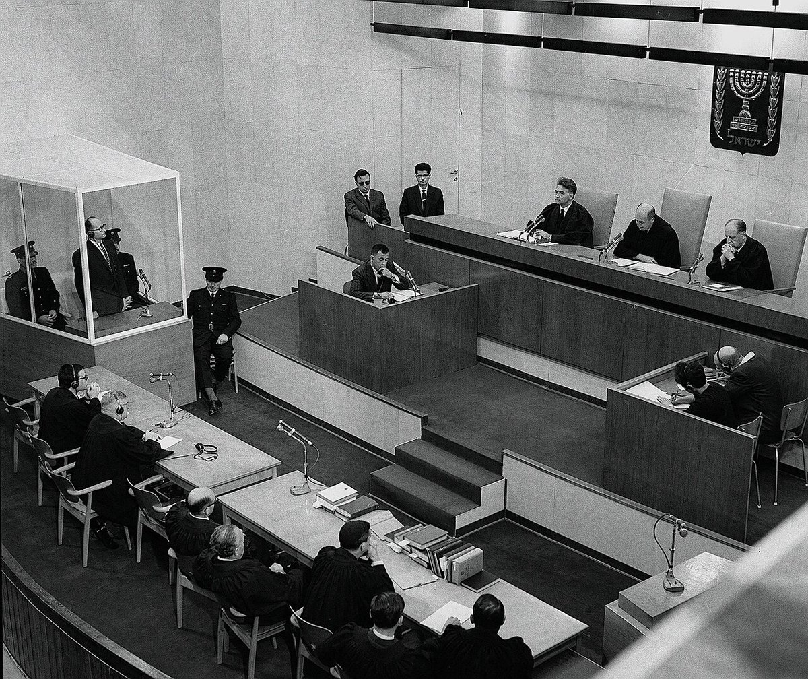

# Arendt, *Eichmann in Jerusalem*

**Prerequisites:** [Hannah Arendt](../thinkers/hannah-arendt.md); [*The Origins of Totalitarianism*](the-origins-of-totalitarianism.md)

*Adolf Eichmann is sentenced to death at the conclusion of his trial in Jerusalem (December 1961), US Holocaust Memorial Museum. Credit: Israeli GPO photographer. License: Public domain. Source: [File:Adolf Eichmann is sentenced to death at the conclusion of the Eichmann Trial USHMM 65289.jpg](https://commons.wikimedia.org/wiki/File:Adolf_Eichmann_is_sentenced_to_death_at_the_conclusion_of_the_Eichmann_Trial_USHMM_65289.jpg).*

## Dating and form

Adolf Eichmann, the SS officer who organized the deportation of Jews to the death camps, was abducted by Israeli agents in Argentina in May 1960 and tried in Jerusalem in 1961. [Arendt](../thinkers/hannah-arendt.md) attended the trial for *The New Yorker*, which published her report in five instalments in February and March 1963. The book, *Eichmann in Jerusalem: A Report on the Banality of Evil*, appeared that year; a revised edition (1964) added a postscript answering critics. Eichmann was convicted and was hanged in 1962.

## Main themes

- **The defendant.** Arendt found Eichmann not a demonic monster but a careerist bureaucrat, "terribly and terrifyingly normal", who spoke in clichés and "officialese" and seemed unable to think from anyone else's point of view. He even claimed to have lived by [Kant's](../../early-modern/thinkers/immanuel-kant.md) moral precepts, distorting the categorical imperative into obedience to the Führer's will.
- **The banality of evil.** The phrase appears only at the end of the main text, as "the fearsome, word-and-thought-defying banality of evil". Arendt meant not that the deeds were banal but that the doer's motives were shallow: thoughtlessness, not depth, made him capable of enormous crimes. See [banality of evil](../../../../glossary/modern/banality-of-evil.md).
- **The trial.** She criticized the prosecution's attempt to make the trial a lesson about all of Jewish history and antisemitism, and argued it should have been framed as a trial for crimes against humanity, committed "on the body of the Jewish people".
- **The Jewish councils.** A few pages discussing the cooperation of Nazi-appointed Jewish councils (*Judenräte*) in the deportations provoked the most anger.
- **Judgment.** In the Epilogue Arendt gives her own judgment: because he had supported a policy of not wanting to share the earth with the Jewish people and other nations, no one could be expected to want to share the earth with him; he must hang.

## Key ideas

- Great evil can be done by people with shallow motives who fail to think.
- Legal judgment must focus on deeds and crimes against humanity.
- Moral responsibility cannot be dissolved into obedience to orders or laws.

## Reception

The book caused one of the most bitter controversies in postwar intellectual life: critics accused Arendt of blaming victims, of coldness and irony, and of being taken in by Eichmann's defence; friends such as Gershom Scholem broke with her. Later historical research (notably Bettina Stangneth's *Eichmann Before Jerusalem*, 2011) showed Eichmann to have been a convinced antisemite. Yet "the banality of evil" remains one of the most influential concepts in moral and political thought, connected with research on obedience and conformity.

## Where this leads

- Next text: [*Gravity and Grace*](gravity-and-grace.md)
- Back: [Kant's *Groundwork*](../../early-modern/texts/groundwork-of-the-metaphysics-of-morals.md)
- Glossary: [banality of evil](../../../../glossary/modern/banality-of-evil.md)
