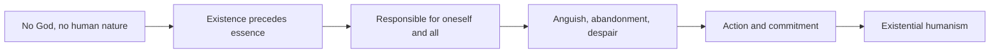

# Sartre, *Existentialism Is a Humanism*

**Prerequisites:** [Jean-Paul Sartre](../thinkers/jean-paul-sartre.md); [Existentialism](../03-existentialism.md)

@@IMG@@

## Dating and form

On 29 October 1945, [Sartre](../thinkers/jean-paul-sartre.md) gave a public lecture at the Club Maintenant in Paris to an overflowing crowd; newspapers reported fainting and broken chairs. The text, with a discussion that followed, was published in 1946 as *L'Existentialisme est un humanisme*. It defended existentialism against criticism from Catholics (who called it despairing and immoral) and Communists (who called it bourgeois and individualist). It is short (around 50 pages) and became the most widely read introduction to existentialism, although Sartre later expressed regret at its publication, as it simplified his views. English translations: Philip Mairet (1948, as *Existentialism and Humanism*) and Carol Macomber (Yale, 2007).

## Main arguments

- **Existence precedes essence.** A paper-knife is made according to a concept: its essence comes before its existence. If there is no God to conceive human nature, then a human being first exists, encounters himself, and only afterwards defines himself. "Man is nothing else but what he makes of himself." See [existence precedes essence](../../../../glossary/modern/existence-precedes-essence.md).
- **Responsibility for all.** In choosing myself I choose an image of humanity; each choice says what a human being should be. Hence anguish.
- **Abandonment.** Without God, no values are given in advance. Sartre quotes Dostoevsky's idea, from *[The Brothers Karamazov](../../nineteenth-century/texts/the-brothers-karamazov.md)*, that if God did not exist, everything would be permitted, as existentialism's starting point. "Man is condemned to be free."
- **The student's dilemma.** During the occupation, a student asked whether to join the Free French in England or stay with his mother, who lived only for him. No ethical theory decides; Sartre's answer was: "You are free, therefore choose—that is to say, invent."
- **Despair.** We must act without hope beyond what depends on our will.
- **Against quietism and pessimism.** Existentialism is an optimistic doctrine of action: there is no reality except in action.
- **A humanism.** Not one that treats "man" as an end or a finished value, but one in which human beings, always going beyond themselves, are the legislators of their values.

## Key ideas

- Humans define themselves through actions; no given nature fixes them.
- Freedom brings total responsibility and anguish.
- Existentialism is a philosophy of action and commitment, not of despair.

## Reception

The lecture made "existence precedes essence" a slogan. [Heidegger](../thinkers/martin-heidegger.md) distanced himself from it in his *Letter on Humanism* (1947), rejecting both Sartre's reading of him and humanism itself. Philosophers have found its ethical argument (that choosing for oneself is choosing for all) too quick, and its dilemma example more useful as an illustration than a proof.

## Where this leads

- Next text: [*The Myth of Sisyphus*](the-myth-of-sisyphus.md)
- Related: [*The Second Sex*](the-second-sex.md)
