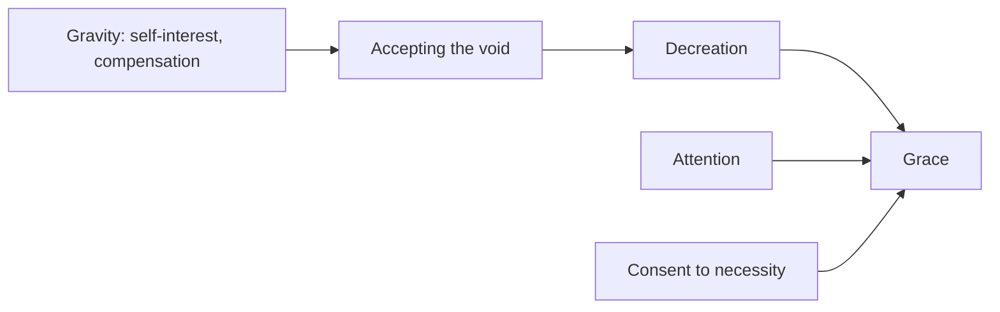

# Weil, *Gravity and Grace*

**Prerequisites:** [[simone-weil|Simone Weil]]

@@IMG@@

## Dating and form

*La Pesanteur et la grâce* was published in 1947 by Plon, four years after [[simone-weil|Weil's]] death. It is not a book she wrote as such: before leaving France in 1942 she gave her notebooks to the Catholic farmer-philosopher Gustave Thibon, on whose farm she had worked. Thibon selected passages and arranged them under thematic headings, with an introduction about his memories of her. The complete notebooks (*Cahiers*) were published later, and some scholars think Thibon's selection made her look more Catholic and less political than she was. English translations: Arthur Wills (1952) and Emma Crawford and Mario von der Ruhr (2002).

## Structure and themes

The book consists of short aphorisms and paragraphs grouped under about forty headings, including "Gravity and grace", "Void and compensation", "Detachment", "Decreation", "The self", "Affliction", "Love", "Evil", "Attention and will", "Metaxu", "Beauty", "The Great Beast" and "Mysticism of work".

- **Gravity.** The soul's natural movements obey laws analogous to physical gravity: self-interest, the craving for compensation, the urge to pass suffering on to others. Grace is the only exception.
- **The void.** We fill every emptiness with imagination and consolation. To accept the void, the absence of reward, makes room for grace, which can only enter where there is a void to receive it.
- **Decreation.** God withdrew to let the world exist; we imitate this by renouncing the self's claim to be the centre. See [[g:decreation|decreation]].
- **Affliction and necessity.** Affliction is brute necessity crushing a person. Consenting to necessity, as to the order of the world, is a form of love.
- **Attention.** Pure attention, without desire for a result, is close to prayer and is the substance of love of neighbour. See [[g:attention|attention]].
- **Metaxu.** Borrowing a Platonic word for "intermediaries", she calls home, country, tradition and culture *metaxu*: goods that warm and nourish the soul and must not be destroyed, though they are not absolute.
- **The Great Beast.** Following Plato's *Republic*, the social collective as an idol that demands worship.

## Key ideas

- The soul is governed by a moral "gravity"; only grace lifts it.
- Accepting emptiness and renouncing the self make room for grace.
- Attention is the heart of prayer and love.

## Reception

The book made Weil famous and became a classic of modern spiritual literature, read by Christians and non-Christians alike; Albert Camus, T. S. Eliot and Iris Murdoch admired her. Readers find its intensity both inspiring and troubling: critics see her asceticism as self-punishing and her views of Judaism as unjust.

## Where this leads

- Next text: [[the-logic-of-scientific-discovery|*The Logic of Scientific Discovery*]]
- Back: [[gk:plato.md|Plato]]; [[pensees|Pascal's *Pensées*]]
